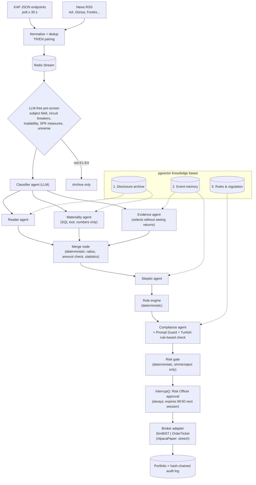

# KAPtan: An Evidence-Gated, Self-Auditing Multi-Agent Disclosure Desk for Borsa İstanbul

**Course:** SENG 429 Enterprise Application Development Lab, Çankaya University, Fall 2026
**Instructor:** Dr. Bilgin Avenoğlu
**Submission:** Project Proposal (W2, 12 October 2026; the exact date will be confirmed with the instructor)

| # | Name | Student ID | Role |
|---|---|---|---|
| 1 | `<Name Surname>` (team leader) | `<ID>` | Data & RAG |
| 2 | `<Name Surname>` | `<ID>` | Agents |
| 3 | `<Name Surname>` | `<ID>` | Strategy, Risk & Execution |
| 4 | `<Name Surname>` | `<ID>` | Frontend & Evaluation |

---

## 1. Abstract

Every trading day, Borsa İstanbul (BIST) companies publish about 350 disclosures on the Public Disclosure Platform (KAP). From 1 October 2026 they must publish them in Turkish and English at the same time. A portfolio manager has to spot the few disclosures that matter, ignore the noise and justify every decision to the Capital Markets Board (SPK) auditors. **KAPtan** is a multi-agent enterprise application built with LangGraph. It turns each KAP disclosure into a structured event, backs every trade idea with historical event-study evidence retrieved through RAG, and routes each proposal through a compliance agent, a deterministic risk gate and a human approval step. There is no automatic execution: every proposal that passes the risk gate waits for a human decision. Every step goes into a hash-chained audit log.

The core design principle is **"the LLM reads, classifies and gathers evidence; a deterministic rule engine decides; a human approves."** Recent benchmarks show that LLM agents allowed to make free buy/sell decisions do not beat simple baselines out of sample [1–3]. We therefore frame the project around a testable research question: does a *classifier-LLM + rules* design beat a *free-deciding LLM* design, with the same data and costs? We evaluate the system on four layers: classification F1, RAG quality (RAGAS), a pre-registered event study and backtest on a holdout period (1 January 2025 – 31 October 2026, run only once), which is our main quantitative evidence, and forward paper-trading tests as supporting evidence (`v1.0-fwd` from 9 November 2026, `v1.1-fwd` from 23 November 2026). All trading in the course is paper trading. We make no claim about profitability.

## 2. Problem Statement and Motivation

### 2.1 Disclosure overload
KAP is the official channel for material events of BIST-listed companies: buyback executions, insider and major-shareholder trades, new contracts, financial reports, SPK measures and more. A sample of six trading days (October 2025 to September 2026) gave about **350 disclosures per day**. About 28% of them were automatic share-level circuit-breaker notices [4]. On 1 October 2026 a new SPK requirement takes effect: all listed companies must publish their special-situation disclosures in English at the same time as in Turkish [5]. The reading load of a fund team roughly doubles overnight, and the two language versions may not always match.

### 2.2 Auditability is a hard requirement
Portfolio management companies are regulated by SPK. A fund manager must be able to show *why* a position was opened: which disclosure triggered it, what evidence supported it, who approved it and which limits applied. Chat-style assistants give an answer but not an audit trail. International rules for algorithmic trading take the same view. They require pre-trade controls and a kill switch (SEC Rule 15c3-5; MiFID II RTS 6, Art. 12 and 15) [6, 7]. KAPtan builds these controls in as deterministic code, not as prompts.

### 2.3 Free-deciding LLM traders fail out of sample
Recent evidence shows that giving an LLM open-ended trading authority is not a good design:

- **Alpha Arena Season 1.5** (nof1.ai, Nov–Dec 2025, US equities, 8 models × 4 modes, $320k total): only **6 of 32 accounts ended positive**, and the aggregate result was about **−35%**. The run lasted only about two weeks, the figures come from a secondary summary, and the organisers themselves note limited statistical power and large run-to-run variation, so we treat it as weak, supporting evidence only [1].
- **StockBench** (contamination-free, March–June 2025, 20 DJIA stocks): most LLM agents **failed to beat buy-and-hold**, although some did. Static financial knowledge did not translate into trading skill [2].
- **FINSABER** (KDD 2026; 20 years, 100+ symbols, bias-controlled): previously reported LLM advantages **"deteriorate significantly"** over longer horizons and broader universes. The agents were too conservative in bull markets and too aggressive in bear markets [3].

Related work adds three failure modes: look-ahead bias and memorisation [8], hallucinated numbers and unfaithful reasoning [9], and prompt injection through news text [10]. On the other hand, LLMs do well at *structured extraction*. For example, event extraction from SEC 8-K filings reaches high precision at high confidence [11].

### 2.4 Where slow systems can still find a signal
Simple news is priced within seconds, so a pipeline that takes 15–60 seconds cannot compete on speed. This holds on BIST as well: in 9,223 announcements from 2015–2017, the price reaction starts within seconds, measured in a 300-second window [12]. A slow system can therefore only hope to find a signal in information that is complex or slowly priced. The Turkish literature reports post-event drift after **buyback executions** and **insider/major-shareholder purchases** [13, 14]. For 711 buybacks by BIST-100 companies in 2015–2020, excess returns over the index were about **+2.0% after one month and +3.4% after three months** [13]. These figures are measured from the trade date (not the disclosure date), ignore transaction costs, rely on simple t-tests and predate the 2021 regime; the insider-purchase sample is small (n = 89). Published anomalies also tend to weaken by roughly 58% after publication [21], so we treat literature figures as an upper bound. These are exactly the "who is buying" signals that a daily-decision system can act on. For E3 (new business / tenders) we found no BIST-specific event study, so E3 is an **exploratory** event type whose evidence can come only from our own event study. Our own holdout test will decide whether any of these effects survive costs.

### 2.5 Gap
Public GitHub projects in this space are either US-centred multi-agent traders in which the LLM decides (e.g., TradingAgents [15]) or Turkish sentiment and data layers that have no decision, compliance or approval chain. We found no system that connects KAP disclosures to evidence, deterministic rules, SPK-aware compliance, human approval and an audit trail.

## 3. Objectives

| ID | Objective | Measurable target |
|---|---|---|
| O1 | Ingest live KAP disclosures (TR+EN) and archive 2018–2026 | Polling at intervals of at least 30 s during the session; first-seen timestamp stored; backfill complete by W3 |
| O2 | Classify disclosures into event types E1–E4, plus X (filter/avoid) and O (other) | Macro-F1 ≥ 0.85 on the 200-disclosure locked test split of a 300-disclosure hand-labelled gold set (100 development + 200 locked) |
| O3 | Ground every proposal in retrieved, point-in-time evidence | RAGAS faithfulness ≥ 0.85, context precision ≥ 0.70 on a 50-question gold set; **0** retrieval time violations (`published_at`/`available_at`), a hard gate |
| O4 | Enforce risk and compliance deterministically | Risk gate 100% unit-test (line + branch) coverage; 0 orders bypass the gate in tests |
| O5 | Resist malicious disclosures | **0** orders from ≥ 30 malicious red-team cases (hard gate); ≥ 95% blocked; false-alarm rate on benign control cases measured and reported |
| O6 | Keep a human in the loop with a tamper-evident audit trail | 100% of orders carry an approver ID; hash-chain verification passes end to end |
| O7 | Answer the research question honestly | Ablation report comparing 5 baselines/variants on the holdout and the forward paper test |
| O8 | Meet operational latency | p95 from first-seen to approval card < 60 s |

*The thresholds in O2, O3, O5 and O8 are the team's fixed evaluation targets (confirmed in the team's canonical decisions, Revision 2; see Section 15).*

## 4. Proposed Solution

### 4.1 Event types (long only)

| Code | Event | Trigger condition | Holding period |
|---|---|---|---|
| E1 | Share buyback **executions** (actual purchases, not announcements) | ≥ 0.25% of capital within 10 sessions, clustered | 20–40 days |
| E2 | Open-market purchase by an executive, a board member or a controlling shareholder (fund threshold notices such as 5% are not E2) | Clustered, preferably after a decline; TL thresholds updated for inflation | 20–60 days |
| E3 | New business relationship / tender | Annualised amount ≥ 10% of annual revenue (total amount if no duration is given; foreign-currency amounts converted at the CBRT rate on the decision date; if revenue is not available at decision time, amount / market cap is used), binding, not a related party | 5 days |
| E4 | Financial results | Structured financial data (incl. inflation accounting) + report language | 5–10 days |

SPK measures, volatility-based measures, bonus-issue hype and dilutive rights issues are used **only as exit/avoid filters**. An **LLM-free pre-screen** (tradable stock, SPK measures, universe, team restricted list) runs before any LLM call. Entry is at the next open or intraday. If the stock has already risen more than 8% in the last 5 sessions, the trade is skipped or halved (possible leakage); E4 has an extra check (more than 12% in the last 10 sessions). Stops are based on a closing-price ATR, and the 0.5% risk sizing uses the resulting stop distance. The universe has minimum liquidity and free-float thresholds. Because SPK temporarily removed the upper limit on the total amount of buybacks on 22 September 2026 (decision 60/1711), the resulting **buyback wave** is analysed as a separate E1 subgroup. Buyback disclosures are not independent events (they cluster in a few companies and on down days), so the event study clusters them by company and window.

### 4.2 Agents and deterministic nodes (LangGraph)

- **LLM agents (6):**
  1. **Classifier.** The KAP `subject` field already types about 90% of disclosures, so the LLM is used only for "Özel Durum Açıklaması (Genel)" and free text. Circuit-breaker notices (~28%) are dropped before any LLM call.
  2. **Reader.** Turns the disclosure text (`/tr/Bildirim/{idx}` or `/tr/api/BildirimPdf/{idx}`) into a structured event (amount, counterparty, duration). General parsing of PDF attachments is a stretch goal.
  3. **Materiality.** Only fetches the numbers (financials, market cap, FX rate) through an SQL tool; it computes no ratios.
  4. **Evidence.** Selects similar past events **without seeing their returns**; the statistics (mean CAR, hit rate, n) are computed by code.
  5. **Skeptic.** Hunts false positives, can shrink the position size or veto.
  6. **Compliance.** Checks SPK measures and market-abuse rules, and screens for prompt injection.
- **Deterministic nodes:** the **Merge node** (computes all ratios with `Decimal` from the Reader's amount and the Materiality numbers, rejects the event if the Reader's amount is not among the amounts extracted from the text by regex, and computes the evidence statistics), the **Rule engine** (pure Python, E1–E4 rules produce a `TradeProposal` Pydantic object) and the **Risk gate** (pure Python; it can only shrink or reject a proposal). The risk-gate rules are specified once, as numbered rules, in our strategy document.
- **Parallelism and state:** Reader, Materiality and Evidence run in parallel through `Send` fan-out. State is persisted with `AsyncPostgresSaver`.
- **Human-in-the-loop:** `interrupt()` pauses the graph. The Risk Officer approves or rejects on a web card, which resumes the graph with `Command(resume=...)`. Every proposal needs this decision; an unanswered approval expires at 09:50 of the next session. In backtest mode approval is simulated (every proposal counts as approved), and a "no approval" ablation is reported separately.
- **Reproducibility:** model IDs are pinned to full version IDs (no aliases), and prompt hashes are recorded in the `v1.0-fwd`/`v1.1-fwd` manifests.

### 4.3 Architecture

### 4.4 Three RAG knowledge bases (pgvector: `PGVectorStore` + `PGEngine`)

| Base | Content | Used by |
|---|---|---|
| 1. Disclosure archive | 2018–2026 KAP disclosures (TR+EN), PDF attachments, financial report text | Reader, Materiality |
| 2. Event memory | Summary embedding per past event. The 1/5/20/60-day abnormal returns are **not** stored in chunk metadata: code reads them from an `event_returns` table with an `available_at` point-in-time filter, and a database view hides holdout returns from development notebooks | Evidence (selection), Merge node (statistics), Skeptic |
| 3. Rules & regulation | SPK communiqués (II-15.1 Special Situations, II-22.1 Buybacks), market-abuse provisions, company risk policy | Compliance |

Every retrieval applies a `published_at < decision_time` filter, so no document from after the decision can be retrieved. Search is **hybrid**: bge-m3 dense vectors plus PostgreSQL `turkish` full-text search plus trigram similarity. On Turkish text, a recent study found no significant difference between BM25, dense and hybrid retrieval (dense retrieval has no clear advantage), so we keep hybrid search for robustness. A separate notebook compares the same pipeline on **Chroma**.

### 4.5 Risk gate parameters (single canonical set)

The full, numbered risk-gate rules live in one place, our strategy and rules document; the summary below refers to them.

- Risk per trade: 0.5% of capital. Position ≤ 10%. 8–10 concurrent positions. Order size ≤ 1% of the stock's daily volume.
- Price band: last price ±2%, plus an upper/lower limit check. Reject if the expected edge is below 2 × cost.
- **Daily −1% → no new orders. −5% from peak → kill switch:** open orders are cancelled, but open positions are **not** liquidated; they close through their own exit rules. Admin or Risk Officer can trigger it; reset requires Admin + Risk Officer.
- Stocks linked to team members are on a **team restricted list** (insider-style block).
- Crisis regime → exposure halved. LLM quota exhausted → HOLD. Live mode requires three separate switches (config + environment + UI confirmation).

### 4.6 Enterprise features

- **RBAC:** *Analyst* (views, adds notes), *Risk Officer* (approves/rejects, kill switch, limits), *Admin* (users, universe, config), *Auditor* (read-only access to decisions and the audit log). Any limit change needs a second approval. A separate "Fund Manager" approval role is a stretch goal.
- **Hash-chained, append-only audit log.** It covers the disclosure, classification, retrieved evidence, each agent output, rule results, approver, order and fill.
- **"Why this trade?" screen:** the disclosure text, the evidence card (similar past events and their returns) and the skeptic's note.
- **Live trace panel** (LangSmith) and a **morning KAP digest** for the fund manager.
- **Personal mode:** the same code produces an *order ticket* that the user enters by hand in their own brokerage app. The system never sends a live order automatically.
- **Demo mode:** injected disclosure fixtures plus replay, available only to Admin in the demo environment and clearly labelled on screen; the live disclosure counter always shows real data.

## 5. Mapping to Course Topics

| Course topic | Where it appears in KAPtan |
|---|---|
| **Large Language Models** | Six LLM agents with structured (Pydantic) outputs; multi-provider setup (Gemini Flash-Lite, Groq, Azure for Students, local Ollama Qwen); classifier model comparison |
| **Agentic AI** | Tool-using agents (SQL, retrieval, price/volume checks), a skeptic that critiques other agents, a compliance agent that can veto, human-in-the-loop approval |
| **LangChain** | Retrievers, `PGVectorStore`/`PGEngine` integration, structured-output chains, prompt templates, LangSmith tracing |
| **LangGraph** | `StateGraph`, parallel `Send` fan-out, conditional edges, `interrupt()` + `Command(resume=)`, `AsyncPostgresSaver` checkpointer |
| **RAG** | Three knowledge bases with different jobs; hybrid dense + lexical retrieval; point-in-time filtering; RAGAS evaluation |
| **Vector databases (Chroma, pgvector)** | pgvector in production (with relational data, FTS and audit in one Postgres); Chroma comparison notebook on the same corpus and gold set. We also document why we did not choose Pinecone (managed, external, no joins with our relational data) |

## 6. Research Question and Hypothesis

**RQ:** For disclosure-driven trading on BIST, does restricting the LLM to classification and evidence gathering, and leaving the decision to pre-registered deterministic rules, give better risk-adjusted outcomes and better auditability than an LLM that decides freely?

**H1:** Under identical data, universe, costs and risk gate, the *classifier-LLM + rules* variant achieves a higher Sharpe ratio and a smaller maximum drawdown than the *free-deciding LLM* variant on the holdout (1 January 2025 – 31 October 2026).

**H0:** There is no difference, or the free LLM is better.

**Ablation arms:** (a) BIST-100 buy-and-hold; (b) equal-weight universe; (c) KAP `subject`-only rules (no LLM); (d) free-deciding LLM (same inputs, the LLM outputs buy/sell/size; it passes through **the same risk gate** and is evaluated only on events after the model's training cutoff); (e) the system without the Skeptic and the other evidence agents, which is exactly the `v1.0-fwd` forward version (classifier + rules); (f) a "no approval" variant in the backtest. The rules are frozen **before** the holdout is opened, and the holdout is run only once. In the forward test we also track the **shadow returns** of rejected signals. A null result is still a valid and reportable finding.

## 7. Data Sources and Legal/Ethical Considerations

| Source | Access | Notes |
|---|---|---|
| KAP (live + history) | kap.org.tr JSON endpoints `/tr/api/disclosure/list/main`, `/tr/api/disclosure/members/byCriteria`; full text via `/tr/Bildirim/{idx}` and `/tr/api/BildirimPdf/{idx}`; our own httpx client (the `kap-client` 1.2.0 library fails on BIST stocks and is used only as a code reference) | No key needed; **tested live on 30 Sep 2026**, including historical queries. KAP sits behind a WAF (HTTP 666 = back off), so we use **polite polling** (at least 30 s apart during the session, at least 2 s per request in backfill, caching, backoff); raw responses archived. We found no explicit terms permitting or forbidding automated access; use is academic and non-commercial, and data is not redistributed. Backfill of 2012–2017 is a stretch goal |
| MKK API Portal | Free plan = sandbox only (frozen ~2023 data) | Not used for live data |
| Prices | yfinance (daily, split-adjusted only), İş Yatırım (raw + adjusted close, capital, market cap; also covers delisted stocks), borsapy `0.11.0` (corporate actions) | Returns use adjusted prices; SimBIST fills and price-band checks use raw prices. 15-min delay, so the strategy trades at the next open |
| News RSS | AA, Dünya, Foreks, Habertürk, TRT Haber, CNBC-e, Borsagündem | Context only (Bloomberg HT RSS inactive since 14 Sep 2026) |
| Macro | TCMB EVDS (`evds` ≥ 0.4.0) | Regime detection |

**Legal and ethical position:**

- **Paper trading only for the course.** Execution uses `SimBIST` (our own paper broker with real BIST prices, commission and slippage). An `AlpacaPaper` US comparison arm is a stretch goal. No real orders are sent by the system.
- **No investment advice.** Outputs are research artefacts and are not published as recommendations. Sharing signals with third parties could count as unlicensed investment advisory, which SPK actively prosecutes. Signals are therefore never shared, and there is no pooled money (Capital Markets Law 6362, Art. 109).
- **Data minimisation:** only public corporate disclosures are processed, with no personal data beyond public insider-trade notices. Personal names are masked before any text is sent to an LLM or to LangSmith (Turkish data protection law, KVKK).
- **Conflicts of interest:** stocks linked to team members are on a restricted list and never traded by the system.
- **Transparency:** every output shows its sources. A disclaimer appears in the UI and the repository.

## 8. Technology Stack

| Layer | Choice |
|---|---|
| Orchestration | LangGraph 1.x |
| LLMs | Gemini Flash-Lite (main), Groq `gpt-oss-120b` (fast) + Llama Prompt Guard 2; fallback chain: Flash-Lite ⇄ Groq gpt-oss → Azure for Students → Ollama Qwen (local) → HOLD |
| Embeddings | bge-m3 (multilingual, local) |
| Storage | PostgreSQL + pgvector, Redis (streams + cache) |
| Backend / Frontend | FastAPI (SSE, JWT) + Next.js |
| Evaluation | RAGAS 0.4, custom replay harness, vectorbt |
| Observability | LangSmith (Developer plan) |
| DevOps / Security | Docker Compose, GitHub Actions, SOPS/age secrets, gitleaks |

Budget: about $0 (free tiers). We estimate about 17K tokens per full decision and 30–60 full decisions per day. Most disclosures are filtered out before any LLM call.

## 9. Evaluation Plan (four layers)

| Layer | Data | Metrics | Target |
|---|---|---|---|
| 1. Classification | 300 hand-labelled disclosures (4 × 75, inter-annotator check on an overlap subset): **100 development + 200 locked test**; classes E1–E4 + X (filter/avoid) + O (other) | Per-class and macro F1; model comparison (Gemini vs Qwen vs one Turkish model); English system prompts vs a fully Turkish prompt variant | Macro-F1 ≥ 0.85 on the locked test set |
| 2. RAG | 50-question gold set over the three bases | RAGAS 0.4: faithfulness, context precision, context recall; pgvector vs Chroma; retrieval time violations | Faithfulness ≥ 0.85; precision ≥ 0.70; **0 time violations (hard gate)** |
| 3. Event study + backtest (**main quantitative evidence**) | 2018–2024 development; **holdout 1 Jan 2025 – 31 Oct 2026, run only once**; rules frozen beforehand; approval simulated | Cumulative abnormal return vs BIST-100 at 1/5/20/60 days with confidence intervals; Sharpe, max drawdown, hit rate, turnover, net of costs; E1 buyback-wave subgroup reported separately | Report as measured; no profit target |
| 4. Forward paper test (**supporting evidence**) | `v1.0-fwd` (classifier + rules) from **9 Nov 2026** and `v1.1-fwd` (all agents) from **23 Nov 2026**, both → final | Return vs BIST-100 and equal-weight; ablation arms; shadow returns of rejected signals; decision latency p50/p95; cost per decision | p95 latency < 60 s; returns reported as measured |

**Security evaluation:** a prompt-injection red-team set of **at least 30 malicious** fake disclosures with hidden instructions, plus benign control cases. **Zero orders from malicious cases is a hard gate**; the block rate target is ≥ 95%, and the false-alarm rate on benign controls is measured and reported, with and without Llama Prompt Guard and our Turkish rule-based injection check. **Governance tests:** the risk gate has 100% coverage, the kill switch is triggered by a simulated loss, and hash-chain tampering is detected.

We also acknowledge the limits of the evaluation. The forward test lasts about 8–10 weeks and most holdings last 20–60 days, so few trades will close and the test has little statistical power. It shows that the system works live; it does not prove an edge. This is why the holdout backtest is our main evidence.

## 10. Work Plan

| Week | Date (approx.) | Milestone | Deliverable |
|---|---|---|---|
| W1 | 5 Oct | API keys, KAP poller, repo skeleton, Docker Compose | Running poller, CI |
| **W2** | **12 Oct** | **Proposal** | This document |
| W3 | 19 Oct | KAP backfill 2018–2026, price data, event taxonomy | Archive DB, labelling guide |
| W4 | 26 Oct | End-to-end skeleton (disclosure → classification → paper order) | Walking skeleton demo |
| W5 | 2 Nov | Event-study engine, rule engine, risk gate + tests, Merge node; rules frozen before the holdout | CAR tables, 100%-covered risk gate |
| **W6** | **9 Nov** | **Forward paper test starts:** `v1.0-fwd` (classifier + rules) frozen; holdout run once | Frozen tag, holdout report, daily logs |
| W7 | 16 Nov | Evidence/Skeptic/Compliance agents, 300-item gold set, **audit hash chain live** | F1 report v1 |
| **W8** | **23 Nov** | **Progress report**; `v1.1-fwd` (all agents) frozen and started | Progress report + demo |
| W9 | 30 Nov | Frontend, RBAC, audit viewer, approval flow | Web UI |
| W10 | 7 Dec | Frontend, RBAC, RAGAS | RAGAS report |
| W11 | 14 Dec | Ablations, red-team, backtest report | Ablation + security report |
| Buffer | 21 Dec – 3 Jan | Bug fixing, holidays; forward test keeps running | — |
| W12 | 4 Jan 2027 | Feature freeze, demo rehearsal | Recorded backup demo |
| Final | Jan 2027 (date set by the instructor) | **Final presentation** | Live demo, final report, repo |

### Division of labour

| Role | Responsibilities |
|---|---|
| 1. Data & RAG | KAP poller + backfill, prices/corporate actions, RSS, three knowledge bases, hybrid search, RAGAS |
| 2. Agents | LangGraph graph, six agents, interrupt/approval, checkpointer, prompts, gold-set F1 |
| 3. Strategy, Risk & Execution | Event-study engine, rule engine, risk gate (100% tests), broker adapters, kill switch |
| 4. Frontend & Evaluation | Next.js panel, RBAC, audit viewer, backtest/paper reports, ablations, demo |

All members label 75 gold-set items each and take part in code review.

## 11. Risks and Mitigations

| Risk | Mitigation |
|---|---|
| "This is just a scraper + classifier" | Tool-using agents, three RAG bases, HITL interrupt, four-layer evaluation, research ablation |
| KAP endpoint/firewall changes | Own httpx client with polite polling and back-off on HTTP 666; per-type parsers with fixture tests; archive raw responses; recorded demo |
| LLM free-tier quotas | LLM-free pre-filtering, caching, HOLD on quota exhaustion, multi-provider fallback |
| Corporate actions distort returns | Adjusted prices for returns, raw İş Yatırım prices for fills; borsapy corporate actions; ticker-change mapping table |
| Turkish text pitfalls (İ/ı, cp1254, decimal comma) | Turkish casefolding, encoding normalisation, deterministic amount parser + unit tests |
| Look-ahead bias / leakage | Point-in-time retrieval filter (`published_at`/`available_at`); Evidence agent never sees returns; holdout returns hidden behind a view; frozen rules; holdout run once; free-LLM arm evaluated only after the model's training cutoff; firm-name masking in the classifier; skip if > 8% run-up in 5 sessions |
| SPK temporarily removed the total-amount limit on buybacks (22 Sep 2026) | The resulting buyback wave is analysed as a separate E1 subgroup, so it does not distort the main E1 statistics |
| No edge is found | Still a valid result: the research question is answered and the platform stands on its own; no move to real money |
| Scope creep | Strict MVP; stretch items (AlpacaPaper arm, general PDF parsing, 2012–2017 backfill, separate Fund Manager role, rumour verification, TR↔EN mismatch detector) only after W10 |

## 12. Expected Outcomes and Deliverables

1. A running, containerised KAPtan system (FastAPI + Next.js + LangGraph + Postgres/pgvector + Redis).
2. A labelled KAP gold set (300 disclosures: 100 development + 200 locked test) and a RAG gold set (50 questions).
3. An evaluation report covering classification F1, RAGAS scores, the event study with holdout (main evidence), forward paper results for `v1.0-fwd` and `v1.1-fwd`, and the ablation of classifier-LLM + rules vs free LLM.
4. A security report: red-team injection results and governance tests (risk gate, kill switch, audit chain).
5. A final presentation with a live demo during the BIST session (demo mode: injected fixtures + replay, clearly labelled), plus a recorded backup.
6. A documented repository with setup instructions and a disclaimer.

We do **not** promise a profitable strategy. Realistic literature-based expectations are between 0 and +5% per year relative to BIST-100, and the result may well be zero. We put the chance of a persistent positive abnormal return after costs at roughly 20–35%; a zero or negative result is a valid finding, and the research question is tested either way. The contribution is the auditable architecture and an honest measurement of it.

## 13. References

1. Nof1, *Alpha Arena* Season 1.5 results; summary: ForkLog, "AI model Grok 4.2 triumphs in trading tournament." https://nof1.ai/ · https://forklog.com/en/ai-model-grok-4-2-triumphs-in-trading-tournament/
2. *StockBench: Can LLM Agents Trade Stocks Profitably in Real-World Markets?* arXiv:2510.02209. https://arxiv.org/abs/2510.02209
3. Li, W. et al. *FINSABER: Can LLM-based Financial Investing Strategies Outperform the Market in Long Run?* KDD 2026. arXiv:2505.07078. https://arxiv.org/abs/2505.07078
4. KAP disclosure list endpoint and platform. https://www.kap.org.tr/
5. Dünya, "Borsadaki tüm şirketlere 1 Ekim'de İngilizce KAP zorunluluğu." https://www.dunya.com/finans/haberler/borsadaki-tum-sirketlere-1-ekimde-ingilizce-kap-zorunlulugu-haberi-841690
6. U.S. SEC, Rule 15c3-5 (Market Access Rule). https://www.sec.gov/rules-regulations/2011/06/risk-management-controls-brokers-or-dealers-market-access
7. European Commission Delegated Regulation (EU) 2017/589 (MiFID II RTS 6). https://eur-lex.europa.eu/eli/reg_del/2017/589/oj
8. Glasserman, P., Lin, C. *Assessing Look-Ahead Bias in Stock Return Predictions Generated by GPT Sentiment Analysis.* arXiv:2309.17322. https://arxiv.org/abs/2309.17322
9. *TradeTrap* (reliability of LLM trading agents). arXiv:2512.02261. https://arxiv.org/abs/2512.02261
10. Greshake, K. et al. *Not what you've signed up for: Compromising Real-World LLM-Integrated Applications with Indirect Prompt Injection.* AISec 2023. arXiv:2302.12173. https://arxiv.org/abs/2302.12173
11. Dolphin, R. et al. (2026). *Grounded Event Extraction from SEC 8-K Filings with a Fine-Grained Taxonomy* [preprint]. https://arxiv.org/html/2607.08346v1
12. Ersan, O., Şimşir, Ş.A., Şimşek, K.D., Hasan, A. (2021). The speed of stock price adjustment to corporate announcements: Insights from Turkey. *Emerging Markets Review* 47, 100778. https://ideas.repec.org/a/eee/ememar/v47y2021ics1566014120305872.html
13. Ünal, S. (2022). Borsa İstanbul'da İçeriden Öğrenenlerin Getirileri. *Akademik Araştırmalar ve Çalışmalar Dergisi* 14(26), 158–172. https://doi.org/10.20990/kilisiibfakademik.972633
14. Küçükçolak, R.A., Küçükoğlu, S., İlter Küçükçolak, N. (2025). Borsa İstanbul'da Hisse Geri Alım Kararlarına İlişkin Ampirik Bir Analiz. *EPFAD*. https://dergipark.org.tr/tr/pub/epfad/article/1621302
15. Xiao, Y. et al. *TradingAgents: Multi-Agents LLM Financial Trading Framework.* arXiv:2412.20138. https://github.com/TauricResearch/TradingAgents
16. Es, S. et al. *RAGAS: Automated Evaluation of Retrieval Augmented Generation.* EACL 2024 (demo). arXiv:2309.15217. https://arxiv.org/abs/2309.15217
17. LangGraph documentation: human-in-the-loop (`interrupt`), persistence. https://langchain-ai.github.io/langgraph/
18. pgvector: open-source vector similarity search for Postgres. https://github.com/pgvector/pgvector
19. Chen, J. et al. *BGE M3-Embedding: Multi-Lingual, Multi-Functionality, Multi-Granularity Text Embeddings.* arXiv:2402.03216. https://arxiv.org/abs/2402.03216
20. Capital Markets Law No. 6362 (SPKn). https://www.mevzuat.gov.tr/mevzuat?MevzuatNo=6362&MevzuatTur=1&MevzuatTertip=5
21. McLean, R.D., Pontiff, J. (2016). Does Academic Research Destroy Stock Return Predictability? *Journal of Finance* 71(1), 5–32. https://onlinelibrary.wiley.com/doi/abs/10.1111/jofi.12365

---

## 14. Note on Scope

The team leader also plans to use the same codebase personally, in "order-ticket" mode, after the course and only if the gates are passed: holdout t ≥ 2 and n ≥ 30, then at least 3 months and 50 paper trades, then a "shadow" stage in which tickets are recorded but no real money is used. The realistic earliest start with real money is April–June 2027. That use is outside the course scope, is never automated, and does not affect the course deliverables.

## 15. Proposed Changes — status (Revision 2)

- **Numeric targets.** Macro-F1 ≥ 0.85, RAGAS faithfulness ≥ 0.85 / context precision ≥ 0.70, red-team block rate ≥ 95%, p95 latency < 60 s. ✅ Accepted and applied (canonical evaluation targets, extended with 0 retrieval time violations and 0 orders from malicious cases as hard gates).
- **Red-team set size.** At least 20 malicious fixtures plus benign controls. ✅ Accepted and applied, with the size raised to **at least 30** malicious cases plus benign controls.
