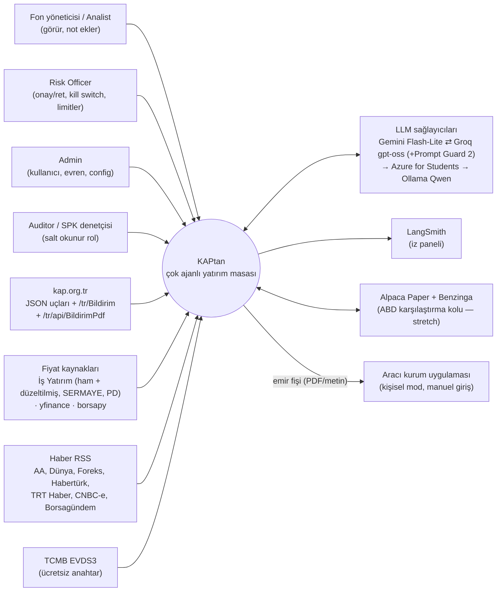
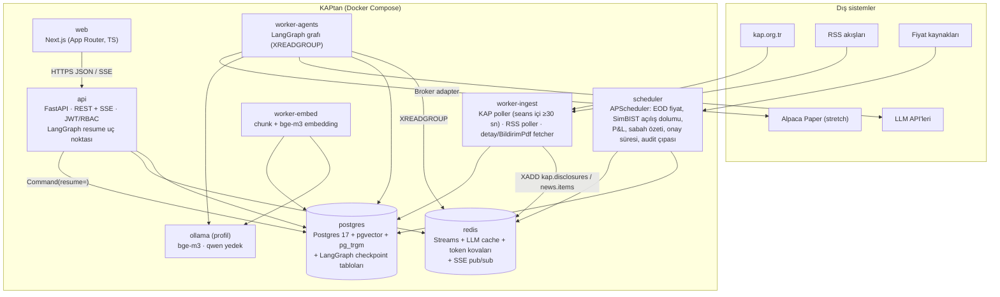
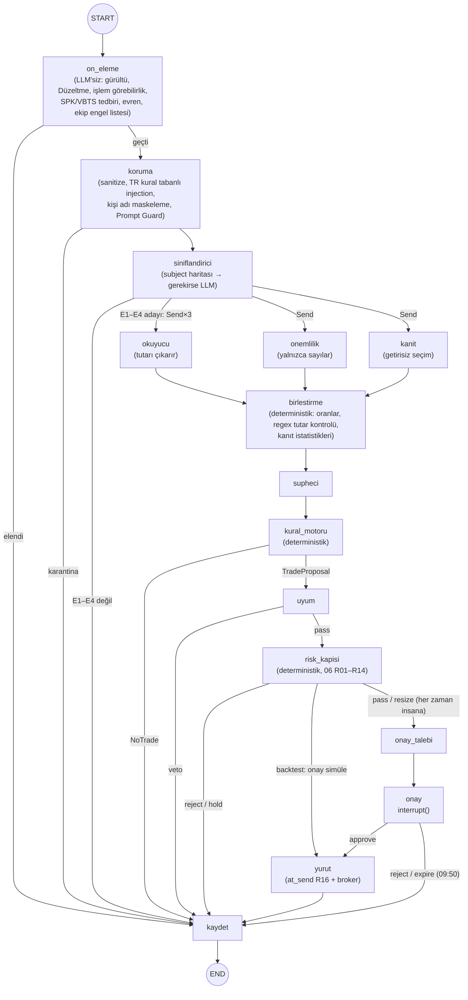
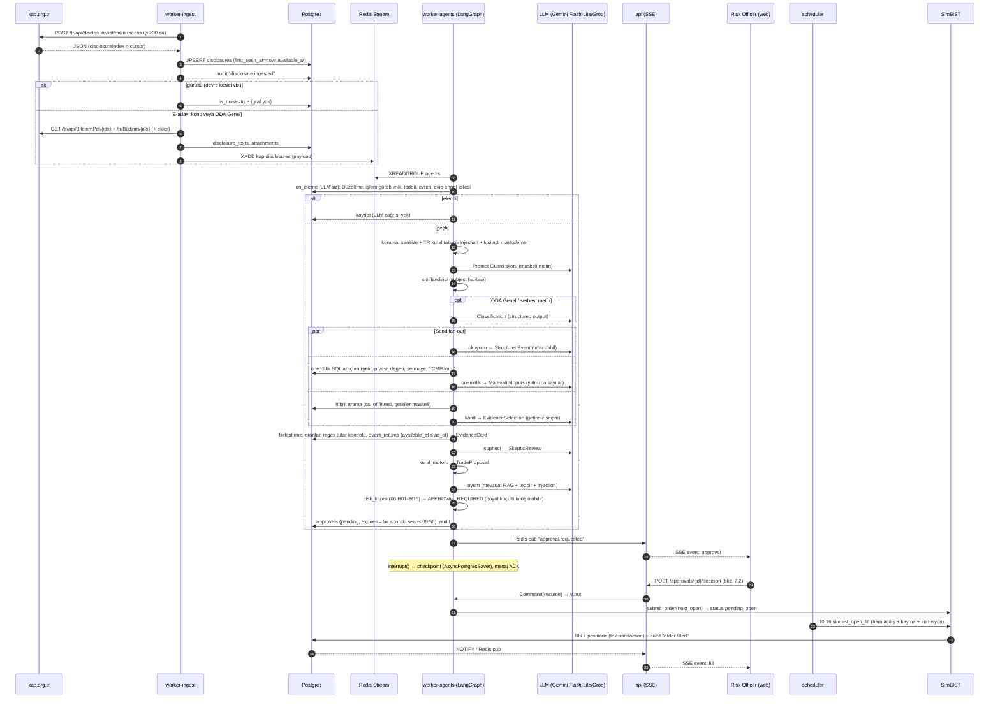
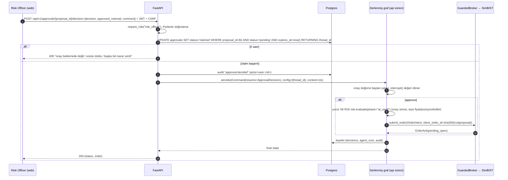
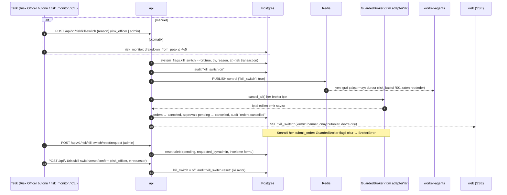

# KAPtan — Sistem Mimarisi ve Tasarım

> **Doküman 04** · SENG 429 Enterprise Application Development Lab · Güz 2026
> Doğruluk kaynağı: `_KANONIK-KARARLAR.md` (**REVİZYON 3 bölümü Revizyon 2'ye, Revizyon 2 orijinal kararlara üstündür**; bu doküman 30.09.2026'da Revizyon 3'e hizalandı). Bu doküman kanonik kararlardan birini değiştirmez; itirazlar ve durumları en sondaki **"Önerilen değişiklikler — durum (Revizyon 2)"** bölümündedir.
> Risk kapısı kurallarının tek kaynağı `06-strateji-ve-kurallar.md` §10'dur (R01–R16); bu doküman yalnızca ID ile referans verir. Ajan şemalarının ayrıntılı kaynağı `05-ajan-spesifikasyonlari.md`'dir.
> Kod, tanımlayıcılar ve SQL İngilizce; açıklamalar Türkçe.
> **[D]** = 29.09.2026'da Context7 / resmi dokümanla doğrulandı. **[!]** = kurulumda (W1–W2) kurulu sürüme karşı tekrar kontrol et.

---

## İçindekiler

1. Amaç, kapsam ve kalite nitelikleri
2. Bağlam diyagramı (C4 Seviye 1)
3. Konteyner diyagramı (C4 Seviye 2)
4. Bileşen sorumlulukları
5. Ajan grafı (LangGraph): durum şeması, düğümler, `Send`, `interrupt`
6. Kural motoru ve risk kapısı
7. Sıra diyagramları (yeni bildirim → paper dolum · onay/resume · kill switch)
8. Broker adapter'ları
9. Dağıtım (docker-compose, config, secrets)
10. Monorepo klasör yapısı
11. API uç noktaları (REST + SSE) ve roller
12. Frontend ekranları
13. Gözlemlenebilirlik
14. Ölçeklenebilirlik ve maliyet
15. Mimari karar kayıtları (ADR)
16. Önerilen değişiklikler — durum (Revizyon 2)

---

## 1. Amaç, kapsam ve kalite nitelikleri

**Amaç.** BIST'te yayımlanan her KAP bildirimini yapılandırılmış bir olaya çevirmek; yalnızca E1–E4 olay türleri için geçmiş veriden kanıt toplamak; al/sat kararını **deterministik kural motoruna** bıraktırmak; her öneriyi uyum ajanı + risk kapısı + Risk Officer onayından geçirip paper (SimBIST) ya da emir fişi (kişisel mod) olarak yürütmek; her adımı hash zincirli audit log'a yazmak.

**Kapsam dışı:** açığa satış, kaldıraç/VİOP, gerçek zamanlı (saniye altı) tepki ticareti, sinyallerin üçüncü kişilerle paylaşılması, otomatik gerçek para emri (kişisel modda son buton her zaman insandadır).

### 1.1 Kalite nitelikleri (öncelik sırasıyla)

| # | Nitelik | Senaryo (ölçülebilir) | Mimari taktikler |
|---|---|---|---|
| Q1 | **Güvenlik (safety)** | LLM hangi çıktıyı üretirse üretsin, risk kapısı ve insan onayı olmadan emir oluşmaz; kill switch aktifken hiçbir adapter emir kabul etmez. | LLM'e yan etkili araç verilmez · kural motoru + risk kapısı saf Python (%100 dal kapsamı) · `GuardedBroker` ikinci fren · `interrupt()` zorunlu · canlı mod için 3 anahtar |
| Q2 | **Denetlenebilirlik (auditability)** | SPK denetçisi herhangi bir emir için bildirim → sınıflandırma → kanıt → kural → onay → dolum zincirini 1 ekranda görür; zincir bozulmuşsa doğrulama butonu hangi `chain_pos`'ta bozulduğunu söyler. | Yalnızca eklenebilir, hash zincirli `audit_log` · her ajan çıktısı Pydantic JSON olarak saklanır · `strategy_version` + `graph_version` + `limits_version` her kararda · gece dış çıpalama |
| Q3 | **Açıklanabilirlik (explainability)** | "Neden bu işlem?" ekranı, kararın hangi kuraldan (ör. `E3.materiality` — yıllıklandırılmış tutar / yıllık gelir ≥ 0,10) ve hangi kanıt kartından (benzer N olay, ortalama anormal getiri) çıktığını gösterir. | Kural motoru her kural için `RuleTrace` üretir · kanıt kartı yalnızca gerçekten getirilen olay/chunk kimliklerine atıf yapabilir (`06` R05) · kanıt istatistiklerini LLM değil kod hesaplar |
| Q4 | **Zaman doğruluğu (point-in-time)** | Backtest ve canlı çalışmada hiçbir sorgu karar anından sonra erişilebilir olan veriyi göremez. | Her satırda `published_at` + `first_seen_at` + `available_at` · RAG filtresi `available_at <= as_of` · kararlar ertesi açılışta |
| Q5 | **Maliyet** | Yılda ~68.600 bildirim (iş günü başına ~270); ≤ 60 tam karar (× 4 Gemini ajanı ≈ 120–240 istek/gün; Flash-Lite ~500 RPD'ye sığar); LLM maliyeti ~0 $ (ücretsiz katmanlar). Kota biterse sistem HOLD'a düşer, çökmez. | **Her LLM çağrısından önce LLM'siz ön eleme** (`on_eleme`: gürültü/devre kesici ~%20, "Düzeltme", işlem görebilirlik, SPK/VBTS tedbiri, evren, ekip engel listesi) + `subject` haritası (%90 LLM'siz tipleme) · Redis LLM cache · token kovası (`quotas.yaml`; Groq günlük token tavanı dahil) · Gemini Flash-Lite ⇄ Groq gpt-oss → Azure for Students → Ollama Qwen → HOLD zinciri |
| Q6 | **Dayanıklılık** | Worker çökse bile bildirim kaybolmaz; onay bekleyen bir akış sunucu yeniden başlasa da devam eder. | Redis Streams consumer group + `XAUTOCLAIM` · `AsyncPostgresSaver` checkpoint · idempotent upsert'ler · deterministik `client_order_id` |
| Q7 | **Değiştirilebilirlik** | Yeni broker, yeni LLM sağlayıcısı veya yeni olay türü (E5) diğer modüllere dokunmadan eklenir. | `Broker` Protocol · `config/models.yaml` · kurallar sürümlü YAML + Python fonksiyon kaydı |
| Q8 | **Güvenlik (security)** | Bildirim metnine gizlenmiş talimat hiçbir emre dönüşmez (red-team seti: 0 emir). | Ingest'te temizleme · **Türkçe kural tabanlı injection kontrolü + Prompt Guard skoru** · kişi adlarının LLM/LangSmith öncesi maskelenmesi (KVKK; ilk LLM çağrısından itibaren, W3 — ücretsiz Gemini girdileri ürün geliştirmede kullanılabilir) · spotlighting · Uyum ajanı · kanıt kuralı · RBAC + JWT |

### 1.2 Mimari ilkeler (değişmez)

1. **LLM okur, sınıflandırır, kanıt toplar → kural motoru karar verir → insan onaylar.** LLM çıktısı hiçbir zaman doğrudan `TradeProposal` olmaz.
2. **LLM'ler yalnızca kısıtlayıcı yönde etkili olabilir.** Şüpheci büyüklüğü küçültebilir/veto edebilir; Uyum veto edebilir. Hiçbir LLM büyüklüğü artıramaz veya reddedilmiş bir öneriyi geri açamaz.
3. **Risk kapısı monotondur:** yalnızca küçültür veya reddeder.
4. **İki bağımsız fren:** grafın içindeki risk kapısı + broker katmanındaki `GuardedBroker`.
5. **Ham veri değişmezdir;** normalizasyon ham veriden yeniden üretilebilir.
6. **Point-in-time her yerde.**
7. **Her şey audit'e yazılır;** audit tablosu güncellenemez/silinemez.

---

## 2. Bağlam diyagramı (C4 Seviye 1)



**Dış bağımlılık riskleri:** KAP web uçları resmi API değildir (30.09.2026'da canlı doğrulandı: `list/main`, `members/byCriteria`, `/tr/Bildirim/{idx}`, `/tr/api/BildirimPdf/{idx}` anahtarsız çalışıyor, geçmiş tarih sorgusu dahil). MKK'nın WAF'ı var (`robots.txt` bile **HTTP 666** döndürüyor) → kibar polling (seans içi ≥ 30 sn, backfill ≥ 2 sn/istek), 666 = geri çekilme sinyali, tarayıcı User-Agent + `Origin`/`Referer`, ham yanıt arşivi. **Tek yol kendi httpx istemcimizdir (`kap_client.py`)**; `kap-client` 1.2.0 BIST hisselerinde `CompanyNotFoundError` verdiği için bağımlılık değildir, yalnızca kaynak kodu referansıdır. Fiyatlar 15 dk gecikmeli → strateji ertesi açılışla çalışır. yfinance yalnızca düzeltilmiş fiyat verir; ham fiyat İş Yatırım'dandır. MKK API Portal ücretsiz planı yalnızca sandbox'tır (şema öğrenmek için).

---

## 3. Konteyner diyagramı (C4 Seviye 2)



| Konteyner | Teknoloji | Ölçek | Durum |
|---|---|---|---|
| `web` | Next.js 15+, TS, Tailwind + shadcn/ui, Recharts / lightweight-charts | 1 | durumsuz |
| `api` | FastAPI, uvicorn, `fastapi.sse.EventSourceResponse` **[D]**, psycopg3 async pool | 1 (2'ye çıkabilir) | durumsuz (JWT) |
| `worker-ingest` | Python 3.12, httpx, feedparser, APScheduler içi döngü | **1 (tek yazıcı)** | cursor Postgres'te |
| `worker-agents` | LangGraph 1.x, langchain-*, `AsyncPostgresSaver` | 1 (kota yüzünden) | checkpoint Postgres'te |
| `worker-embed` | sentence-transformers veya Ollama `bge-m3` (CPU'da ~5–15 parça/sn tahmini; W1'de 1.000 parçayla ölçülür; yalnızca filtrelenmiş bildirimler + mevzuat gömülür; toplu backfill gömmesi Colab GPU'da) | 1 | idempotent (`content_sha256`) |
| `scheduler` | APScheduler (AsyncIOScheduler), `Europe/Istanbul` | **1 (tek örnek)** | job kilidi Postgres advisory lock |
| `postgres` | `pgvector/pgvector:pg17` | 1 | kalıcı hacim |
| `redis` | `redis:7-alpine`, AOF açık | 1 | kalıcı hacim |
| `ollama` | `ollama/ollama` (profil `local-llm`) | 0–1 | model hacmi |

---

## 4. Bileşen sorumlulukları

| Bileşen | Modül | Sorumluluk | Girdi → Çıktı | Sahip rol |
|---|---|---|---|---|
| **Ingestion – KAP poller** | `ingest/kap_poller.py` | Seans içinde **en sık 30 sn'de bir** (seans dışı daha seyrek; `07` §2.1) bugünün `list/main` / `byCriteria` listesini kendi httpx istemcimizle (`ingest/kap_client.py`; tarayıcı User-Agent + `Origin`/`Referer`) çeker; 429/5xx/**HTTP 666 (WAF)** yanıtında üstel geri çekilme + jitter; `disclosure_index` cursor; `first_seen_at` damgası; ham JSON arşivi; devre kesici vb. gürültüyü `is_noise=true` işaretler; E-adayı konuları stream'e yazar | KAP JSON → `disclosures` + `XADD kap.disclosures` | 1 Veri & RAG |
| **Ingestion – detay/PDF** | `ingest/kap_detail.py` | Yalnızca filtrelenmiş (evren + hedef konu) bildirimler için tam metin: `/tr/api/BildirimPdf/{idx}` (formu tablo başlıklarıyla düzenli metin olarak verir) + `/tr/Bildirim/{idx}` (RSC yükü, TR/EN) ve ekler; PDF → metin. **Gövde ayrıştırma bildirim tipine göre** (`oda_ExplanationTextBlock` her tipte yok; ör. geri alım bildiriminde tablo metinden okunur) → tip bazlı ayrıştırıcılar + fixture testleri | idx → `disclosure_texts`, `attachments` | 1 |
| **Ingestion – RSS** | `ingest/rss_poller.py` | 60–120 sn, ETag/If-Modified-Since; kanonik URL; MinHash dedup; ticker ±6 saat KAP bağlama | RSS → `news_articles` | 1 |
| **Ingestion – backfill** | `ingest/kap_backfill.py` | 2018–2026 gün gün (geçmiş tarih sorgusu canlı doğrulandı), 2000 satır sınırı, istekler arası ≥ 2 sn, sürdürülebilir (`ingestion_runs`) | → `disclosures` (first_seen_at NULL) | 1 |
| **Stream** | Redis Streams | Ingest ile ajanlar arası kalıcı kuyruk; consumer group `agents`; `XACK`, `XAUTOCLAIM` ile asılı mesaj kurtarma; DLQ `kap.dlq` | — | 1 + 2 |
| **Agent graph** | `agents/graph.py` | LLM'siz ön eleme + koruma + 6 LLM ajanı + deterministik **Birleştirme**, kural motoru, risk kapısı + onay `interrupt()`; checkpointer `AsyncPostgresSaver` | `DisclosureEnvelope` → `TradeProposal` / HOLD / arşiv | 2 Ajanlar |
| **Kural motoru** | `rules/` | E1–E4 kuralları, sızıntı filtresi, maliyet eşiği; saf fonksiyonlar; `RuleTrace` üretir | `StructuredEvent`+`MergedFeatures` (Birleştirme)+`EvidenceCard`+`SkepticReview` → `RuleDecision` | 3 Strateji |
| **Risk kapısı** | `risk/` | `06` §10 R01–R16 (boyut %0,5 risk / ≤%10 / ≤%1 ADV / 8–10 pozisyon, ±%2 bant, tavan/taban, tedbir vetosu, günlük −%1 / zirveden −%5, kriz rejimi, LLM kotası → HOLD, ekip engel listesi, tutar regex kontrolü); saf fonksiyon, %100 dal kapsamı | `TradeProposal`+`GateContext`+`Limits` → `RiskVerdict` | 3 |
| **Approval service** | `approvals/` | Bekleyen onay kaydı, süre (**bir sonraki seansın 09:50'sinde düşer**, `06` R15), iyimser kilit (`claim`), `Command(resume=)`; backtest modunda onay simüle edilir | Risk Officer kararı → graf devamı | 2 + 4 |
| **Broker adapter'ları** | `brokers/` | `Broker` Protocol; SimBIST, OrderTicket, AlpacaPaper (**stretch**), BtcTurk (stub), MatriksDEK (stub); `GuardedBroker`; `BrokerRouter` | `OrderIntent` → `OrderAck` / `Fill` | 3 |
| **Portföy** | `portfolio/` | Pozisyon projeksiyonu (dolumla aynı transaction), günlük P&L, zirve öz sermaye, drawdown; kill switch tetiği | fills + fiyat → `positions`, `pnl_daily` | 3 |
| **Audit** | `audit/` | `audit.write(action, entity, payload)`; DB trigger zinciri: `hash = sha256(prev_hash ‖ canonical)`, `canonical` = `run_id` dahil tüm alanların **kanonik JSON dizisi** (`jsonb_build_array(...)::text`, `09` §7.1); doğrulama; gece çıpası; W7'de devrede | olaylar → `audit_log` | 3 + 4 |
| **API** | `api/` | REST + SSE, JWT, RBAC, 4-göz kuralları, rate limit | HTTP | 4 |
| **Frontend** | `web/` | 7 ana ekran (§12) | — | 4 |
| **Scheduler** | `workers/scheduler.py` | Zamanlı işler (§4.1) | — | 3 + 1 |
| **Observability** | `obs/` | LangSmith izleri (örneklemeli; CI/replay'de kapalı), JSON log (structlog), Prometheus metrikleri, sağlık uçları | — | herkes |

### 4.1 Zamanlı işler (scheduler, `Europe/Istanbul`)

| İş | Zaman | Açıklama |
|---|---|---|
| `morning_brief` | Hafta içi 08:30 | Önceki 18:10 → 08:30 arası önemli bildirimler, açık pozisyonlar, bekleyen onaylar, risk durumu → "Sabah özeti" ekranı + e-posta/Telegram (opsiyonel) |
| `approval_expiry` | Her dakika | `expires_at < now()` olan onayları `expired` yapar; ilgili grafı `Command(resume={"decision":"expire"})` ile kapatır |
| `simbist_open_fill` | Hafta içi 10:16 | Kuyruktaki `pending_open` SimBIST emirlerini günün **ham** açılış fiyatı (15 dk gecikme sonrası kesinleşen) + kayma + komisyon ile doldurur |
| `eod_prices` | Hafta içi 18:30 | Günlük fiyatlar: **ham** kapanış (`HG_KAPANIS`) + düzeltilmiş (`HGDG_KAPANIS`) + `SERMAYE` + `PD` İş Yatırım'dan (ince sarmalayıcı, ≥ 90 sn timeout; `isyatirimhisse`'in sabit `timeout=10`'u kullanılmaz); yfinance düzeltilmiş `Close` çapraz kontrol. yfinance `Volume == 0` sahte tatil satırları atılır, takvim `market_calendar`/XU100'e hizalanır; kod değişimleri `ticker_history` ile eşlenir (ör. KOZAL → TRALT); borsadan çıkanların verisi İş Yatırım'dan |
| `intraday_archive` | Hafta içi 19:00 | Günün 1m (borsapy) ve 1h (yfinance) barları — ücretsiz geçmiş kaybolduğu için |
| `pnl_eod` | Hafta içi 18:45 | `pnl_daily` (strateji + baseline'lar: BIST-100 al-tut, eşit ağırlık) |
| `risk_monitor` | Seans içi her 5 dk | Öz sermaye/drawdown hesabı → günlük -%1 → `halted_today`; zirveden -%5 → **kill switch** |
| `corporate_actions` | Pazartesi 07:00 | borsapy `.splits` / `.dividends` → `corporate_actions` |
| `event_returns` | Hafta içi 20:00 | Olgunlaşan 1/5/20/60 günlük anormal getirileri `core.event_returns`'e yazar (`available_at` = ufuk kapanışı + EOD). **Chunk metadata'sına getiri yazılmaz**; kanıt istatistikleri yalnızca bu tablodan `available_at <= as_of` filtresiyle okunur |
| `tedbir_sync` | Her 30 dk | SPK tedbir / volatilite tedbiri listesini (DUY bildirimleri + SPK bülteni) `restricted_securities` tablosuna yazar (ekip engel listesi aynı tabloda, Admin elle yönetir) |
| `audit_anchor` | Her gece 23:55 | Zincir başı hash'ini dışarıya (özel Git repo) yazar |
| `reconcile` | Hafta içi 18:50 | Broker (SimBIST defteri/Alpaca) ↔ DB pozisyon mutabakatı |
| `backfill_resume` | Manuel / gece | Yarım kalan backfill ve tam metin işlerini sürdürür |

---

## 5. Ajan grafı (LangGraph 1.x)

### 5.1 Düğüm listesi

Düğüm adları bu dokümanda Türkçe, `05-ajan-spesifikasyonlari.md`'de İngilizce kod adlarıyla geçer; eşleme son sütundadır (kodda **05'teki İngilizce adlar** kullanılır).

| Düğüm | Tür | Model / araç | Çıktı (Pydantic) | Not | 05 kod adı |
|---|---|---|---|---|---|
| `on_eleme` | **Deterministik (LLM'siz)** | `subject` haritası + `universe_daily` + `restricted_securities` + `market_calendar` | `PreScreenResult{passed, route, reasons[]}` | **Hiçbir LLM/Prompt Guard çağrısından önce** çalışır: gürültü, "Düzeltme" (yalnızca düzeltme yeni olay değildir), işlem görebilirlik, SPK/VBTS tedbiri (`06` R04), evren (`06` R03), ekip engel listesi (`06` R13) | `route` + `pre_gate` |
| `koruma` | Deterministik + küçük sınıflandırıcı | Sanitize · **Türkçe kural tabanlı injection kontrolü** (regex) · **kişi adı maskeleme** (`KİŞİ_n`) · Prompt Guard skoru | `GuardResult{quarantined, injection_score, regex_hits[]}` | Yalnızca ön elemeyi geçenler; maskelenmiş metin sonraki tüm LLM'lere ve LangSmith'e gider | `guard` |
| `siniflandirici` | LLM **koşullu** | Deterministik `subject → EventCode` haritası; yalnızca "Özel Durum Açıklaması (Genel)" ve serbest metinlerde LLM | `Classification` | ~%90 LLM'siz | `classifier` |
| `okuyucu` | LLM | Tam metin (`BildirimPdf` + RSC) + PDF ekleri | `StructuredEvent` (**tutar**, para birimi, karşı taraf, süre, bağlayıcılık, ilişkili taraf mı, alıntılar) | `Send` dalı; tutarı çıkaran **tek** ajan | `reader` |
| `onemlilik` | LLM + araç | Salt okunur SQL araçları (`get_financials`, `get_market_snapshot`, `get_fx_rate`) | `MaterialityInputs` (yıllık gelir + dönem, piyasa değeri, halka açık piyasa değeri, ödenmiş sermaye, karar tarihindeki TCMB kurları, `ref_id`'ler) | `Send` dalı; **yalnızca sayıları getirir, tutar çıkarmaz, oran hesaplamaz** | `materiality` |
| `kanit` | LLM + RAG | Olay hafızası (getiriler **maskeli**) + Bildirim arşivi, hibrit arama, `as_of` filtresi | `EvidenceSelection` (seçilen benzer olay kimlikleri + gerekçe; **getiri yok**) | `Send` dalı; LLM getirileri görmeden seçer | `evidence` |
| `birlestirme` | **Deterministik** | `merge.run()` | `MergedFeatures` (oranlar, regex tutar kontrolü, sızıntı ölçümü) + `EvidenceCard` (ort./medyan CAR, isabet oranı, n — `event_returns`'ten, `available_at <= as_of`) | LLM yok; üç dalın fan-in noktası | `merge` |
| `supheci` | LLM | Groq `openai/gpt-oss-120b` (kısa prompt) → Gemini Flash-Lite yedek | `SkepticReview` (`size_multiplier ∈ [0,1]`, `veto`, gerekçe) | Yalnızca küçültür | `skeptic` |
| `kural_motoru` | **Deterministik** | `rules.evaluate()` | `RuleDecision` → `TradeProposal` veya `NoTrade` | LLM yok | `rule_engine` |
| `uyum` | LLM + deterministik | Kural ve mevzuat RAG + tedbir listesi + injection skorları | `ComplianceResult` (`pass`/`veto`, bulgular) | Yalnızca veto | `compliance` |
| `risk_kapisi` | **Deterministik** | `risk.evaluate()` (`06` R01–R14, pre_trade) | `RiskVerdict` | Yalnızca küçültür/reddeder/HOLD | `risk_gate` |
| `onay_talebi` | Yan etki | `approvals.create_pending` (`expires_at` = bir sonraki seans 09:50), SSE bildirimi | — | `interrupt` öncesi yan etkiler burada | `request_approval` |
| `onay` | **`interrupt()`** | Risk Officer | `ApprovalDecision` | Resume'da düğüm baştan çalışır → saf tutulur. **Backtest modunda** atlanır, onay simüle edilir | `approval` |
| `yurut` | Deterministik | `risk.evaluate(phase="at_send")` (`06` R16) + `BrokerRouter` | `OrderAck` | `client_order_id` ile idempotent | `execute` |
| `kaydet` | Deterministik | `decisions`, `agent_runs`, `agent_outputs`, audit | — | Tüm yollar buradan END'e | `record` |

### 5.2 Graf diyagramı



**Neden `Send`?** Üç dal (Okuyucu/Önemlilik/Kanıt) aynı süper adımda paralel çalışır ve her birine **özel yük** (ör. `as_of`, olay koduna göre farklı araç seti) gönderilir **[D]** (`Send("node", payload)` koşullu kenardan döndürülür; reducer ile birleştirilir). Üç düğüm de aynı süper adımda bittiği için sonraki düğüm (`birlestirme`) **bir kez** tetiklenir.

**Okuyucu ↔ Önemlilik bağımlılığı nasıl çözülür? (Revizyon 2)** Önemlilik ajanı **tutarı çıkarmaz**; yalnızca paydaları ve kurları (yıllık gelir, piyasa değeri, halka açık piyasa değeri, ödenmiş sermaye, karar tarihindeki TCMB kuru) araçlardan getirir. Oranları deterministik `birlestirme` düğümü **Okuyucu'nun tutarıyla** hesaplar:
- Döviz tutar → karar tarihindeki (as_of'ta yayımlanmış son) TCMB kuruyla TL.
- E3: **yıllıklandırılmış tutar / yıllık gelir** (süre > 12 ay ise `tutar × 12 / süre`; süre belirtilmemişse toplam tutar). Yıllık gelir karar anında yoksa yedek oran **tutar / piyasa değeri**.
- **Regex çapraz kontrolü:** Okuyucu'nun tutarı, bildirim metninden deterministik regex (`parse_tr_decimal`) ile çıkarılan tutarlar kümesinde yoksa → `amount_in_text=False` → öneri reddedilir (`06` R14). Eski "iki ajan da tutar çıkarır, fark >%5 → ret" kuralı **kaldırıldı**.
- Kanıt: Kanıt LLM'inin seçtiği olay kimlikleri için ortalama/medyan CAR, isabet oranı ve n'yi kod `core.event_returns`'ten (`available_at <= as_of`) hesaplar.

### 5.3 Durum şeması

```python
# backend/src/kaptan/agents/state.py
from __future__ import annotations
import operator
from dataclasses import dataclass
from typing import Annotated, Any, Literal
from typing_extensions import TypedDict

EventCode = Literal["E1", "E2", "E3", "E4", "NONE"]

class KaptanState(TypedDict, total=False):
    # --- kimlik ve sürümler ---
    run_id: str
    thread_id: str                      # f"disc-{disclosure_index}-{strategy_version}" (<255 karakter)
    strategy_version: str               # "v1.0-fwd" | "v1.1-fwd"
    mode: Literal["paper", "personal", "live", "backtest"]   # backtest: onay simüle edilir
    as_of: str                          # ISO-8601 UTC; = disclosure.available_at (point-in-time anahtarı)

    # --- girdi ---
    disclosure: dict[str, Any]          # DisclosureEnvelope.model_dump(mode="json"); kişi adları koruma'da maskelenir
    ticker: str

    # --- LLM öncesi ---
    prescreen: dict[str, Any]           # PreScreenResult (LLM'siz ön eleme)
    guard: dict[str, Any]               # GuardResult (TR kural tabanlı injection + Prompt Guard)

    # --- sınıflandırma ---
    classification: dict[str, Any]      # Classification

    # --- paralel dallar (fan-in reducer'lar) ---
    branch_outputs: Annotated[list[dict[str, Any]], operator.add]   # {"branch": "okuyucu"|"onemlilik"|"kanit", "output": {...}}
    retrieved_ids: Annotated[list[str], operator.add]               # 06 R05 için: gerçekten getirilen olay/chunk kimlikleri
    llm_usage: Annotated[list[dict[str, Any]], operator.add]        # token muhasebesi

    # --- sıralı adımlar ---
    merged: dict[str, Any] | None       # MergedFeatures + EvidenceCard (birlestirme, deterministik)
    skeptic: dict[str, Any] | None      # SkepticReview
    rule_decision: dict[str, Any] | None
    proposal: dict[str, Any] | None     # TradeProposal
    compliance: dict[str, Any] | None   # ComplianceResult
    risk: dict[str, Any] | None         # RiskVerdict
    approval_expires_at: str | None     # onay_talebi yazar: bir sonraki seansın 09:50'si (06 R15)
    approval: dict[str, Any] | None     # ApprovalDecision
    order: dict[str, Any] | None        # OrderAck
    outcome: Literal["archived", "prescreen_rejected", "quarantined", "no_trade", "compliance_veto",
                     "risk_reject", "risk_hold", "approval_reject", "approval_expired", "ordered",
                     "hold_quota"] | None


class BranchTask(TypedDict):
    """Send ile her dala giden özel yük (state'e yazılmaz)."""
    branch: Literal["okuyucu", "onemlilik", "kanit"]
    disclosure: dict[str, Any]
    ticker: str
    event_code: EventCode
    as_of: str


@dataclass(frozen=True)
class KaptanContext:
    """Checkpoint'e YAZILMAZ; her invoke VE resume çağrısında yeniden verilir."""
    services: "Services"                # repos, retriever, llm registry, broker router, clock, redis, audit
    strategy_version: str
    mode: Literal["paper", "personal", "live", "backtest"]
    prompt_manifest: "PromptManifest"   # manifests/v1.0-fwd.json | v1.1-fwd.json (prompt hash'leri + tam model ID'leri)
```

Alan modelleri (Pydantic v2, `frozen=True, extra="forbid"`):

```python
# backend/src/kaptan/domain/schemas.py (özet)
from decimal import Decimal
from typing import Literal
from pydantic import BaseModel, ConfigDict, Field

class Frozen(BaseModel):
    model_config = ConfigDict(frozen=True, extra="forbid")

class Classification(Frozen):
    event_code: Literal["E1", "E2", "E3", "E4", "NONE"]
    subtype: str | None = None                  # ör. "contract", "tender", "insider_buy"
    method: Literal["subject_map", "llm"]
    confidence: float = Field(ge=0, le=1)
    avoid_flags: list[Literal["spk_tedbir", "vbts", "bedelsiz_hype", "dilutive_rights"]] = []

class StructuredEvent(Frozen):                  # Okuyucu
    amount: Decimal | None = None
    currency: Literal["TRY", "USD", "EUR", "OTHER"] | None = None
    counterparty: str | None = Field(default=None, max_length=200)
    is_related_party: bool | None = None
    is_binding: bool | None = None
    duration_months: int | None = Field(default=None, ge=0, le=600)
    buyback_shares: Decimal | None = None       # E1
    insider_role: Literal["board", "executive", "major_holder", "other"] | None = None  # E2
    source_spans: list[str] = Field(default_factory=list, max_length=8)   # alıntı ↔ metin eşleşmesi test edilir

class MaterialityInputs(Frozen):                # Önemlilik — YALNIZCA sayıları getirir; tutar çıkarmaz, oran hesaplamaz
    annual_revenue_try: Decimal | None          # as_of'ta yayımlanmış son yıllık/TTM gelir (fundamentals_pit; available_at = KAP "Finansal Rapor" publishDate, yoksa dönem sonu + yasal süre); yoksa None
    revenue_period: str | None                  # ör. "2025/12"
    market_cap_try: Decimal
    free_float_mcap_try: Decimal | None
    paid_in_capital_try: Decimal | None
    fx_rates: dict[str, Decimal] = {}           # TCMB döviz alış; karar tarihinde (as_of) yayımlanmış son kur
    ref_ids: list[str] = Field(max_length=12)   # araç sonuçlarının ref_id'leri; kod değerleri doğrular

class EvidenceSelection(Frozen):                # Kanıt LLM — getirileri GÖRMEDEN emsal seçer
    similar_event_ids: list[str] = Field(max_length=25)
    rationale_tr: str = Field(max_length=600)   # getiri/performans ifadesi içeremez (regex denetimi)

class EvidenceCard(Frozen):                     # birlestirme (kod) üretir; LLM üretmez
    selection: EvidenceSelection
    n_similar: int
    mean_car: float | None                      # core.event_returns, available_at <= as_of
    median_car: float | None
    hit_rate: float | None
    retrieved_ids: list[str]                    # bu koşuda araçtan gerçekten dönenler (06 R05)

class MergedFeatures(Frozen):                   # birlestirme (deterministik)
    amount_try: Decimal | None                  # Okuyucu tutarı × TCMB kuru (as_of)
    amount_in_text: bool                        # Okuyucu tutarı ∈ regex ile metinden çıkarılan tutarlar (06 R14)
    annualized_amount_try: Decimal | None       # süre > 12 ay → tutar × 12 / süre; süre yoksa toplam tutar
    denominator_kind: Literal["annual_revenue", "market_cap", "paid_in_capital", "free_float_mcap"]
    ratio: Decimal | None                       # E3: yıllıklandırılmış tutar / yıllık gelir (yedek: tutar / piyasa değeri)
    ret_5d_mkt_adj: Decimal                     # sızıntı ölçümü
    evidence: EvidenceCard

class SkepticReview(Frozen):                    # Şüpheci
    size_multiplier: float = Field(ge=0.0, le=1.0)
    veto: bool
    concerns: list[str] = Field(max_length=6)

class TradeProposal(Frozen):                    # Kural motoru üretir (LLM değil)
    proposal_id: str
    run_id: str
    ticker: str
    side: Literal["buy"]                        # yalnızca long; çıkışlar ayrı "exit" yolu
    event_code: Literal["E1", "E2", "E3", "E4"]
    entry: Literal["next_open", "intraday_limit"]
    requested_notional: Decimal = Field(gt=0)
    ref_price: Decimal = Field(gt=0)
    stop_pct: Decimal = Field(gt=0)
    holding_days: int = Field(ge=1, le=60)
    expected_edge_bps: int
    est_cost_bps: int
    rule_trace: tuple[dict, ...]
    evidence_ids: tuple[str, ...]

class ComplianceResult(Frozen):
    verdict: Literal["pass", "veto"]
    findings: list[str] = Field(max_length=10)
    injection_score: float = Field(ge=0, le=1)
    regulation_chunk_ids: list[str] = Field(max_length=10)

class ApprovalDecision(Frozen):
    decision: Literal["approve", "reject", "expire"]
    approved_notional: Decimal | None = None    # ≤ requested (düğümde zorlanır)
    decided_by: str
    comment: str = Field(default="", max_length=500)
```

### 5.4 Graf kurulum kodu

```python
# backend/src/kaptan/agents/graph.py
from typing import Literal
from langgraph.graph import StateGraph, START, END
from langgraph.types import Send, RetryPolicy
from .state import KaptanState, KaptanContext
from .nodes import (on_eleme, koruma, siniflandirici, okuyucu, onemlilik, kanit, birlestirme,
                    supheci, kural_motoru, uyum, risk_kapisi, onay_talebi, onay, yurut, kaydet)

LLM_RETRY = RetryPolicy(max_attempts=3, initial_interval=2.0)
BRANCHES = ("okuyucu", "onemlilik", "kanit")

def route_after_prescreen(state: KaptanState) -> Literal["koruma", "kaydet"]:
    # LLM'siz ön eleme: işlem görebilirlik, SPK/VBTS tedbiri, evren, ekip engel listesi, "Düzeltme"
    return "koruma" if state["prescreen"]["passed"] else "kaydet"

def route_after_guard(state: KaptanState) -> Literal["siniflandirici", "kaydet"]:
    return "kaydet" if state["guard"]["quarantined"] else "siniflandirici"

def route_after_classify(state: KaptanState) -> list[Send] | Literal["kaydet"]:
    c = state["classification"]
    if c["event_code"] == "NONE" or c["avoid_flags"]:
        return "kaydet"
    return [Send(b, {"branch": b, "disclosure": state["disclosure"], "ticker": state["ticker"],
                     "event_code": c["event_code"], "as_of": state["as_of"]})
            for b in BRANCHES]

def route_after_rules(state: KaptanState) -> Literal["uyum", "kaydet"]:
    return "uyum" if state.get("proposal") else "kaydet"

def route_after_compliance(state: KaptanState) -> Literal["risk_kapisi", "kaydet"]:
    return "risk_kapisi" if state["compliance"]["verdict"] == "pass" else "kaydet"

def route_after_risk(state: KaptanState) -> Literal["onay_talebi", "yurut", "kaydet"]:
    if state["risk"]["verdict"] in ("reject", "hold"):
        return "kaydet"
    if state["mode"] == "backtest":
        return "yurut"                                # backtest: onay simüle edilir (+ "onaysız" ablation raporu)
    return "onay_talebi"                              # otomatik yürütme YOK: her öneri insana gider

def route_after_approval(state: KaptanState) -> Literal["yurut", "kaydet"]:
    return "yurut" if state["approval"]["decision"] == "approve" else "kaydet"

def build_graph() -> StateGraph:
    g = StateGraph(KaptanState, context_schema=KaptanContext)
    g.add_node("on_eleme", on_eleme.run)                  # deterministik, LLM yok
    g.add_node("koruma", koruma.run, retry_policy=LLM_RETRY)
    g.add_node("siniflandirici", siniflandirici.run, retry_policy=LLM_RETRY)
    g.add_node("okuyucu", okuyucu.run, retry_policy=LLM_RETRY)
    g.add_node("onemlilik", onemlilik.run, retry_policy=LLM_RETRY)
    g.add_node("kanit", kanit.run, retry_policy=LLM_RETRY)
    g.add_node("birlestirme", birlestirme.run)            # deterministik
    g.add_node("supheci", supheci.run, retry_policy=LLM_RETRY)
    g.add_node("kural_motoru", kural_motoru.run)          # deterministik
    g.add_node("uyum", uyum.run, retry_policy=LLM_RETRY)
    g.add_node("risk_kapisi", risk_kapisi.run)            # deterministik
    g.add_node("onay_talebi", onay_talebi.run)
    g.add_node("onay", onay.run)                          # interrupt()
    g.add_node("yurut", yurut.run)
    g.add_node("kaydet", kaydet.run)

    g.add_edge(START, "on_eleme")
    g.add_conditional_edges("on_eleme", route_after_prescreen, ["koruma", "kaydet"])
    g.add_conditional_edges("koruma", route_after_guard, ["siniflandirici", "kaydet"])
    g.add_conditional_edges("siniflandirici", route_after_classify, [*BRANCHES, "kaydet"])
    for b in BRANCHES:
        g.add_edge(b, "birlestirme")                      # aynı süper adım → birlestirme bir kez çalışır
    g.add_edge("birlestirme", "supheci")
    g.add_edge("supheci", "kural_motoru")
    g.add_conditional_edges("kural_motoru", route_after_rules, ["uyum", "kaydet"])
    g.add_conditional_edges("uyum", route_after_compliance, ["risk_kapisi", "kaydet"])
    g.add_conditional_edges("risk_kapisi", route_after_risk, ["onay_talebi", "yurut", "kaydet"])
    g.add_edge("onay_talebi", "onay")
    g.add_conditional_edges("onay", route_after_approval, ["yurut", "kaydet"])
    g.add_edge("yurut", "kaydet")
    g.add_edge("kaydet", END)
    return g
```

### 5.5 `interrupt()` düğümü

**[D]** Resume'da **düğüm baştan çalışır**; `interrupt()` öncesindeki kod tekrar yürür → yan etkiler `onay_talebi`'nde. `Command(resume=value)` içindeki değer `interrupt()`'ın dönüş değeridir. Aynı `thread_id` zorunludur.

```python
# backend/src/kaptan/agents/nodes/onay.py
from decimal import Decimal
from langgraph.types import interrupt
from kaptan.domain.schemas import ApprovalDecision

def run(state, runtime) -> dict:
    p, r = state["proposal"], state["risk"]
    raw = interrupt({                                   # yalnızca SAF kod bu satırdan önce
        "kind": "trade_approval",
        "proposal_id": p["proposal_id"], "ticker": p["ticker"], "event_code": p["event_code"],
        "notional": r["final_notional"], "reasons": r["escalation_reasons"],
        "evidence_ids": p["evidence_ids"], "expires_at": state["approval_expires_at"],   # bir sonraki seans 09:50
    })
    d = ApprovalDecision.model_validate(raw)            # resume yüküne güvenme
    if d.approved_notional is not None and d.approved_notional > Decimal(r["final_notional"]):
        d = d.model_copy(update={"decision": "reject", "comment": "approved > final (engellendi)"})
    outcome = {"approve": None, "reject": "approval_reject", "expire": "approval_expired"}[d.decision]
    return {"approval": d.model_dump(mode="json"), **({"outcome": outcome} if outcome else {})}
```

### 5.6 Worker döngüsü (Redis Streams → graf)

```python
# backend/src/kaptan/workers/agent_worker.py (özet)
STREAM, GROUP = "kap.disclosures", "agents"

async def main(redis, graph, ctx, consumer: str) -> None:
    try:
        await redis.xgroup_create(STREAM, GROUP, id="0", mkstream=True)
    except ResponseError as e:                          # BUSYGROUP → zaten var
        if "BUSYGROUP" not in str(e):
            raise
    while True:
        # 1) 10 dk'dan uzun asılı kalanları devral (çökmüş consumer)
        _, claimed, _ = await redis.xautoclaim(STREAM, GROUP, consumer, min_idle_time=600_000,
                                               start_id="0-0", count=5)
        # 2) yeni mesajlar
        resp = await redis.xreadgroup(GROUP, consumer, {STREAM: ">"}, count=5, block=5_000)
        msgs = claimed + [m for _, batch in (resp or []) for m in batch]
        for msg_id, fields in msgs:
            await handle(msg_id, fields, redis, graph, ctx)

async def handle(msg_id, fields, redis, graph, ctx):
    env = DisclosureEnvelope.model_validate_json(fields[b"payload"])
    if await ctx.services.runs.already_done(env.disclosure_index, ctx.strategy_version):
        await redis.xack(STREAM, GROUP, msg_id); return            # idempotent
    if not await ctx.services.llm_budget.ok():
        await ctx.services.runs.mark_hold_quota(env)                # kanonik: kota bitti → HOLD
        await redis.xack(STREAM, GROUP, msg_id); return
    config = {"configurable": {"thread_id": f"disc-{env.disclosure_index}-{ctx.strategy_version}"}}
    try:
        await graph.ainvoke(initial_state(env, ctx), config=config, context=ctx)   # interrupt'ta durur
        await redis.xack(STREAM, GROUP, msg_id)
    except Exception as exc:
        if int(fields.get(b"attempt", b"0")) >= 3:
            await redis.xadd("kap.dlq", {**fields, b"error": str(exc)[:500]})
            await redis.xack(STREAM, GROUP, msg_id)
        # aksi halde ACK yok → XAUTOCLAIM tekrar dener
        ctx.services.log.exception("graph_failed", disclosure_index=env.disclosure_index)
```

Notlar:
- Grafın `interrupt`'ta durması "başarılı bitiş" sayılır → mesaj ACK'lenir; devam, API'nin resume çağrısıyla olur.
- `AsyncPostgresSaver` bağlantıları `autocommit=True`, `row_factory=dict_row` ile açılmalı; `setup()` bir kez `migrate` işinde çağrılır **[D]**.

---

## 6. Kural motoru ve risk kapısı

### 6.1 Kural motoru (deterministik, sürümlü)

```python
# backend/src/kaptan/rules/engine.py (özet)
@dataclass(frozen=True)
class RuleInputs:
    event: StructuredEvent; merged: MergedFeatures          # oranlar + kanıt kartı Birleştirme'den (LLM değil)
    skeptic: SkepticReview; classification: Classification
    buyback_10d_pct_capital: Decimal | None   # E1 kümesi (Birleştirme, tekilleştirilmiş satırlar)
    insider_cluster_n: int | None             # E2 kümesi (son 30 gün ayrı kişi sayısı)
    drawdown_60d: Decimal                     # E2 "düşüş sonrası" tercih
    est_cost_bps: int                         # komisyon + BSMV + kayma tahmini

def evaluate(x: RuleInputs, cfg: RuleConfig) -> RuleDecision:
    trace: list[RuleTrace] = []
    code = x.classification.event_code
    ev = x.merged.evidence                       # istatistikleri kod hesapladı (event_returns, available_at <= as_of)
    ok = {"E1": _e1, "E2": _e2, "E3": _e3, "E4": _e4}[code](x, cfg, trace)
    if not ok:                                   return RuleDecision.no_trade(trace, "event_rule")
    if x.skeptic.veto:                           return RuleDecision.no_trade(trace, "skeptic_veto")
    if ev.n_similar < cfg.min_similar:           return RuleDecision.no_trade(trace, "no_evidence")
    edge = cfg.edge_bps(code, ev)                # 06 §8.2: küçültülmüş (shrinkage) + %50 bozulma payı
    if edge < 2 * x.est_cost_bps:                return RuleDecision.no_trade(trace, "edge_lt_2x_cost")
    size_mult = x.skeptic.size_multiplier
    if x.merged.ret_5d_mkt_adj > Decimal("0.08"):   # sızıntı filtresi (06 §4)
        if code in ("E3", "E4"):                 return RuleDecision.no_trade(trace, "leak_skip")
        size_mult = min(size_mult, 0.5)
    return RuleDecision.trade(code, size_mult, cfg.holding_days[code], trace)

def _e3(x, cfg, trace) -> bool:                  # Yeni iş ilişkisi / ihale (06 §3.3)
    m = x.merged
    threshold = (cfg.e3_materiality_min if m.denominator_kind == "annual_revenue"   # 0,10 — yıllıklandırılmış tutar / yıllık gelir
                 else cfg.e3_mcap_materiality_min)                                  # yedek: tutar / piyasa değeri (06 §13, [K])
    checks = {
        "E3.materiality":       m.ratio is not None and m.ratio >= threshold,
        "E3.binding":           x.event.is_binding is True,
        "E3.not_related_party": x.event.is_related_party is False,
    }
    trace.extend(RuleTrace(rule=k, passed=v) for k, v in checks.items())
    return all(checks.values())
# Tutar ↔ metin regex çapraz kontrolü kural motorunda değil, risk kapısında: 06 R14.
```

E1: `buyback_10d_pct_capital >= 0.0025` ve en az 2 ayrı işlem günü (küme) · E2: yalnızca **yönetici / yönetim kurulu üyesi / kontrol eden pay sahibi** borsadan alımı (fon eşik bildirimleri E2 değildir), `insider_cluster_n >= 2` tercihli · E4: tam rapor okunmuş (`disclosure_texts.has_full_report`), yapılandırılmış finansal veri (TMS 29) + rapor dili skoru — tüm eşikler ve formüller `06` §3'tedir, `config/rules-v1.0.yaml`'da **W5'te dondurulur**, holdout'a bakılmadan.

### 6.2 Risk kapısı (kurallar ve sıra)

**Tek kaynak `06-strateji-ve-kurallar.md` §10'dur**; aşağıdaki tablo yalnızca özet ve düğüm eşlemesidir (parametre değerleri: `06` §13 / `config/limits.default.yaml`). Kurallar sırayla çalışır, ilk REJECT/HOLD zinciri durdurur, RESIZE'lar kümülatif küçültür; kapı asla büyütmez.

| ID (`06`) | Kural | Sonuç | Nerede |
|---|---|---|---|
| R01 | Kill switch aktif **veya** zirveden düşüş ≤ −%5 | REJECT (BUY) | `risk_kapisi`, `yurut` (R16) |
| R02 | Günlük K/Z ≤ −%1 (`halted_today`) | REJECT (BUY) | `risk_kapisi`, `yurut` |
| R03 | Evren (likidite + halka açıklık alt sınırı) | REJECT | `on_eleme` (LLM öncesi) + `risk_kapisi` |
| R04 | SPK tedbiri / VBTS / N1 sert veto + tedbir verisi tazeliği | REJECT (BUY) | `on_eleme` + `risk_kapisi` + `yurut` |
| R05 | Kanıt: kimlikler ⊆ bu koşuda getirilenler, hepsi `published_at < karar anı`, n ≥ 5 | REJECT | `risk_kapisi` |
| R06 | Beklenen avantaj ≥ 2 × maliyet | REJECT | `risk_kapisi` |
| R07 | Boyut: işlem riski %0,5 / `stop_pct` (kapanış bazlı ATR), pozisyon ≤ %10, ≤ %1 ADV, nakit | RESIZE / REJECT | `risk_kapisi` |
| R08 | Portföy: eşzamanlı 8 hedef / **10 maks**, sektör, grup, günlük giriş, bekleme | RESIZE / REJECT | `risk_kapisi` |
| R09 | Fiyat bandı ±%2, tavan/taban, bayat fiyat | REJECT / HOLD | `risk_kapisi`, `yurut` |
| R10 | Kriz rejimi → maruziyet ×0,5, yeni E3 yok | RESIZE / REJECT | `risk_kapisi` |
| R11 | Veri ve LLM sağlığı (kota bitti → **HOLD**, KAP gecikmesi, şema, injection) | HOLD / REJECT | `risk_kapisi` |
| R12 | Mod, canlı silahlanma (3 anahtar), yalnızca long, kaldıraçsız | REJECT | `risk_kapisi`, `yurut` |
| R13 | Ekip içeriden-öğrenen engel listesi | REJECT (BUY) | `on_eleme` + `risk_kapisi` + `yurut` |
| R14 | Tutar çapraz kontrolü: Okuyucu tutarı ∈ metinden regex ile çıkarılan tutarlar | REJECT | `risk_kapisi` (girdi `birlestirme`'den) |
| R15 | **Zorunlu insan onayı** (otomatik yürütme yok); kart seviyesi normal/escalate; `expires_at` = bir sonraki seansın 09:50'si; backtest'te simüle onay | APPROVAL_REQUIRED | `risk_kapisi` → `onay_talebi` |
| R16 | Gönderim anı yeniden kontrol (onay süresi, R01–R04, R09, R12, R13; kişisel fiş 30 dk) | REJECT | `yurut` |

Özellik testleri (Hypothesis, `06` §10.1): `final_notional ≤ requested`; kill switch → reject; tedbirli → reject; `mode ≠ "backtest"` → onaysız emir yok; kanıt kimliği getirilmemişse reject; regex dışı tutar → reject. CI kapısı: `kaptan.risk` ve `kaptan.rules` için %100 satır + dal kapsamı.

---

## 7. Sıra diyagramları

### 7.1 (a) Yeni bildirim → paper dolum



### 7.2 (b) FastAPI resume uç noktası ile onay



Kural: resume isteği **tek kazanan** üretir (iyimser kilit). Karar veren kullanıcı öneriyi başlatan kullanıcı olamaz (sistem başlatır; limit değişikliklerinde 4-göz ayrıca geçerli). `approved_notional` yalnızca **küçültme** olabilir.

### 7.3 (c) Kill switch tetiklenmesi



Kill switch'i **Admin veya Risk Officer** tetikleyebilir (ayrıca otomatik: zirveden −%5; sistem: aynı gün ≥3 R11 REJECT). Açık pozisyonlar kill switch ile **otomatik satılmaz** (BIST, 15 dk gecikme, ertesi açılış mantığı); yalnızca açık emirler iptal edilir ve yeni emir engellenir; pozisyonlar kendi çıkış kurallarıyla (`06` X1–X4) kapanır. Reset = **Admin + Risk Officer** (iki ayrı hesap). **Kişisel mod (tek kişi):** iki onay arasında ≥ 24 saat ve en az 5 seans bekleme (`06` §11).

---

## 8. Broker adapter'ları

### 8.1 Protocol

```python
# backend/src/kaptan/brokers/base.py
from dataclasses import dataclass
from decimal import Decimal
from enum import StrEnum
from typing import Literal, Protocol, runtime_checkable

class BrokerMode(StrEnum):
    PAPER = "paper"; MANUAL = "manual"; LIVE = "live"

@dataclass(frozen=True)
class OrderIntent:
    client_order_id: str                   # sha256(run_id|proposal_id)[:32] → idempotent
    ticker: str
    side: Literal["buy", "sell"]
    order_type: Literal["market", "limit"]
    time_in_force: Literal["day", "opg"]   # opg = açılış seansı
    qty: Decimal                           # BIST: tam lot (1 pay)
    limit_price: Decimal | None = None     # son fiyat ±%2 bandı içinde

@dataclass(frozen=True)
class OrderAck:
    client_order_id: str
    broker_order_id: str | None
    status: Literal["pending_open", "accepted", "awaiting_manual_entry",
                    "partially_filled", "filled", "canceled", "rejected"]
    filled_qty: Decimal
    avg_fill_price: Decimal | None
    raw: dict

@runtime_checkable
class Broker(Protocol):
    name: str
    mode: BrokerMode
    async def submit_order(self, intent: OrderIntent) -> OrderAck: ...
    async def get_order(self, client_order_id: str) -> OrderAck | None: ...
    async def cancel_order(self, client_order_id: str) -> None: ...
    async def cancel_all(self) -> int: ...
    async def positions(self) -> list["BrokerPosition"]: ...
    async def account(self) -> "AccountSnapshot": ...
```

### 8.2 Beş adapter

| Adapter | Mod | Durum | Davranış |
|---|---|---|---|
| **`SimBIST`** | paper | **Ders ana** | Gerçek BIST fiyatlarıyla deterministik simülatör. `opg` emirleri `pending_open` kuyruğuna; 10:16'da günün açılış fiyatıyla dolum. Dolum, fiyat bandı ve tavan/taban kontrolü **ham fiyatla** (İş Yatırım `HG_KAPANIS`/açılış); getiri hesabı düzeltilmiş fiyatla. Kayma = `max(5 bps, k·√(qty/ADV20))` (hacme bağlı); maliyet `config/costs.yaml`: **baz senaryo %0,05 / taraf + kayma**, **duyarlılık senaryosu %0,20 / taraf** (banka aracı kurumları binde ~1,9–2 + komisyon üzerinden %5 BSMV; borsa payı %0,0025). Tavan/taban kilitliyse dolum yok → `rejected`. Tam lot. Replay/backtest de aynı sınıfı kullanır (enjekte saat + fiyat beslemesi). |
| **`AlpacaPaper`** | paper | **Stretch** — ABD karşılaştırma kolu (ana kapsam dışı) | `alpaca-py` `TradingClient(paper=True)`; Benzinga haberleri `NewsDataStream` ile ayrı ingest'e; aynı graf ABD olay tanımlarıyla (ablation). DST sonrası ABD açılışı 17:30 TR. |
| **`OrderTicket`** | manual | Kişisel mod | Emir göndermez; emir fişi üretir (ticker, adet, limit fiyat bandı, geçerlilik, gerekçe linki, fiş no = `client_order_id`) → PDF + ekranda kopyalanabilir metin; durum `awaiting_manual_entry`. Kullanıcı aracı kurum uygulamasından girer, sonra "Dolumu gir" formuyla fiyat/adet kaydeder → `fills`. |
| **`BtcTurk`** | live | Opsiyonel stub (**önerilmiyor**) | Tüm metotlar `NotImplementedError`; yalnızca Protocol uyumluluğu testi. |
| **`MatriksDEK`** | live | Gelecek (~5.000 TL/ay) | Stub; "Dışarıdan Emir Kabulü" entegrasyonu Aşama 3'te değerlendirilir. |

**Algolab 31.12.2025'te kapandı** → adapter yok.

`GuardedBroker(inner)` her adapter'ı sarar: kill switch, `halted_today`, canlı mod için **3 anahtar** (config `live.enabled` + env `KAPTAN_LIVE_ENABLED=true` + UI'da iki kullanıcılı `live_armed` bayrağı) ve emir başına sert tavan. `BrokerRouter.for_(market, mode)`: `bist/paper → SimBIST`, `bist/manual → OrderTicket`, `us/paper → AlpacaPaper` (yalnızca stretch uygulanırsa). Backtest/replay modunda da `SimBIST` kullanılır ve onay simüle edilir (`06` R15).

**Demo modu (kanonik):** `DEMO_MODE=true` iken `scripts/inject_disclosure.py` / `POST /admin/demo/inject` ile `tests/fixtures/demo/` altındaki bildirim fixture'ları enjekte edilir (`ingest_source='demo'`) ve kaydedilmiş LLM yanıtları + fiyat beslemesiyle **replay** edilir; canlı KAP/LLM'e bağımlılık olmadan final demo akışı tekrarlanabilir.

---

## 9. Dağıtım

### 9.1 docker-compose

```yaml
# docker-compose.yml
name: kaptan
x-backend: &backend
  build: { context: ./backend }
  env_file: .env
  environment:
    TZ: Europe/Istanbul
    PYTHONIOENCODING: utf-8
    PYTHONUTF8: "1"
  depends_on:
    postgres: { condition: service_healthy }
    redis:    { condition: service_healthy }
  restart: unless-stopped

services:
  postgres:
    image: pgvector/pgvector:pg17
    environment:
      POSTGRES_DB: kaptan
      POSTGRES_USER: kaptan_owner
      POSTGRES_PASSWORD_FILE: /run/secrets/pg_owner_pw
      POSTGRES_INITDB_ARGS: "--encoding=UTF8 --locale-provider=icu --icu-locale=tr-TR"
    secrets: [pg_owner_pw]
    volumes: [pgdata:/var/lib/postgresql/data, ./db/init:/docker-entrypoint-initdb.d:ro]
    healthcheck: { test: ["CMD-SHELL", "pg_isready -U kaptan_owner -d kaptan"], interval: 5s, retries: 20 }
    ports: ["127.0.0.1:5432:5432"]

  redis:
    image: redis:7-alpine
    command: ["redis-server", "--appendonly", "yes", "--requirepass", "${REDIS_PASSWORD}"]
    volumes: [redisdata:/data]
    healthcheck: { test: ["CMD", "redis-cli", "-a", "${REDIS_PASSWORD}", "ping"], interval: 5s, retries: 20 }

  migrate:          # alembic upgrade head + AsyncPostgresSaver.setup() + PGVectorStore tablo kontrolü
    <<: *backend
    command: ["uv", "run", "python", "-m", "kaptan.workers.migrate"]
    restart: "no"

  api:
    <<: *backend
    command: ["uv", "run", "uvicorn", "kaptan.api.main:app", "--host", "0.0.0.0", "--port", "8000"]
    ports: ["127.0.0.1:8000:8000"]
    depends_on: { migrate: { condition: service_completed_successfully } }

  worker-ingest:
    <<: *backend
    command: ["uv", "run", "python", "-m", "kaptan.workers.ingest_worker"]
    volumes: [rawarchive:/data/raw]          # raw_kap_daily/*.json.gz, detay HTML, PDF

  worker-agents:
    <<: *backend
    command: ["uv", "run", "python", "-m", "kaptan.workers.agent_worker"]

  worker-embed:
    <<: *backend
    command: ["uv", "run", "python", "-m", "kaptan.workers.embed_worker"]

  scheduler:
    <<: *backend
    command: ["uv", "run", "python", "-m", "kaptan.workers.scheduler"]

  web:
    build: { context: ./web }
    environment: { API_BASE_URL: "http://api:8000" }
    ports: ["127.0.0.1:3000:3000"]
    depends_on: [api]

  ollama:
    image: ollama/ollama:latest
    profiles: ["local-llm"]
    volumes: [ollama:/root/.ollama]

secrets:
  pg_owner_pw: { file: ./secrets/pg_owner_pw.txt }   # git'e girmez; SOPS'tan çözülür

volumes: { pgdata: {}, redisdata: {}, rawarchive: {}, ollama: {} }
```

Tüm portlar `127.0.0.1`'e bağlıdır. Uzak demo için Tailscale / Cloudflare Tunnel + login; açık port yok.

### 9.2 Konfigürasyon

| Dosya | İçerik | Değişim kuralı |
|---|---|---|
| `config/universe.yaml` | Likidite (ADV20 ≥ X TL) ve halka açıklık (≥ %Y) alt sınırları, hariç listeler | Admin, audit |
| `config/subject_map.v1.yaml` | KAP `subject` → E-kodu / gürültü / kaçınma bayrağı | Sürümlü, `v1.0-fwd`'de donuk |
| `config/rules.v1.yaml` | E1–E4 eşikleri, tutma süreleri, sızıntı politikası | W5'te donuk |
| `config/limits.default.yaml` | Risk parametreleri (kanonik tek set) → DB `limits` v1 seed | Sonraki değişiklikler DB'de, 4-göz |
| `config/costs.yaml` | Komisyon, BSMV, kayma modeli (baz %0,05 / taraf + hacme bağlı kayma; duyarlılık %0,20 / taraf) | Sürümlü |
| `config/models.yaml` | Rol → birincil/yedek model kimlikleri — **tam sürüm ID'siyle dondurulur (alias/`-latest` yok)**; ana model Gemini Flash-Lite (tam ID W1'de AI Studio'dan okunur), Sınıflandırıcı ve Şüpheci Groq gpt-oss; zincir Gemini Flash-Lite ⇄ Groq gpt-oss → Azure for Students → Ollama Qwen → HOLD | Sürümlü; `manifests/v1.0-fwd.json` (9 Kas) ve `manifests/v1.1-fwd.json` (23 Kas) prompt hash'leri + model ID'leri + eşikler; uyuşmazlık = başlatma reddi |
| `config/quotas.yaml` | Sağlayıcı RPM/RPD/TPM (W1'de panellerden okunur) | Serbest |
| `config/feeds.yaml` | RSS URL'leri, aralıklar | Serbest |

`settings.py` (pydantic-settings) eksik secret'ta **başlangıçta hata verir**, secret'ları `SecretStr` tutar ve loglamaz.

### 9.3 Ortam değişkenleri ve secret'lar

```dotenv
# .env.example — yalnızca isimler, değer YOK
DATABASE_URL=                 # postgresql://app_rw@postgres:5432/kaptan  (psycopg)
SQLALCHEMY_URL=               # postgresql+psycopg://...  (PGEngine için)
REDIS_URL=
REDIS_PASSWORD=
JWT_SIGNING_KEY=
GOOGLE_API_KEY=               # Gemini Flash-Lite (üretim)
GOOGLE_API_KEY_FWD=           # ileri dönük koşu — ayrı anahtar
GOOGLE_API_KEY_EVAL=          # RAGAS hakem — ayrı proje
GROQ_API_KEY=                 # gpt-oss + Prompt Guard 2
AZURE_OPENAI_ENDPOINT=        # Azure for Students (geri dönüş zinciri, $100 kredi)
AZURE_OPENAI_API_KEY=
OLLAMA_BASE_URL=http://ollama:11434
LANGSMITH_API_KEY=
LANGSMITH_TRACING=true        # örneklemeli; CI ve replay'de false
LANGSMITH_PROJECT=kaptan
ALPACA_PAPER_KEY=
ALPACA_PAPER_SECRET=
EVDS_API_KEY=                 # TCMB EVDS (ücretsiz anahtar)
KAP_USER_AGENT=               # tarayıcı UA + iletişim notu
KAPTAN_MODE=paper             # paper | personal | live | backtest (backtest: onay simüle)
DEMO_MODE=false               # true: fixture enjeksiyonu + replay (final demo)
KAPTAN_LIVE_ENABLED=false     # canlı modun 1. anahtarı
AUDIT_ANCHOR_REPO=            # gece çıpası hedefi
```

Secret yönetimi: **SOPS + age** ile `secrets/*.enc.yaml` (üye başına age anahtarı); `gitleaks` pre-commit + CI; sızıntıda **anahtar rotasyonu** (runbook). CI gerçek anahtar kullanmaz (`LLM_MODE=replay`, `BROKER_MODE=paper`). DB rolleri: `kaptan_owner` (migration), `app_rw` (servisler, audit'e yalnızca INSERT/SELECT), `app_ro` (dashboard), `auditor_ro`.

---

## 10. Monorepo klasör yapısı

```
kaptan/
├── docker-compose.yml · docker-compose.override.yml · .env.example · .gitattributes (LF)
├── .github/workflows/ ci.yml · nightly-replay.yml · CODEOWNERS (risk/, rules/, brokers/, db/ → 2 onay)
├── docs/
│   ├── adr/ 0001-langgraph.md … 0006-redis-streams.md
│   ├── proposal/ progress/ final/
│   └── runbooks/ kill-switch.md · key-rotation.md · backfill.md · go-live-checklist.md
├── config/ universe.yaml subject_map.v1.yaml rules.v1.yaml limits.default.yaml costs.yaml models.yaml quotas.yaml feeds.yaml
├── db/ migrations/ (Alembic, SQL-first) · init/ (roller, extension) · seed/
├── backend/
│   ├── pyproject.toml  (uv, ruff, mypy --strict: domain/ rules/ risk/ brokers/)
│   ├── src/kaptan/
│   │   ├── settings.py
│   │   ├── domain/        schemas.py enums.py money.py
│   │   ├── text/          turkish.py (tr_lower, NFC, sayı/tarih ayrıştırma)
│   │   ├── ingest/        kap_client.py kap_poller.py kap_backfill.py kap_detail.py pdf.py rss_poller.py dedup.py linker.py sanitize.py
│   │   ├── prices/        yfinance_src.py isyatirim_src.py borsapy_src.py corporate_actions.py adjust.py
│   │   ├── rag/           chunking.py embed.py store.py (PGVectorStore) hybrid.py (RRF SQL)
│   │   ├── llm/           registry.py cache.py budget.py guard.py (Prompt Guard) injection_rules_tr.py mask_persons.py
│   │   ├── agents/        graph.py state.py prompts/ nodes/{on_eleme,koruma,siniflandirici,okuyucu,onemlilik,kanit,birlestirme,supheci,kural_motoru,uyum,risk_kapisi,onay_talebi,onay,yurut,kaydet}.py tools/sql_tools.py   (kodda 05'teki İngilizce adlar)
│   │   ├── rules/         engine.py e1.py e2.py e3.py e4.py config.py   (%100 kapsam)
│   │   ├── risk/          engine.py rules.py context.py regime.py      (%100 kapsam)
│   │   ├── brokers/       base.py simbist.py alpaca_paper.py order_ticket.py btcturk_stub.py matriks_dek_stub.py guarded.py router.py
│   │   ├── portfolio/     positions.py pnl.py monitor.py
│   │   ├── approvals/     service.py
│   │   ├── audit/         writer.py verify.py anchor.py
│   │   ├── repos/         (psycopg3 async, parametreli SQL)
│   │   ├── api/           main.py deps.py (JWT/RBAC) sse.py routers/{auth,disclosures,runs,approvals,portfolio,risk,limits,audit,eval,brief,admin}.py
│   │   ├── obs/           logging.py metrics.py
│   │   ├── workers/       ingest_worker.py agent_worker.py embed_worker.py scheduler.py migrate.py
│   │   └── eval/          replay.py event_study.py baselines.py ablation.py ragas_eval.py redteam.py classify_f1.py
│   └── tests/ unit/ integration/ fixtures/ (kap_json/, detail_html/, redteam/, prices/, demo/)
├── web/  (Next.js App Router, TS, pnpm)
│   ├── app/(auth)/login · app/inbox · app/approvals · app/runs/[id] (Neden bu işlem?) · app/portfolio
│   │   app/audit · app/limits · app/eval · app/brief · app/admin
│   ├── lib/api.ts lib/sse.ts lib/auth.ts
│   └── tests/ (vitest + playwright)
├── manifests/ v1.0-fwd.json · v1.1-fwd.json   (prompt hash'leri, tam model ID'leri, rules_hash)
├── evals/ gold_classification.jsonl (300 = 100 geliştirme + 200 kilitli test) · rag_gold.jsonl (50) · redteam_kap.jsonl · replay_sets/
├── notebooks/ chroma_vs_pgvector.ipynb · event_study_e1_e4.ipynb
└── scripts/ verify_audit_chain.py · kill.py · inject_disclosure.py · seed_demo.py
```

---

## 11. API uç noktaları

Önek `/api/v1`. Kimlik doğrulama: kısa ömürlü JWT (15 dk) + httpOnly/Secure/SameSite=strict refresh cookie; argon2id parola; cookie ile yapılan değiştirici isteklerde CSRF token; `slowapi` ile auth ve değiştirici uçlarda hız sınırı. Rol kısaltmaları: **A** = Analist, **R** = Risk Officer, **D** = Admin, **U** = Auditor (kanonik salt okunur rol; hiçbir değiştirici uca erişemez, tek POST'u yan etkisiz `/audit/verify`).

| Metot | Yol | Rol | Açıklama |
|---|---|---|---|
| POST | `/auth/login` · `/auth/refresh` · `/auth/logout` | herkes | JWT + refresh cookie |
| GET | `/me` | A R D U | Kullanıcı + roller |
| GET | `/disclosures?date=&ticker=&event_code=&noise=` | A R D U | Inbox listesi (sayfalı) |
| GET | `/disclosures/{index}` | A R D U | Detay: metin TR/EN, ekler, sınıflandırma, bağlı haberler |
| POST | `/disclosures/{index}/notes` | A R D | Not ekle (audit) |
| GET | `/runs?status=&from=` · `/runs/{run_id}` | A R D U | Ajan çalıştırmaları, ajan çıktıları |
| GET | `/runs/{run_id}/explain` | A R D U | "Neden bu işlem?" yükü: bildirim, kural izi, kanıt kartı (20 olay), şüpheci notu, uyum bulguları, risk sonuçları |
| GET | `/approvals?status=pending` | A R D U | Onay kuyruğu |
| POST | `/approvals/{proposal_id}/decision` | **R** | Onay/ret/küçült → `Command(resume=)`; 409 eşzamanlılık / süre dolmuş (09:50) |
| GET | `/orders` · `/orders/{id}` | A R D U | Emirler, dolumlar |
| POST | `/orders/{id}/manual-fill` | **R** (kişisel modda sahibi) | OrderTicket dolum girişi |
| GET | `/orders/{id}/ticket.pdf` | R D | Emir fişi |
| GET | `/portfolio/positions` · `/portfolio/pnl?from=&to=` | A R D U | Pozisyonlar, P&L vs BIST-100 |
| GET | `/risk/status` | A R D U | Kill switch, günlük P&L, drawdown, rejim, kota |
| POST | `/risk/kill-switch` | **R D** | Aç (açık emirleri iptal eder, pozisyon satmaz) |
| POST | `/risk/kill-switch/reset/request` · `/reset/confirm` | **D** başlatır · **R** onaylar | 2 aktörlü reset (kişisel mod: ≥24 saat + 5 seans) |
| GET | `/limits` · `/limits/history` | A R D U | Geçerli ve geçmiş limit sürümleri |
| POST | `/limits/proposals` | R D | Limit değişikliği önerisi |
| POST | `/limits/proposals/{id}/approve` | R D (**≠ öneren**) | İkinci onay → yeni sürüm |
| GET | `/audit?entity=&from=&actor=` | R D U | Audit görüntüleyici |
| POST | `/audit/verify` | R D U | Zinciri doğrula → `{ok, first_bad_pos}` |
| GET | `/eval/summary` · `/eval/ablations` · `/eval/classification` · `/eval/rag` | A R D U | Değerlendirme panosu |
| GET | `/brief/today` · `/brief/{date}` | A R D | Sabah özeti |
| GET/PUT | `/admin/users` · `/admin/universe` · `/admin/config` | **D** | Yönetim |
| POST | `/admin/live/arm` · `/admin/live/confirm` | D başlatır · R onaylar | Canlı modun 3. anahtarı |
| POST | `/admin/demo/inject` | D (yalnızca `DEMO_MODE`) | Demo bildirimi enjekte et |
| GET | `/healthz` · `/readyz` · `/metrics` | iç ağ | Sağlık, Prometheus |

**SSE** (`response_class=EventSourceResponse`, `ServerSentEvent(data=..., event=..., id=...)` **[D]**):

| Yol | Olaylar | Rol |
|---|---|---|
| `GET /stream/feed` | `disclosure` (yeni bildirim), `classification`, `news_linked` | A R D |
| `GET /stream/runs/{run_id}` | `node` (düğüm başladı/bitti), `progress`, `interrupt`, `done` | A R D |
| `GET /stream/desk` | `approval.requested`, `order`, `fill`, `kill_switch`, `halt`, `limits.changed` | A R D U |

SSE kaynağı Redis pub/sub'dır (`desk.events`); worker'lar yayınlar, api abonedir → api süreci ile graf süreci ayrık kalır. `id` alanı olayın Redis stream kimliğidir; yeniden bağlanmada `Last-Event-ID` ile kaçırılanlar `XRANGE` ile gönderilir. 15 sn'de bir `comment` keep-alive.

---

## 12. Frontend ekranları

| Ekran | Yol | Rol | İçerik |
|---|---|---|---|
| **Inbox** | `/inbox` | A R D | Canlı bildirim akışı (SSE); bugünkü toplam / gürültü / E-adayı sayaçları; filtre (ticker, E-kodu, sınıf); satırda sınıflandırma rozeti, bağlı haber sayısı, not |
| **Onay kuyruğu** | `/approvals` | R (A görür) | Kartlar: ticker, olay, önerilen → risk sonrası tutar, kalan süre (09:50'ye), kural izi özeti, kanıt özeti, şüpheci notu; Onayla / Küçült / Reddet (yorum zorunlu) |
| **"Neden bu işlem?"** | `/runs/[id]` | A R D U | Bildirim metni (TR/EN, vurgulu `source_spans`), ön eleme sonucu, sınıflandırma yöntemi, Birleştirme hesabı (Okuyucu tutarı + regex eşleşmesi / payda / dönem / kur), **kanıt kartı** (seçilen benzer olaylar + kodla hesaplanan anormal getiri dağılımı), şüpheci notu, kural izi (✓/✗ tablo), uyum bulguları, risk kuralları (`06` R01–R16), onaylayan, emir/dolum, audit zincir konumları; ajan iz zaman çizelgesi (LangSmith linki) |
| **Portföy** | `/portfolio` | A R D U | Açık pozisyonlar (giriş, tutma süresi, planlanan çıkış tarihi), P&L eğrisi vs BIST-100 ve eşit ağırlık, drawdown, risk durumu paneli, kill switch butonu (R/D) |
| **Audit görüntüleyici** | `/audit` | R D U | Filtreli tablo (aktör, eylem, varlık), JSON payload, `prev_hash`/`hash`; **"Zinciri doğrula"** butonu; son dış çıpa |
| **Limitler** | `/limits` | A R D U (değişiklik R D) | Geçerli sürüm, geçmiş, bekleyen öneriler; diff görünümü; ikinci onay |
| **Değerlendirme panosu** | `/eval` | A R D U | 4 katman: sınıflandırma macro-F1 (kilitli test seti, model × E-kodu), RAGAS metrikleri trendi, olay çalışması / **holdout backtest (ana kanıt)**, ileri dönük paper (`v1.0-fwd` ve `v1.1-fwd`) vs baseline'lar ve ablation'lar; red-team yakalama oranı; token/karar maliyeti |
| **Sabah özeti** | `/brief` | A R D | 08:30 raporu: dünkü seans sonrası önemli bildirimler, bugün açılışta girilecek onaylı emirler, bekleyen onaylar, açık pozisyon riskleri, tedbir değişiklikleri |
| Yönetim | `/admin` | D | Kullanıcılar/roller, evren, config, canlı mod anahtarı, demo enjeksiyonu |

---

## 13. Gözlemlenebilirlik

- **İz:** LangSmith Developer ($0, 1 koltuk, **ayda 5K iz, 14 gün saklama**) — izler **örneklenir** (CI ve replay'de iz kapalı); örneklenen graf çalıştırmaları `run_id`, `thread_id`, `disclosure_index`, `strategy_version` etiketleriyle. Kalıcı kayıt audit zinciridir. **LangSmith'e yalnızca kişi adları maskelenmiş (`KİŞİ_n`) girdiler gider** (maskeleme `koruma` düğümünde, ilk LLM çağrısından — W3 — itibaren açık; KVKK). Canlı iz paneli frontend'de (varsa) LangSmith linki + kendi SSE düğüm zaman çizelgesi; düğüm olayları LangGraph `stream_events(version="v3")` ile alınıp Redis pub/sub üzerinden SSE'ye aktarılır.
- **Log:** structlog JSON; her satırda `run_id`/`disclosure_index`/`request_id`; secret ve tam bildirim metni loglanmaz.
- **Metrikler** (`/metrics`, Prometheus formatı; opsiyonel Grafana profili): `kap_poll_latency_seconds`, `kap_ingest_lag_seconds` (`first_seen_at − published_at`, p50/p95 — ders raporunda sonuç), `kap_poll_empty_total` (WAF geri çekilme), `kap_waf_666_total` (HTTP 666 yanıtları), `stream_pending_messages`, `graph_run_duration_seconds{outcome}`, `llm_tokens_total{provider,role}`, `llm_quota_remaining`, `risk_rejects_total{rule}`, `approvals_pending`, `audit_chain_ok`.
- **Uyarılar** (Telegram bot, opsiyonel): poller 5 dk boyunca boş/başarısız, kota %80, kill switch, audit doğrulama hatası, onay 09:30'da hâlâ bekliyor.

---

## 14. Ölçeklenebilirlik ve maliyet

| Boyut | Bugün | Tavan | Not |
|---|---|---|---|
| Bildirim hacmi | ~270/iş günü (yılda ~68.600; TR+EN) | 2.000/gün | Poller tek istekte günü alır; sorun değil |
| Grafa giren | ~20–60/gün | ~150/gün | LLM kotası bağlayıcı; worker tek replika |
| LLM token | ~17K/karar → ~0,5–1 M/gün | Gemini Flash-Lite ~15 RPM / ~500 RPD (ölçülmüş, resmî tablo yok; Flash ~20 RPD olduğu için ana model olamaz) · Groq gpt-oss ~1K RPD / ~200K TPD **[!]** | 30–60 karar × 4 Gemini ajanı ≈ 120–240 istek/gün; cache + ön eleme + Groq gpt-oss ⇄ → Azure for Students → Ollama yedek; bitince HOLD |
| Embedding | bge-m3 CPU ~5–15 parça/sn (tahmin) | — | Yalnızca filtrelenmiş bildirimler + mevzuat; W1'de 1.000 parçayla ölçülür; toplu gömme Colab GPU |
| Backfill | 2018–2026 ≈ 0,6–0,9 M satır | — | Postgres için küçük |
| `rag_chunks` | ~0,5–1,5 M × 1024-d | ~5 M | HNSW RAM ≈ 4 KB × N → 1 M ≈ 4–6 GB (`m=16`); gerekirse `halfvec(1024)` ile yarıya |
| API | 4 kullanıcı + demo | onlarca | Durumsuz; ikinci replika eklenebilir |

Yatay ölçek yolu (kapsam dışı, not): `worker-agents` N replika (consumer group zaten hazır; kota kovası Redis'te ortak), Postgres okuma replikası dashboard için, `prices_intraday` için TimescaleDB. Maliyet hedefi **~0 $/ay**; ücretli yedek için fatura hesabında 10 $ sert tavan.

---

## 15. Mimari karar kayıtları (ADR)

### ADR-001 — Ajan orkestrasyonu: LangGraph 1.x
- **Bağlam:** 6 LLM ajanı + deterministik düğümler, paralel dallar, insan onayında saatlerce bekleme, süreç yeniden başlasa da devam, denetlenebilir durum.
- **Seçenekler:** LangGraph · CrewAI · AutoGen/AG2 · OpenAI Agents SDK · düz Python + Celery.
- **Karar:** LangGraph 1.x (`StateGraph`, `Send`, `interrupt()` + `Command(resume=)`, `AsyncPostgresSaver`, `RetryPolicy`).
- **Gerekçe:** Açık, tipli durum ve açık kontrol akışı (kural motorunu grafın bir düğümü yapmak kolay); dayanıklı checkpoint ile HITL birinci sınıf; LangSmith izi; ders içeriği ile uyumlu. CrewAI/AutoGen konuşma odaklıdır ve deterministik yönlendirmeyi zorlaştırır; düz Python'da checkpoint/interrupt'ı biz yazardık.
- **Sonuçlar:** Sürüm sabitlenir (`langgraph>=1.0,<2`); resume semantiği (düğüm baştan çalışır) nedeniyle yan etkiler ayrı düğümde; API kayması için entegrasyon testleri.

### ADR-002 — Vektör deposu: pgvector (`PGVectorStore` + `PGEngine`)
- **Seçenekler:** pgvector · Chroma · Pinecone · Qdrant.
- **Karar:** Postgres + pgvector, HNSW (`vector_cosine_ops`), kendi `rag_chunks` tablomuza `PGVectorStore` bağlanır; hibrit arama için aynı tabloda `tsvector('turkish')` + `pg_trgm`.
- **Gerekçe:** (1) **Point-in-time filtre + ticker + taban türü aynı SQL'de** — vektör, FTS ve trigram tek sorguda RRF ile birleşir; (2) tek veritabanı → audit, işlem ve RAG verisi aynı transaction/yedek; (3) ücretsiz, yerel, veri Türkiye dışına çıkmaz (Pinecone bulut); (4) Türkçede BM25, dense ve hibrit arasında anlamlı fark bulunmadı (dense'in açık üstünlüğü yok) → hibrit arama dayanıklılık için korunur, FTS/trigram şart, Chroma'da yok. Chroma karşılaştırması notebook olarak (ders konusu).
- **Sonuçlar:** Boyut sabit (`vector(1024)`, bge-m3); model değişirse yeni sütun/tablo + yeniden embedding. `PGVector` (eski sınıf) kullanılmaz.

### ADR-003 — Kararı kurallar verir, LLM değil
- **Bağlam:** Serbest karar veren LLM'lerin sonuçları zayıf (StockBench: çoğu model al-tut'u geçemedi, bazıları geçti; FINSABER doğrulandı; Alpha Arena 1.5 iki haftalık, rakam ikincil kaynaktan → yalnızca destekleyici, zayıf kanıt); SPK denetçisine gerekçe gerekir.
- **Karar:** LLM'ler yalnızca okur/sınıflandırır/çıkarır/kanıt toplar/kısıtlar; `TradeProposal`'ı deterministik kural motoru üretir; risk kapısı saf Python.
- **Gerekçe:** Tekrarlanabilirlik (aynı girdi → aynı karar), test edilebilirlik (%100 dal kapsamı), açıklanabilirlik (kural izi), prompt-injection yüzeyinin daralması.
- **Sonuçlar:** Araştırma iddiası ablation ile test edilir ("sınıflandırıcı LLM + kurallar" vs "serbest LLM"). Kural eşikleri holdout'tan önce dondurulur.

### ADR-004 — KAP erişimi: web JSON uçlarını polling (push yok)
- **Seçenekler:** MKK VYK REST (eş anlı, lisanslı) · MKK API Portal ücretsiz plan · kap.org.tr JSON uçlarını polling · 3. parti veri sağlayıcı.
- **Karar:** `list/main` / `members/byCriteria` polling (seans içinde **≥ 30 sn**; seans dışı daha seyrek), `disclosure_index` cursor, kendi `first_seen_at`; tam metin `/tr/api/BildirimPdf/{idx}` + `/tr/Bildirim/{idx}`; MKK sandbox yalnızca şema için.
- **Gerekçe:** Push/RSS yok **(doğrulandı)**; VYK üretim erişimi BİST veri dağıtım sözleşmesi ister; ücretsiz plan dondurulmuş ~2023 verisi. Uçlar 30.09.2026'da canlı denendi: anahtarsız, 0,2–0,5 sn, geçmiş tarih sorgusu (2020 dahil) çalışıyor → backfill mümkün. Strateji ertesi açılışla çalıştığı için saniye düzeyi gecikme önemsiz.
- **Sonuçlar:** MKK WAF'ı (`robots.txt` bile **HTTP 666**) ve yapı değişikliği riski → ham yanıt arşivi, 666/boş yanıtta geri çekilme, tarayıcı User-Agent + `Origin`/`Referer`; **tek yol kendi httpx istemcimiz (`kap_client.py`)** — `kap-client` 1.2.0 IGS üye tipini çekmediği için BIST hisselerinde `CompanyNotFoundError` veriyor, bu yüzden bağımlılık/fallback değil yalnızca kaynak kodu referansıdır; gövde ayrıştırma bildirim tipine göre (tip bazlı ayrıştırıcılar + fixture); konu taksonomisi gerçek satırlardan (`subjects/ODA/IGS` yalnızca 13 konu döndürüyor; "Yeni İş İlişkisi" ayrı konu); kibar polling (08:00–23:59, seans içi ≥ 30 sn), backfill 1 istek/2 sn; otomatik çekme için açık izin/yasak metni bulunamadı → akademik, ticari olmayan kullanım beyanı, veri yeniden dağıtılmaz, ham arşiv özel repoda; kapdestek@mkk.com.tr'ye akademik erişim sorusu.

### ADR-005 — Yürütme: SimBIST (kendi paper broker'ımız), broker API değil
- **Seçenekler:** Algolab (**31.12.2025'te kapandı**) · Matriks DEK (~5.000 TL/ay) · kendi simülatörümüz · yalnızca Alpaca.
- **Karar:** Ders için `SimBIST` (gerçek BIST fiyatları, komisyon + kayma, ertesi açılış dolumu); kişisel mod için `OrderTicket` (manuel giriş); `AlpacaPaper` ABD karşılaştırma kolu **stretch** hedeftir.
- **Gerekçe:** Ücretsiz ve erişilebilir BIST emir API'si yok; strateji 5–60 gün tuttuğu için otomatik hıza gerek yok; son buton zaten insanda. Aynı sınıf backtest/replay'de kullanılır → paper ile backtest arasında model tutarlılığı.
- **Sonuçlar:** Dolum modeli bir varsayımdır (ham açılış seansı fiyatı + kayma; baz %0,05 / taraf, duyarlılık %0,20 / taraf); raporda açıkça belirtilir. Canlı adapter'lar stub; Protocol sayesinde sonradan eklenebilir.

### ADR-006 — Mesajlaşma: Redis Streams (Kafka/RabbitMQ değil)
- **Karar:** Redis Streams + consumer group; Redis aynı zamanda LLM cache, token kovası ve SSE pub/sub.
- **Gerekçe:** İş günü başına ~270 mesaj; tek bağımlılıkla kalıcı kuyruk, ACK, yeniden talep (`XAUTOCLAIM`); Kafka bu hacim için aşırı.
- **Sonuçlar:** AOF açık; stream `MAXLEN ~ 100000`; kalıcı kayıt Postgres'te (stream yalnızca iş kuyruğu).

---

## 16. Önerilen değişiklikler — durum (Revizyon 2)

Kanonik dosyanın REVİZYON 2 bölümüne göre durum. Gövde metni bu durumlara göre güncellendi.

1. **Önemlilik ↔ Okuyucu bağımlılığı.** ✅ Kabul edildi ve uygulandı — ancak kanonun **nihai** biçimiyle: Önemlilik tutar çıkarmaz, yalnızca sayıları getirir; oranları deterministik `birlestirme` düğümü Okuyucu'nun tutarıyla hesaplar; tutar ↔ metin regex kontrolü (`06` R14). Bu dokümandaki eski "ikisi de tutar çıkarır, >%5 fark → `NoTrade`" seçeneği ❌ kanonda yerine geçildiği için kaldırıldı (§5.1–5.2, §6.1).
2. **Risk kapısında otomatik onay yolu yok.** ✅ Kabul edildi ve uygulandı (kanon: "Otomatik yürütme yok"; `06` R15; backtest'te onay simüle edilir).
3. **Onay süresi 09:50.** ✅ Kabul edildi ve uygulandı: onay **bir sonraki seansın 09:50'sinde** düşer (`06` R15/R16). ❌ Seans içi bildirimler için ayrı "60 dk" süresi reddedildi: kanon tek kural benimsedi; kişisel modda ayrıca fiş TTL'si 30 dk (`06` R16).
4. **Kriz rejimi tanımı.** ✅ Kabul edildi ve uygulandı — tanım `06` §9'da (XU100 < SMA50 ∧ RV20 ≥ P80, veya günlük ≤ −%5, veya endeks devre kesici; 5 seans histerezis). Buradaki "−%15 zirveden / 90. yüzdelik" taslağı ❌ `06` tanımı tek kaynak olduğu için kullanılmıyor.
5. **Stop tanımı.** ✅ Kabul edildi ve uygulandı (kanon: kapanış bazlı ATR; %0,5 risk `stop_pct` ile) — formül `06` §6.1 (`clamp(k × ATR20 / fiyat, lo, hi)`, tip bazlı); buradaki `max(2·ATR20/fiyat, %5)` taslağı ❌ `06` tek kaynak olduğu için kullanılmıyor.
6. **Kill switch açık pozisyonları satmaz.** ✅ Kabul edildi ve uygulandı (§7.3; Admin veya Risk Officer tetikler; reset Admin + Risk Officer; kişisel mod ≥24 saat + 5 seans).
7. **ADR-006 → kanonik "Teknoloji" satırına referans.** ⏳ Açık (belge düzeni kararı; içerik çelişkisi yok).
8. **(Yeni) Düğüm adlandırması.** ✅ Karar verildi (Revizyon 2): **kodda `05`'teki İngilizce adlar** (`pre_gate`, `guard`, `classifier`, `reader`, `materiality`, `evidence`, `merge`, `skeptic`, `rules`, `compliance`, `risk_gate`, `approval`); dokümanlarda Türkçe adlar + §5.1 eşleme tablosu.
9. **(Revizyon 3) Doğrulanmış bulgular işlendi.** ✅ `kap-client` fallback'i kaldırıldı (tek yol kendi httpx istemcimiz; WAF/HTTP 666 geri çekilmesi); tip bazlı gövde ayrıştırıcıları; ham fiyat İş Yatırım'dan (SimBIST dolumu, R09 ham fiyatla), yfinance `Volume == 0` filtresi, `ticker_history`, borsadan çıkanlar için İş Yatırım, ≥ 90 sn timeout sarmalayıcısı; `fundamentals_pit.available_at` kuralı; ana model Gemini Flash-Lite ve zincir Gemini Flash-Lite ⇄ Groq gpt-oss → Azure for Students → Ollama → HOLD; maskeleme ilk LLM çağrısından (W3); LangSmith örnekleme; `stream_events(version="v3")`; bge-m3 yalnızca filtrelenmiş belgeler; maliyet modeli baz %0,05 / duyarlılık %0,20 (§3, §4, §5.1, §8, §9, §13–§15).
