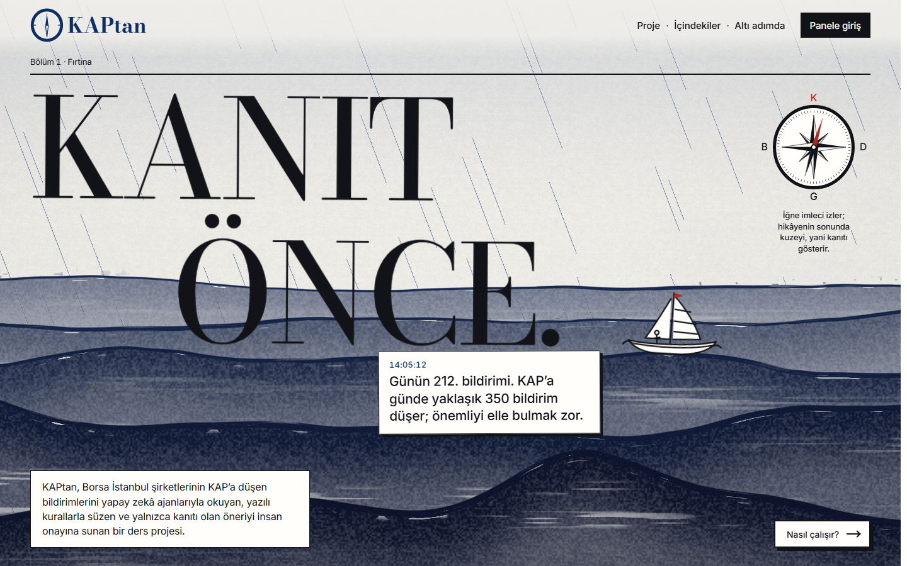
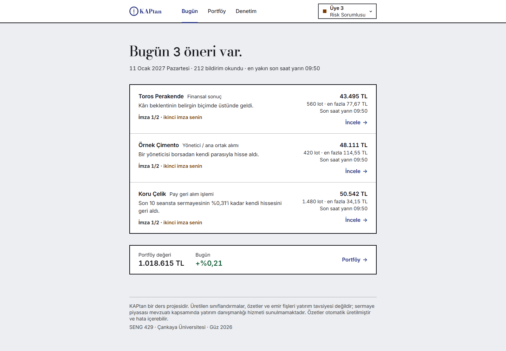
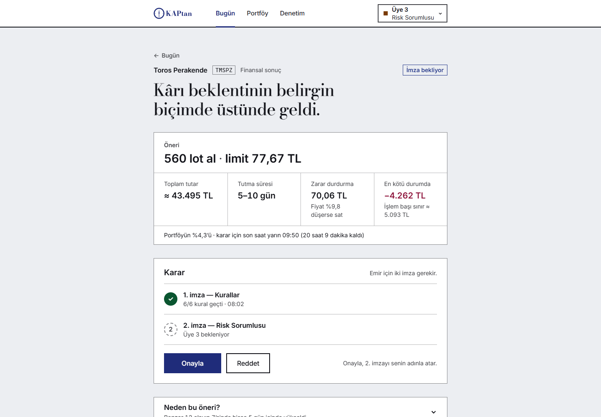
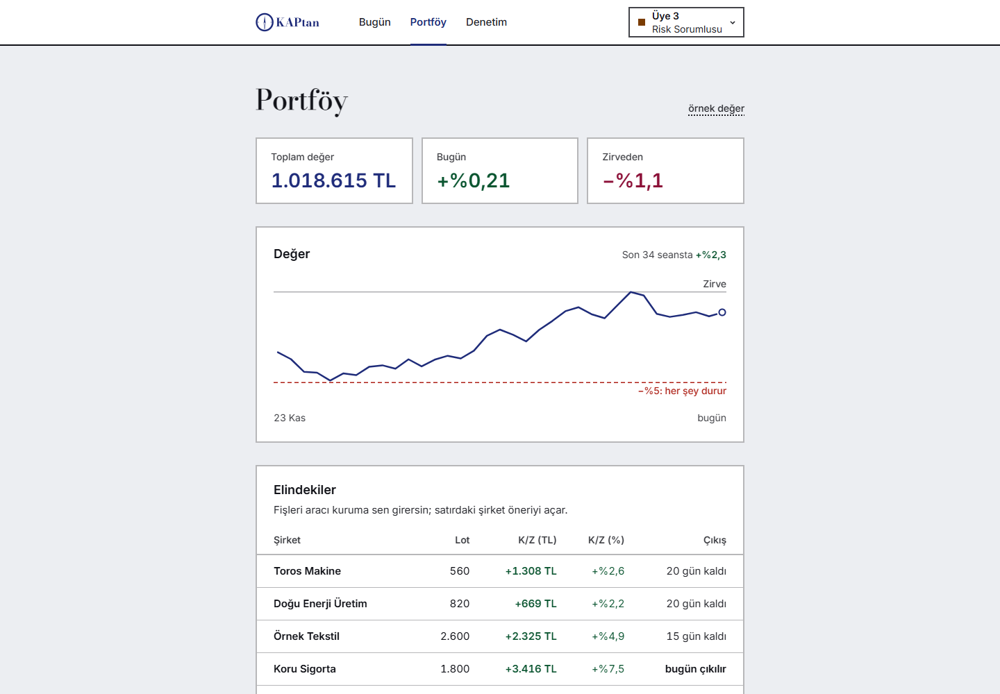
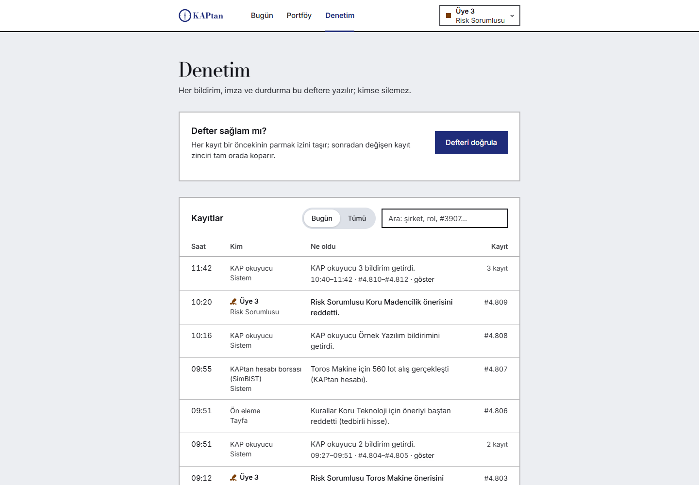
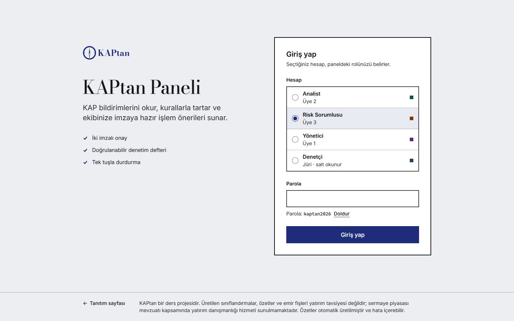
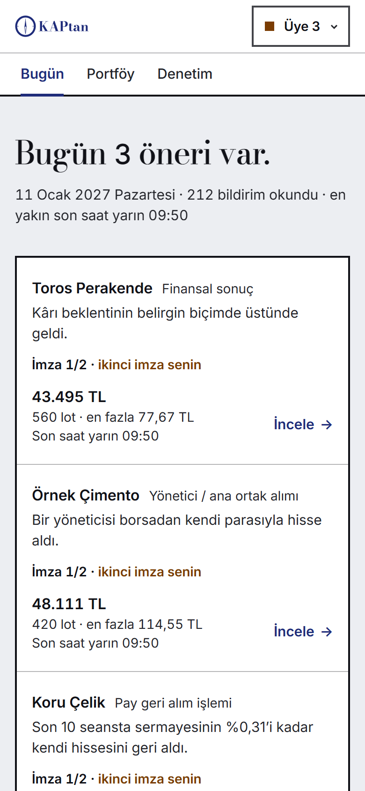
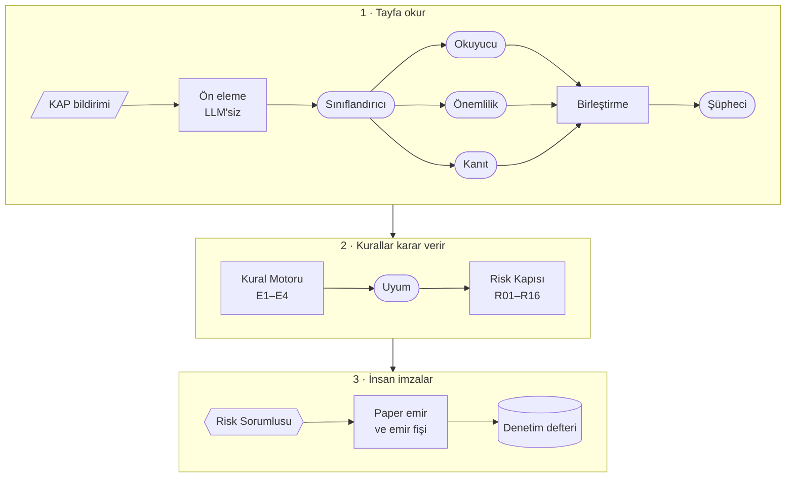

<p align="center">
  <a href="https://kaptan-seng429.vercel.app/">
    
  </a>
</p>

<h1 align="center">KAPtan</h1>

<p align="center">
  <b>Yapay zekâ okur, kurallar karar verir, insan imzalar.</b><br>
  Borsa İstanbul şirketlerinin KAP bildirimleri için çok ajanlı karar destek masası.
</p>

<p align="center">
  <a href="https://kaptan-seng429.vercel.app/">Canlı site</a> ·
  <a href="https://kaptan-seng429.vercel.app/login">Panel</a> ·
  <a href="docs/README.md">Belgeler</a> ·
  <a href="#in-english">In English</a>
</p>

<p align="center"><sub>SENG 429 Enterprise Application Development Lab · Çankaya Üniversitesi · Güz 2026</sub></p>

---

## In English

**KAPtan** is a multi-agent decision-support desk for the Public Disclosure Platform (KAP) of Borsa İstanbul,
built for the SENG 429 Enterprise Application Development Lab at Çankaya University (Fall 2026). Six LLM agents
read each disclosure, classify it, extract the figures and bring historical evidence; a deterministic rule engine
and a 16-rule risk gate make the decision; a human Risk Officer signs every proposal, and every step is written
to a hash-chained audit ledger. Nothing is executed automatically: a signed proposal becomes a paper-trading
order and an order ticket that a person enters by hand. This repository holds the public landing page and the
Next.js panel, which runs on a mock API today; the Python agent backend is being built against
[`kaptan-panel/API.md`](kaptan-panel/API.md). The documentation is in Turkish. Not investment advice.

## Ne yapar?

Borsa İstanbul şirketleri önemli her gelişmeyi KAP'ta (Kamuyu Aydınlatma Platformu) duyurur: yeni bir sözleşme,
kendi hissesini geri alma, yöneticinin hisse alması, bilanço. İş günü başına yaklaşık 270–350 bildirim gelir ve
hiçbir fon yöneticisi hepsini okuyamaz. KAPtan bu akışı izler, gürültüyü yapay zekâya göndermeden eler; sekiz
kişilik tayfa kalan bildirimin türünü bulur, tutarını çıkarır, şirket için ne kadar önemli olduğunu tartar ve
benzer geçmiş olayları sonuçlarına bakmadan getirir. Al ya da sat kararını yapay zekâ değil yazılı kurallar
verir, çünkü araştırmalar serbest karar veren dil modellerinin çoğu zaman al-tut stratejisini geçemediğini
gösteriyor (FINSABER, StockBench). Otomatik emir yoktur: her öneri bir insanın imzasını bekler ve her adım
değiştirilemez bir deftere yazılır.

## Ekranlar

<table>
  <tr>
    <td width="50%" valign="top">
      <br>
      <sub><b>Bugün</b> · tek büyük cümle, karar saati, öneri kartları, portföy satırı</sub>
    </td>
    <td width="50%" valign="top">
      <br>
      <sub><b>Öneri</b> · kısa hikâye, iki imza, Onayla / Reddet, emir fişi, notlar</sub>
    </td>
  </tr>
  <tr>
    <td width="50%" valign="top">
      <br>
      <sub><b>Portföy</b> · toplam, çizgi, elindekiler, girilecek fişler, Durdur</sub>
    </td>
    <td width="50%" valign="top">
      <br>
      <sub><b>Denetim</b> · hash zincirli defter ve "Defteri doğrula"</sub>
    </td>
  </tr>
  <tr>
    <td width="50%" valign="top">
      <br>
      <sub><b>Giriş</b> · hesap seçimi (Analist, Risk Sorumlusu, Yönetici, Denetçi) ve parola</sub>
    </td>
    <td width="50%" valign="top" align="center">
      <br>
      <sub><b>Telefonda</b> · aynı panel, 390 px</sub>
    </td>
  </tr>
</table>

## Bir önerinin yolu



<sub>Yuvarlak kutular LLM ajanı, köşeli kutular deterministik kod, altıgen insandır. Okuyucu, Önemlilik ve Kanıt
paralel çalışır. Şüpheci küçültür ya da veto eder, Uyum veto eder, Risk Kapısı küçültür ya da reddeder; hiçbiri
öneriyi büyütemez. Yanıtlanmayan öneri bir sonraki seansın 09:50'sinde düşer.</sub>

<details>
<summary><b>Bir örnekle adım adım</b></summary>

<br>

Saat 14:05'te bir şirket KAP'a şunu yazıyor: *"Yıllık gelirimizin %15'i büyüklüğünde yeni bir ihale kazandık."*

1. **Yakalama.** Sistem KAP'ı seans içinde en sık 30 saniyede bir kontrol eder ve bildirimi görür.
2. **Ön eleme (düz kod).** Devre kesici bildirimleri, işlem göremeyen, SPK tedbirli ya da evren dışı hisseler
   yapay zekâya hiç gönderilmeden elenir.
3. **Sınıflandırıcı.** KAP'ın `subject` alanı çoğu bildirimi zaten tipler; tip belirsizse ajan devreye girer:
   "Bu bir önemli sözleşme bildirimi (E3)."
4. **Okuyucu, Önemlilik, Kanıt (paralel).** Okuyucu tutarı, karşı tarafı ve süreyi çıkarır. Önemlilik yalnızca
   sayıları getirir: yıllık gelir, piyasa değeri, kur. Kanıt, benzer geçmiş olayları sonrasında ne olduğunu
   görmeden seçer.
5. **Birleştirme (düz kod).** Oranları kod hesaplar ("tutar yıllık gelirin %15'i"), tutarın bildirim metninde
   gerçekten geçtiğini denetler ve kanıt istatistiğini çıkarır.
6. **Şüpheci.** Açık arar: "Hisse son 5 günde zaten %9 yükselmiş, haber sızmış olabilir; pozisyonu yarıya indir."
7. **Kural Motoru (düz kod).** "E3 kuralları sağlanıyor; 5 gün tutulacak alım önerisi."
8. **Uyum.** SPK tedbiri yok; bildirimde sistemi kandırmaya çalışan gizli bir talimat yok.
9. **Risk Kapısı (düz kod).** Pozisyon büyüklüğü, günlük zarar sınırı, likidite. Yalnızca küçültür ya da reddeder.
10. **İmza.** Risk Sorumlusu kartı okur: bildirim, kanıt, şüphecinin notu, önerilen emir. Onaylarsa bir paper
    emir ve aracı kurum uygulamasına elle girilecek bir emir fişi çıkar.
11. **Kayıt.** Her adım denetim defterine yazılır: "Bu hisseyi neden aldık?" sorusunun cevabı oradadır.

Kaynak: [`docs/proje/01-proje-tanitimi.md`](docs/proje/01-proje-tanitimi.md)

</details>

## Tayfa

Sekiz kişilik tayfa: altı LLM ajanı okur ve kanıt toplar, iki deterministik aşama karar verir.

| # | Tayfa | Tür | Görevi | Asla yapmaz |
|---|---|---|---|---|
| 01 | Sınıflandırıcı | LLM | Bildirimin türünü bulur: E1–E4, filtre ya da diğer | Al ya da sat demez; yalnızca etiketler |
| 02 | Okuyucu | LLM | Serbest metni alanlara çevirir: tutar, karşı taraf, süre | Oran hesaplamaz |
| 03 | Önemlilik | LLM | Şirketin finansallarını ve piyasa değerini getirir | Eşiğe kendisi karar vermez |
| 04 | Kanıt | LLM | Olay hafızasından benzer geçmiş olayları seçer | Getiri görmez, istatistik hesaplamaz |
| 05 | Şüpheci | LLM | Sızıntı ve abartı arar; büyüklüğü küçültür ya da veto eder | Bir öneriyi büyütemez |
| 06 | Uyum | LLM | SPK tedbirlerini denetler, prompt-injection yakalar | Kural esnetmez |
| 07 | Kural Motoru | Deterministik | E1–E4 kurallarını yazılı eşiklerle uygular | Yorum yapmaz, LLM çağırmaz |
| 08 | Risk Kapısı | Deterministik | 16 kuraldan (R01–R16) geçirir | Öneriyi asla büyütmez; pozisyon satmaz |

Ajanların görevleri, araçları, şemaları ve istemleri: [`docs/proje/05-ajan-spesifikasyonlari.md`](docs/proje/05-ajan-spesifikasyonlari.md).

## Seyir kuralları

Dört olay türü; yalnızca alım, açığa satış ve kaldıraç yok.

| Kod | Olay | Şart | Tutma |
|---|---|---|---|
| E1 | Pay geri alım **işlemleri** (gerçekleşen alım) | 10 seansta sermayenin en az %0,25'i | 20–40 gün |
| E2 | Yönetici, yönetim kurulu üyesi ya da kontrol eden pay sahibinin piyasadan alımı | Küme hâlinde, tercihen düşüş sonrası | 20–60 gün |
| E3 | Yeni iş ilişkisi ya da ihale | Yıllıklandırılmış tutar ≥ yıllık gelirin %10'u, bağlayıcı, ilişkili taraf değil | 5 gün |
| E4 | Finansal sonuç | Tam rapor, enflasyon muhasebesi ve rapor dili | 5–10 gün |

Son 5 seansta %8'den fazla yükselen hisse atlanır ya da yarıya indirilir (haber sızmış olabilir). İşlem başına
sermayenin en fazla %0,5'i riske girer, bir pozisyon sermayenin %10'unu geçmez; günlük −%1'de yeni emir durur,
zirveden −%5'te Durdur devreye girer. Kuralların tek kaynağı:
[`docs/proje/06-strateji-ve-kurallar.md`](docs/proje/06-strateji-ve-kurallar.md).

**Gerçekçi beklenti.** BIST-100'e göre yılda 0 ile +%5 arası fazladan getiri; sıfır da çıkabilir. E3 için
BIST'e özgü bir olay çalışması yoktur, keşifseldir. Sıfır ya da negatif sonuç da geçerli bir bulgudur: projenin
araştırma sorusu ("serbest karar veren LLM" mi, "sınıflandıran LLM + kurallar" mı?) her durumda cevaplanır.

<details>
<summary><b>Neyi ölçüyoruz?</b></summary>

<br>

| Katman | Ölçüt | Hedef |
|---|---|---|
| Sınıflandırma | 200 bildirimlik kilitli test setinde macro-F1 | ≥ 0,85 |
| RAG | RAGAS faithfulness / context precision | ≥ 0,85 / ≥ 0,70 |
| Zaman sızıntısı | Karar anından sonra yayımlanmış belge getirme | 0 (sert kapı) |
| Güvenlik | ≥ 30 kötü niyetli sahte bildirimden çıkan emir | 0 (sert kapı) |
| Geçmiş test | 2025-01-01 → 2026-10-31 holdout, kurallar önceden sabit, yalnızca bir kez | Ana sayısal kanıt |
| İleri dönük paper test | `v1.0-fwd` (9 Kasım, sınıflandırıcı + kurallar) ve `v1.1-fwd` (23 Kasım, tüm ajanlar), BIST-100 ile karşılaştırmalı | Destekleyici kanıt |

Ayrıntı: [`docs/proje/08-degerlendirme-plani.md`](docs/proje/08-degerlendirme-plani.md)

</details>

## Kurumsal katman

SENG 429 bir *Enterprise* dersi; sade üç ekranın üstünde ince bir kurumsal katman var. Her özellik ait olduğu
yerde, yanında tek bir düz cümleyle durur.

| Rol | Yapabildikleri |
|---|---|
| Analist | Okur, not ekler |
| Risk Sorumlusu | Öneriyi onaylar ya da reddeder, emir fişini işaretler, durdurur; sınır değişikliğini ve yeniden başlatmayı onaylar |
| Yönetici | Kullanıcılar, ayarlar ve senaryolar; durdurur; sınır değişikliğini önerir, yeniden başlatmayı başlatır |
| Denetçi | Her şeyi görür, hiçbir şeyi değiştiremez |

- **İki imza.** Öneriyi tayfa yazar; önce kurallar (makine), sonra Risk Sorumlusu (insan) imzalar. Öneriyi yazan
  onu onaylayamaz. Yetkisiz bir düğme gizlenmez: kapalı durur ve nedenini söyler ("Bunu Risk Sorumlusu yapar.").
- **Denetim defteri.** Her kayıt bir öncekinin SHA-256 özetini taşır. "Defteri doğrula" zinciri ekranda baştan
  yürür: "Zincir sağlam." ya da "Kayıt #3.907'de zincir kırık."
- **Sınırlar.** Sınırlar düz cümlelerdir ("Bir işlemde en fazla sermayenin %0,5'i riske girer."). Değişikliği
  Yönetici önerir (1/2), başka bir kişi olan Risk Sorumlusu onaylar (2/2); sınırlar yalnızca sıkılaştırılabilir.
- **Durdur.** Yeni emir çıkmaz, açık emirler iptal edilir, bekleyen öneriler düşer, pozisyon satılmaz. Yeniden
  başlatma iki kişi ister: Yönetici başlatır, Risk Sorumlusu onaylar.

Tek yetki tablosu `kaptan-panel/src/lib/auth/permissions.ts`; mock API, her düğme ve "Kim ne yapabilir?" tablosu
aynı tabloyu okur. Ürün kuralları: [`kaptan-panel/SPEC.md`](kaptan-panel/SPEC.md).

## Durum

| Parça | Durum |
|---|---|
| Tanıtım sayfası | Yayında: [kaptan-seng429.vercel.app](https://kaptan-seng429.vercel.app/) |
| Panel | Yayında: [kaptan-seng429.vercel.app/login](https://kaptan-seng429.vercel.app/login). Bütün ekranlar, dört rol, iki imza, defter doğrulama, sınır değişikliği, Durdur ve rehberli tur, tarayıcı içinde çalışan deterministik bir mock API ile |
| Backend | Yazılıyor. Python ajan grafı ve FastAPI servisi bir ekip arkadaşı tarafından [`kaptan-panel/API.md`](kaptan-panel/API.md) sözleşmesine göre geliştiriliyor; panelin http istemcisi hazır |
| Proje belgeleri | 15 belge ve kanonik kararlar: [`docs/proje/`](docs/proje/00-ICINDEKILER.md) |

Paneldeki şirketler ve rakamlar örnek veridir (ör. ÖRNEK ENERJİ A.Ş.); gerçek şirket, gerçek fiyat ya da gerçek
sinyal yoktur. Mock modunda parola giriş sayfasında yazar: `kaptan2026`.

## Teknoloji

| Katman | Teknoloji |
|---|---|
| Tanıtım sayfası | Vite 8, düz JavaScript, GSAP, Lenis, WebGL (mürekkep deniz), Canvas 2D, Vitest |
| Panel | Next.js 16 (App Router), React 19, TypeScript (strict), Tailwind CSS 4, Radix UI, zod, @noble/hashes, Vitest, Testing Library, Playwright, axe-core |
| Backend (yazılıyor) | Python, LangGraph 1.x, FastAPI (SSE, JWT), Postgres + pgvector, Redis Streams, bge-m3 |
| Modeller | Gemini Flash-Lite (ana), Groq gpt-oss ve Llama Prompt Guard 2; geri dönüş zinciri Azure for Students, yerel Ollama, en sonda HOLD |
| Değerlendirme | RAGAS 0.4, kendi replay düzeneği, vectorbt |
| Yayın | Vercel: tek deploy, `/` tanıtım sayfası, `/login` ve diğer yollar panel |

Mimari, diyagramlar ve karar kayıtları (ADR): [`docs/proje/04-mimari.md`](docs/proje/04-mimari.md).

## Depo haritası

```
.
├── kaptan-landing/        Tanıtım sayfası (Vite): pirinç kâğıdına basılmış bir çizgi roman
├── kaptan-panel/          Panel (Next.js 16); tanıtım sayfasını da "/" adresinde sunar
├── docs/
│   ├── README.md          Belgelerin dizini
│   ├── proje/             15 proje belgesi ve kanonik kararlar
│   ├── arastirma/         Üç turluk araştırma geçmişi ve nihai proje özeti
│   └── screens/           Bu sayfadaki ekran görüntüleri
└── .github/workflows/     CI: tip denetimi, lint ve birim testleri
```

Vercel bu iki klasör adıyla derler; `kaptan-landing/` ve `kaptan-panel/` yeniden adlandırılmamalıdır.

## Hızlı başlangıç

Gerekenler: Node.js 24 (CI'daki sürüm). Testler en az Node 22.22 ister.

```bash
# Panel ve tanıtım sayfası birlikte: http://localhost:3100
cd kaptan-panel
npm ci
npm run dev        # predev adımı ../kaptan-landing'i derleyip public/ içine kopyalar
```

```bash
# Yalnız tanıtım sayfası: http://localhost:5173
cd kaptan-landing
npm ci
npm run dev
```

Yalnız panel üzerinde çalışırken `SKIP_LANDING=1 npm run dev` tanıtım sayfasını derlemeyi atlar. Gerçek bir
backend'e bağlamak için `NEXT_PUBLIC_API_MODE=http` ve `KAPTAN_API_ORIGIN` yeter; ayrıntılar
[`kaptan-panel/README.md`](kaptan-panel/README.md) ve [`kaptan-panel/API.md`](kaptan-panel/API.md) içinde.

## Testler

| Ne | Nerede | Komut |
|---|---|---|
| Birim ve bileşen testleri | `kaptan-panel` | `npm test` |
| Kapsam (satır, ifade, fonksiyon %80; dal %75) | `kaptan-panel` | `npm run coverage` |
| Uçtan uca akışlar (Playwright, Microsoft Edge kanalı) | `kaptan-panel` | `npm run e2e` |
| Erişilebilirlik (axe-core, WCAG 2.1 A/AA, 390 ve 1440 px) | `kaptan-panel` | `npx playwright test e2e/a11y.spec.ts` |
| Hepsi: tip denetimi, lint, kapsam, derleme | `kaptan-panel` | `npm run check` |
| Birim testleri | `kaptan-landing` | `npm test` |
| Kapsam (eşik %80) | `kaptan-landing` | `npm run coverage` |

GitHub Actions, `main` dalına gelen her push ve pull request'te panelin tip denetimini ve lint'ini, iki uygulamanın
da birim testlerini çalıştırır
([`.github/workflows/ci.yml`](.github/workflows/ci.yml)).

## Belgeler

| Belge | İçerik |
|---|---|
| [Proje tanıtımı](docs/proje/01-proje-tanitimi.md) | Projeyi beş dakikada anlatır |
| [Proposal](docs/proje/02-proposal.md) | Hocaya teslim edilen proje önerisi (İngilizce) |
| [PRD](docs/proje/03-PRD.md) | Personalar, kullanıcı hikâyeleri, kabul kriterleri |
| [Mimari](docs/proje/04-mimari.md) | Sistem mimarisi, ajan grafı, API, ADR'ler |
| [Strateji ve kurallar](docs/proje/06-strateji-ve-kurallar.md) | E1–E4 ve risk kapısı kuralları R01–R16 |
| [Güvenlik ve uyum](docs/proje/09-guvenlik-ve-uyum.md) | Tehdit modeli, roller, denetim zinciri, yasal uyum |
| [Final sunumu senaryosu](docs/proje/11-demo-senaryosu.md) | Beş dakikalık sunum akışı ve olası sorular |
| [Kanonik kararlar](docs/proje/_KANONIK-KARARLAR.md) | Bütün belgelerin uyduğu ortak kararlar; çelişkide bu geçerlidir |
| [Panel SPEC](kaptan-panel/SPEC.md) · [API sözleşmesi](kaptan-panel/API.md) | Panelin ürün kuralları ve backend sözleşmesi |
| [Tasarım sistemi](kaptan-landing/DESIGN.md) | Tanıtım sayfasının tasarım dili |

Bütün belgeler ve araştırma geçmişi: [`docs/README.md`](docs/README.md).

## Ders ve ekip

**SENG 429 Enterprise Application Development Lab** · Çankaya Üniversitesi · Güz 2026 · Dr. Bilgin Avenoğlu.
Proje şartı: dört kişilik grup, LLM + RAG + ajanlara dayanan bir kurumsal uygulama, ajanlar Python ile.

| Rol | Sorumluluk |
|---|---|
| Veri & RAG | KAP verisi, fiyatlar, üç bilgi tabanı (bildirim arşivi, olay hafızası, SPK kuralları) |
| Ajanlar | LangGraph grafı ve altı LLM ajanı, insan onayı (`interrupt`) |
| Strateji, Risk & Yürütme | Kural motoru, risk kapısı, paper broker (SimBIST) |
| Frontend & Değerlendirme | Panel, roller, sonuç raporları |

Takvim: Proposal 12 Ekim 2026 · uçtan uca iskelet 26 Ekim · ileri dönük paper test 9 Kasım · Progress 23 Kasım ·
final sunumu Ocak 2027.

<details>
<summary><b>Dersin konuları projede nerede?</b></summary>

<br>

| Dersteki konu | Projede |
|---|---|
| Large Language Models | Bildirimi okuma, sınıflandırma, bilgi çıkarma |
| Agentic AI ve LangGraph | Altı ajan, paralel dallar (`Send`), insan onayı (`interrupt`) |
| LangChain | Yapılandırılmış çıktı, araç çağırma, retriever'lar |
| RAG | Üç bilgi tabanı: bildirim arşivi, geçmiş olay getirileri, SPK kuralları |
| Vector Databases | pgvector (asıl), Chroma (karşılaştırma) |

</details>

## Yasal uyarı

KAPtan bir ders projesidir. Üretilen sınıflandırmalar, özetler ve emir fişleri yatırım tavsiyesi değildir; sermaye
piyasası mevzuatı kapsamında yatırım danışmanlığı hizmeti sunulmamaktadır. Özetler otomatik üretilmiştir ve hata
içerebilir.

KAP, Borsa İstanbul ve SPK ile bağlantılı değildir. Yazı tipleri (Bodoni Moda, Inter, Instrument Serif) SIL Open
Font License 1.1 ile dağıtılır; ayrıntı [`kaptan-landing/THIRD_PARTY_NOTICES.md`](kaptan-landing/THIRD_PARTY_NOTICES.md).
