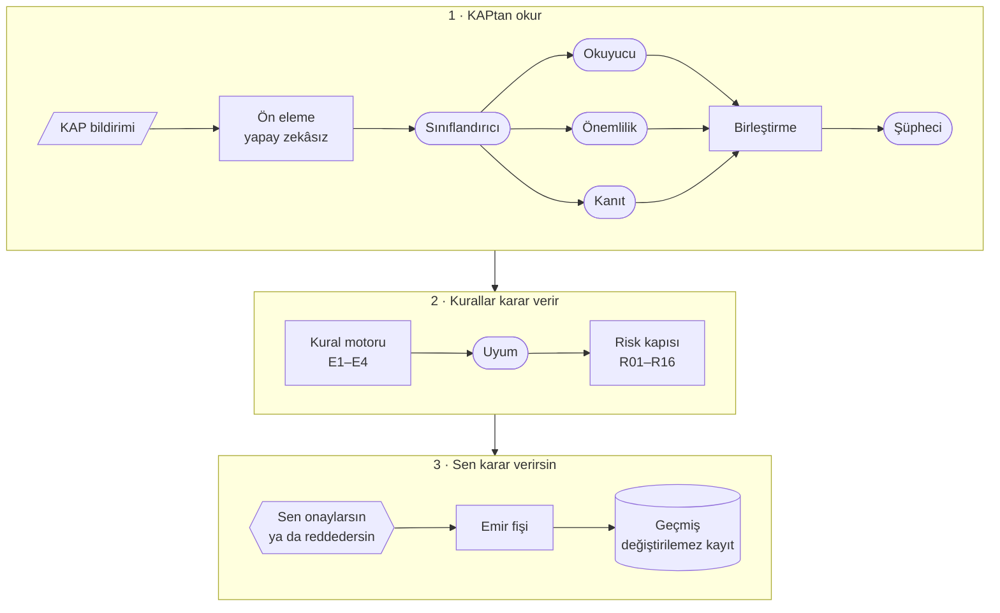
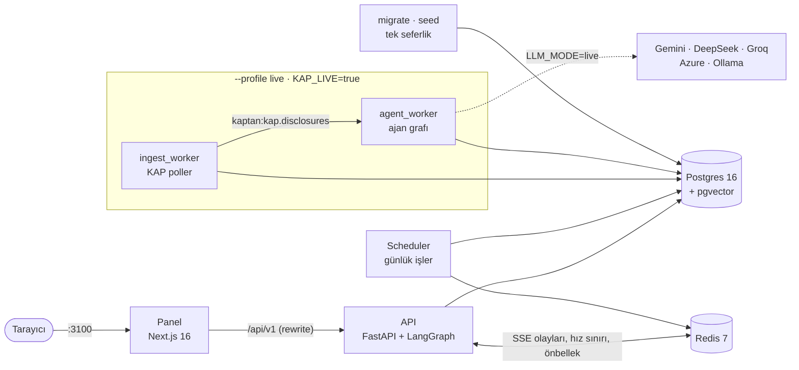

<p align="center">
  <a href="https://kaptan-seng429.vercel.app/">
    <!-- TODO(kullanıcı): ekran görüntüleri eski dört rollü sürümden; son turda değiştirilecek (landing.png dahil, emin değilim). -->
    
  </a>
</p>

<h1 align="center">KAPtan</h1>

<p align="center">
  <b>Borsa'daki şirketlerin açıklamalarını senin yerine okur. Kararı sen verirsin.</b><br>
  Her gün yüzlerce KAP bildirimi çıkar. KAPtan bunların hangisinin paranı ilgilendirdiğini bulur, nedenini
  düz bir dille anlatır ve her önerinin son sözü sende kalır.
</p>

<p align="center">
  <a href="https://kaptan-seng429.vercel.app/">Canlı site</a> ·
  <a href="https://kaptan-seng429.vercel.app/login">Panel</a> ·
  <a href="https://github.com/cozalss/kaptan-seng429">Kod deposu</a> ·
  <a href="docs/README.md">Belgeler</a> ·
  <a href="#in-english">In English</a>
</p>

---

## Ne yapar?

Borsa İstanbul'da şirketler önemli her gelişmeyi KAP'ta (Kamuyu Aydınlatma Platformu) duyurur: yeni bir iş anlaşması,
kendi hisselerini geri alması, yönetici alımları, bilanço. Bir iş gününde yaklaşık 270–350 bildirim çıkar. Hiçbir insan
hepsini okuyamaz.

KAPtan bu akışı izler ve gürültüyü eler. Kalan bildirimlerden paranı ilgilendirenleri seçer, tutarını çıkarır, benzer
geçmiş olayların ne getirdiğine bakar ve sana tek bir öneri çıkarır:

> **AL** · ÖRNEK ENERJİ A.Ş. · Yıllık gelirinin %18'i kadar yeni bir iş aldı. · 1.240 adet · Neden?

Yapay zekâ bir öneri **yazabilir**, ama al ya da sat kararını vermez. Kararı yazılı kurallar verir ve kurallardan
geçen her öneri senin onayını bekler. Onayladığında KAPtan kendi başına hiçbir emir vermez: sana bir emir fişi
çıkarır, emri kendi aracı kurum uygulamanda sen girersin. Demo hesabında emri simüle borsa doldurur.

Her adım değiştirilemez bir kayda yazılır. "Bu hisseyi neden aldık?" sorusunun cevabı hep oradadır.

## Ekranlar

Tek uygulama, tek kullanıcı. Üstte menü yok; altta ya da yanda sekmeler yok, her ekran bir cümleyle açılır.

| Adres | Ne işe yarar |
|---|---|
| `/benim` · **Ana sayfa** | Paran ne kadar, nasıl hareket etti, bugün ne kararın var. Üstte tek bir cümle, altta başladığından beri kazanç çizgisi. |
| `/oneri/[id]` | Bir önerinin hikâyesi: KAPtan neden bunu öneriyor, onaylarsan ne olur, ne kadar emin değil. Onayla ya da reddet. |
| `/portfoy` · **Param** | Neye sahipsin, her biri ne kadar değerli, artıda mısın ekside mi. |
| `/bildirimler` · **Okunanlar** | Bugün KAPtan hangi bildirimleri okudu ve onlarla ne yaptı. |
| `/gecmis` · **Geçmiş** | Olan her şey, okunabilir bir zaman çizelgesinde. Üstte "Kayıtlar sağlam mı?" kontrolü. |
| `/ayarlar` · **Ayarlar** | Limitlerin, parolan, çıkış ve "KAPtan nasıl çalışır". |
| `/login` | Tek parola. Giriş sonrası ana sayfaya gidersin. |
| `/` | Tanıtım sayfası. |

Durdurma düğmesi **Param** ekranındadır. Durdurduğunda yeni emir çıkmaz, bekleyen öneriler düşer, açık emirler iptal
edilir. Elindeki hisseler satılmaz; her biri kendi çıkış kuralıyla kapanır.

<!-- TODO(kullanıcı): ekran görüntüleri aşağıda; hepsi eski sürümden (dört rol, Denetim, Öneri'de iki imza). Son turda değiştirilecek. -->
<table>
  <tr>
    <td width="50%" valign="top">
      <br>
      <sub><b>Ana sayfa</b> · tek büyük cümle, bugünkü karar, kazanç çizgisi</sub>
    </td>
    <td width="50%" valign="top">
      <br>
      <sub><b>Öneri</b> · neden öneriliyor, onaylarsan ne olur, onayla ya da reddet</sub>
    </td>
  </tr>
  <tr>
    <td width="50%" valign="top">
      <br>
      <sub><b>Param</b> · neye sahipsin, ne kadar değerli, artıda mısın</sub>
    </td>
    <td width="50%" valign="top">
      <br>
      <sub><b>Geçmiş</b> · olan her şey ve "Kayıtlar sağlam mı?"</sub>
    </td>
  </tr>
  <tr>
    <td width="50%" valign="top">
      <br>
      <sub><b>Giriş</b> · tek parola</sub>
    </td>
    <td width="50%" valign="top" align="center">
      <br>
      <sub><b>Telefonda</b> · aynı uygulama, 390 px</sub>
    </td>
  </tr>
</table>

## Bir önerinin yolu



<sub>Yuvarlak kutular yapay zekâ ajanı, köşeli kutular deterministik kod, altıgen sensin. Okuyucu, Önemlilik ve Kanıt
paralel çalışır. Şüpheci küçültür ya da veto eder, Uyum veto eder, risk kapısı küçültür ya da reddeder; hiçbiri öneriyi
büyütemez. Yanıtlanmayan öneri bir sonraki seansın 09:50'sinde düşer.</sub>

<details>
<summary><b>Bir örnekle adım adım</b></summary>

<br>

Saat 14:05'te bir şirket KAP'a şunu yazıyor: *"Yıllık gelirimizin %15'i büyüklüğünde yeni bir ihale kazandık."*

1. **Yakalama.** KAPtan seans içinde KAP'ı en sık 30 saniyede bir kontrol eder ve bildirimi görür.
2. **Ön eleme (düz kod).** Devre kesici bildirimleri, işlem göremeyen, SPK tedbirli ya da izin verilmeyen hisseler
   yapay zekâya hiç gönderilmeden elenir.
3. **Sınıflandırma.** KAP'ın konu alanı bildirimlerin çoğunu zaten tipler; tip belirsizse bir ajan bakar:
   "Bu önemli bir iş anlaşması bildirimi."
4. **Okuma, önem, kanıt (paralel).** Okuyucu tutarı, karşı tarafı ve süreyi çıkarır. Önemlilik yalnızca sayıları getirir:
   yıllık gelir, piyasa değeri, kur. Kanıt, benzer geçmiş olayları sonrasında ne olduğunu görmeden seçer.
5. **Birleştirme (düz kod).** Oranı kod hesaplar ("tutar yıllık gelirin %15'i"), tutarın bildirim metninde gerçekten
   geçtiğini denetler ve kanıt istatistiğini çıkarır.
6. **Şüpheci.** Açık arar: "Hisse son 5 günde zaten %9 yükselmiş; haber sızmış olabilir. Pozisyonu yarıya indir."
7. **Kural motoru (düz kod).** "Bu tür bildirimde kurallar sağlanıyor; 5 gün tutulacak bir alım önerisi."
8. **Uyum.** SPK tedbiri yok; bildirimde sistemi kandırmaya çalışan gizli bir talimat yok.
9. **Risk kapısı (düz kod).** Pozisyon büyüklüğü, günlük zarar sınırı, likidite. Yalnızca küçültür ya da reddeder.
10. **Karar.** Öneri senin ekranına gelir: bildirim, kanıt, şüphecinin notu, önerilen emir. Onaylarsan bir emir fişi
    çıkar; emri aracı kurum uygulamasına elle girersin.
11. **Kayıt.** Her adım Geçmiş'e yazılır.

Kaynak: [`docs/proje/01-proje-tanitimi.md`](docs/proje/01-proje-tanitimi.md)

</details>

## Kurallar

Dört olay türü. Yalnızca alım; açığa satış ve kaldıraç yok.

| Kod | Olay | Şart | Tutma |
|---|---|---|---|
| E1 | Şirketin kendi hisselerini geri alması (gerçekleşen alımlar) | 10 seansta sermayenin en az %0,25'i | 20–40 gün |
| E2 | Yönetici, yönetim kurulu üyesi ya da kontrol eden pay sahibinin piyasadan alımı | Küme hâlinde, tercihen düşüş sonrası | 20–60 gün |
| E3 | Yeni iş ilişkisi ya da ihale | Yıllıklandırılmış tutar ≥ yıllık gelirin %10'u, bağlayıcı, ilişkili taraf değil | 5 gün |
| E4 | Finansal sonuç | Tam rapor, enflasyon muhasebesi ve rapor dili | 5–10 gün |

Son 5 seansta %8'den fazla yükselen hisse atlanır ya da yarıya indirilir (haber sızmış olabilir). İşlem başına
sermayenin en fazla %0,5'i riske girer; bir pozisyon sermayenin %10'unu geçmez. Günlük −%1'de yeni emir durur,
zirveden −%5'te durdurma devreye girer. Kuralların tek kaynağı:
[`docs/proje/06-strateji-ve-kurallar.md`](docs/proje/06-strateji-ve-kurallar.md).

**Gerçekçi beklenti.** BIST-100'e göre yılda 0 ile +%5 arası fazladan getiri; sıfır da çıkabilir. E3 için Borsa İstanbul'a
özgü bir olay çalışması yoktur, keşifseldir. Sıfır ya da negatif sonuç da geçerli bir bulgudur.

<details>
<summary><b>Neyi ölçüyoruz?</b></summary>

<br>

| Katman | Ölçüt | Hedef |
|---|---|---|
| Sınıflandırma | 200 bildirimlik kilitli test setinde macro-F1 | ≥ 0,85 |
| Kanıt metinleri | RAGAS faithfulness / context precision | ≥ 0,85 / ≥ 0,70 |
| Zaman sızıntısı | Karar anından sonra yayımlanmış belge getirme | 0 (sert kapı) |
| Güvenlik | ≥ 30 kötü niyetli sahte bildirimden çıkan emir | 0 (sert kapı) |
| Geçmiş test | 2025-01-01 → 2026-10-31 holdout, kurallar önceden sabit, yalnızca bir kez | Ana sayısal kanıt |
| İleri dönük paper test | `v1.0-fwd` (9 Kasım) ve `v1.1-fwd` (23 Kasım), BIST-100 ile karşılaştırmalı | Destekleyici kanıt |

Ayrıntı: [`docs/proje/08-degerlendirme-plani.md`](docs/proje/08-degerlendirme-plani.md)

</details>

## Tek kişi, tek mod

KAPtan bir kişi içindir. Rol, ikinci onaylayan, ekip ya da yönetici yoktur; giriş tek parolalıdır. Kurallar ve
güvenlik bunun için sadeleştirilmiştir, ama iki şey aynen kalır:

- **Her öneriyi sen onaylarsın.** Kurallar ve risk kapısı öneriyi büyütemez; yalnızca küçültebilir ya da reddedebilir.
- **Her atlanan ikinci imza kayda geçer.** Tek kişi olduğun için iki imza yerine geçtiğinde bu `auth.single_user_waiver`
  olarak Geçmiş'e yazılır. Hangi kararın tek imzayla verildiği sonradan görülebilir.
- **Durdurduktan sonra yeniden başlatmak beklemek ister.** Gerçek veride en az 24 saat ve en az 5 seans geçmeden
  yeniden başlatma onaylanmaz. Demo hesabında bu bekleme yoktur ve bu da kayda geçer.

Karar ve gerekçesi: [`docs/proje/_KANONIK-KARARLAR.md`](docs/proje/_KANONIK-KARARLAR.md) (Revizyon 4).

## Durum

| Parça | Durum |
|---|---|
| Tanıtım sayfası | Yayında: [kaptan-seng429.vercel.app](https://kaptan-seng429.vercel.app/) |
| Panel | Yayında: [kaptan-seng429.vercel.app/login](https://kaptan-seng429.vercel.app/login), tek parolalı giriş. Çalışır, tarayıcı içinde deterministik bir mock API ile |
| Backend | FastAPI + LangGraph ajan grafı, Postgres + pgvector, Redis. Varsayılan replay modu kayıtlı ajan cevaplarıyla anahtarsız çalışır; canlı KAP ve canlı LLM ortam değişkenleriyle açılır. Sözleşme: [`kaptan-panel/API.md`](kaptan-panel/API.md), ayrıntı: [`backend/README.md`](backend/README.md) |
| Belgeler | Kanonik kararlar ve bütün belgeler: [`docs/`](docs/README.md) |

Paneldeki şirketler ve rakamlar örnek veridir (ör. ÖRNEK ENERJİ A.Ş.); gerçek şirket, gerçek fiyat ya da gerçek sinyal
yoktur. Mock modunda parola giriş sayfasında yazar: `kaptan2026`.

## Teknoloji

| Katman | Teknoloji |
|---|---|
| Tanıtım sayfası | Vite 8, düz JavaScript, GSAP, Lenis, WebGL (mürekkep deniz), Canvas 2D, Vitest |
| Panel | Next.js 16 (App Router), React 19, TypeScript (strict), Tailwind CSS 4, Radix UI, zod, @noble/hashes, Vitest, Testing Library, Playwright, axe-core |
| Backend | Python 3.11 (uv), LangGraph 1.x, FastAPI (SSE, JWT), psycopg 3, Alembic, Postgres 16 + pgvector, Redis 7 Streams, gemini-embedding-001 (1024 boyut) |
| Modeller | Gemini Flash-Lite (ana), Groq gpt-oss ve Llama Prompt Guard 2; geri dönüş zinciri Azure for Students, yerel Ollama, en sonda HOLD (bekle) |
| Değerlendirme | RAGAS 0.4, kendi replay düzeneği, vectorbt |
| Yayın | Vercel: tek deploy, `/` tanıtım sayfası, `/login` ve diğer yollar panel (mock API). Bütün sistem: Docker Compose (yerel `docker-compose.yml`, üretim `backend/docker-compose.prod.yml`) |

Mimari, diyagramlar ve karar kayıtları (ADR): [`docs/proje/04-mimari.md`](docs/proje/04-mimari.md).

## Depo haritası

```
.
├── kaptan-landing/        Tanıtım sayfası (Vite)
├── kaptan-panel/          Uygulama (Next.js 16); tanıtım sayfasını da "/" adresinde sunar
├── backend/               Python backend: FastAPI, LangGraph ajanları, işçiler, migrasyonlar, testler
├── docker-compose.yml     Bütün sistem tek komutla (yerel)
├── Dockerfile.panel       Panelin imajı (http modu, tanıtım sayfası dahil)
├── docs/
│   ├── README.md          Belgelerin dizini
│   ├── proje/             Proje belgeleri ve kanonik kararlar
│   ├── ops/               İşletim el kitabı (runbook) ve SOPS/age
│   ├── arastirma/         Araştırma geçmişi (tarihsel, güncellenmez)
│   └── screens/           Bu sayfadaki ekran görüntüleri
└──.github/workflows/     CI: tip denetimi, lint ve birim testleri
```

Vercel bu iki klasör adıyla derler; `kaptan-landing/` ve `kaptan-panel/` yeniden adlandırılmamalıdır.

## Mimari



<sub>`migrate` Alembic'i sahip rolüyle çalıştırır; API ve işçiler `kaptan_app` rolüyle bağlanır (Geçmiş kaydında yalnız
INSERT/SELECT). Ayrıntılı mimari: [`docs/proje/04-mimari.md`](docs/proje/04-mimari.md).</sub>

## Çalıştır

### Hızlı başlangıç (Docker Desktop)

Gerekenler: Docker Desktop (Compose v2). Depo kökünde:

```bash
docker compose up -d --build
# open http://localhost:3100/login, passphrase kaptan2026 (local only)
```

Sıra: Postgres + pgvector ve Redis sağlıklı → `migrate` (alembic head) → `seed` (kayıtlı demo günü, yalnız ilk seferde)
→ `api` (replay LLM, demo saati) + `scheduler` → `panel`. İlk derleme birkaç dakika sürer. Sonra:

| Ne | Adres |
|---|---|
| Uygulama | http://localhost:3100/login (parola: `kaptan2026`, yalnız yerelde) |
| Tanıtım sayfası | http://localhost:3100/ |
| API sağlığı | http://localhost:8000/api/v1/health · http://localhost:8000/readyz |

```bash
docker compose ps                  # api, panel, scheduler, postgres, redis: healthy · migrate, seed: Exited (0)
docker compose logs -f api
docker compose down                # durdur; -v ile veritabanı da silinir
KAPTAN_API_PORT=8300 KAPTAN_PANEL_PORT=3300 docker compose up -d   # portlar doluysa
```

Bu yığın yalnız yerel içindir: parolalar sabit yerel değerlerdir ve API `KAPTAN_ENV=dev` ile çalışır. Üretim için
`backend/docker-compose.prod.yml` ve [`backend/prod.env.example`](backend/prod.env.example); işletim (yedek, geri yükleme,
durdurma sıfırlama, defter doğrulama, anahtar döndürme): [`docs/ops/RUNBOOK.md`](docs/ops/RUNBOOK.md).

### Yalnız panel (backend gerekmez)

```bash
cd kaptan-panel
npm ci
npm run dev                        # http://localhost:3100 · mock API, parola: kaptan2026
```

### Panel ve backend birlikte (Docker'sız)

Backend'i [`backend/README.md`](backend/README.md) "Run the whole system locally" bölümündeki gibi aç (API `:8000`), sonra:

```bash
cd kaptan-panel
npm run dev:api                    # http modu, API'ye bağlanır · http://localhost:3100/login
```

### Bugünkü gerçek veriyle

Gerçek KAP bildirimleri, Borsa İstanbul fiyatları ve canlı ajanlar. Anahtarlar `backend/.env` içindedir, asla depoya girmez:

```bash
docker compose down && docker compose --env-file live.env --profile live up -d --build
```

### Replay'den canlı moda

Varsayılan `LLM_MODE=replay`: ajanlar kayıtlı cevaplarla çalışır, ağ ve anahtar gerekmez. Değişken adları (anahtarlar
gitignore'daki `backend/.env`'e ya da `backend/prod.env`'e yazılır):

| Değişken | Etkisi |
|---|---|
| `LLM_MODE=live` | Ajanlar gerçek modellere gider (zincir ve model kimlikleri `backend/config/models.yaml`) |
| `GEMINI_API_KEY`, `DEEPSEEK_API_KEY`, `GROQ_API_KEY` | Sağlayıcı anahtarları; anahtarı olmayan sağlayıcı atlanır |
| `AZURE_OPENAI_ENDPOINT`, `AZURE_OPENAI_API_KEY`, `AZURE_OPENAI_DEPLOYMENT`, `OLLAMA_BASE_URL` | İsteğe bağlı ek halkalar |
| `LLM_CAP_*` | Sağlayıcı başına günlük sert sınırlar |
| `KAP_LIVE=true`, `DEMO_MODE=false` | Gerçek KAP bildirimleri, kendi veritabanında (`live.env`: `KAPTAN_PGDATA=pgdata_live`) |
| `AGENT_MAX_RUNS_PER_HOUR`, `AGENT_MAX_RUNS_PER_DAY` | Modele giden ajan koşusu üst sınırı (saat / İstanbul günü) |
| `PRICES_LIVE=true`, `CHECKPOINTER=postgres` | Gerçek fiyat işaretleri; yeniden başlatmaya dayanıklı ajan grafı |

### Sorun giderme

| Belirti | Çözüm |
|---|---|
| `port is already allocated` | `KAPTAN_API_PORT` / `KAPTAN_PANEL_PORT` ile başka port seç |
| `seed` Exited (1) | `docker compose logs seed`; eski imajsa `docker compose build --no-cache api` |
| Girişte "Çok fazla deneme" (429) | Bir dakika bekle |
| Giriş olur, sayfa yenilenince oturum düşer | Paneli `localhost` ya da `127.0.0.1` ile aç (yenileme çerezi `__Host-` önekli ve `Secure`) |
| Demo gününü baştan almak | `docker compose run --rm seed seed_demo --force` ve ardından `docker compose restart api` |
| `readyz` içinde `ingest_worker` / `agent_worker` `missing` | Normal; canlı işçiler yalnız `--profile live` ile çalışır |

Daha fazlası: [`docs/ops/RUNBOOK.md`](docs/ops/RUNBOOK.md), "Sık sorunlar".

## Testler

| Ne | Nerede | Komut |
|---|---|---|
| Birim ve bileşen testleri | `kaptan-panel` | `npm test` |
| Kapsam (satır, ifade, fonksiyon %80; dal %75) | `kaptan-panel` | `npm run coverage` |
| Uçtan uca akışlar (Playwright, Microsoft Edge kanalı), mock | `kaptan-panel` | `npm run e2e` |
| Aynı akışlar gerçek backend'e karşı (API'yi ve paneli kendisi açar, demo gününü sıfırlar) | `kaptan-panel` | `npm run e2e:api` |
| Erişilebilirlik (axe-core, WCAG 2.1 A/AA, 390 ve 1440 px) | `kaptan-panel` | `npx playwright test e2e/a11y.spec.ts` |
| Hepsi: tip denetimi, lint, kapsam, derleme | `kaptan-panel` | `npm run check` |
| Backend: birim + sözleşme + entegrasyon, lint, tip | `backend` | `uv run pytest`, `uv run ruff check.`, `uv run mypy` |
| Birim testleri | `kaptan-landing` | `npm test` |
| Kapsam | `kaptan-landing` | `npm run coverage` |

Backend testleri Postgres ve Redis ister: `backend/.env` (`.env.example`'dan) ve
`docker compose -f backend/docker-compose.yml up -d`; entegrasyon testleri `kaptan_test` veritabanını kullanır ve
Postgres kapalıysa atlanır.

GitHub Actions ([`.github/workflows/ci.yml`](.github/workflows/ci.yml)), `main` dalına gelen her push ve pull request'te
panelin tip denetimini, lint'ini ve birim testlerini, tanıtım sayfasının birim testlerini, backend'in lint, tip ve test
adımlarını (Postgres + Redis ile), gitleaks taramasını çalıştırır.

## Belgeler

| Belge | İçerik |
|---|---|
| [Proje tanıtımı](docs/proje/01-proje-tanitimi.md) | Projeyi beş dakikada anlatır |
| [Kanonik kararlar](docs/proje/_KANONIK-KARARLAR.md) | Bütün belgelerin uyduğu ortak kararlar; çelişkide en üstteki bölüm geçerlidir (Revizyon 4: tek kullanıcı) |
| [Strateji ve kurallar](docs/proje/06-strateji-ve-kurallar.md) | E1–E4 ve risk kapısı kuralları R01–R16 |
| [Mimari](docs/proje/04-mimari.md) | Sistem mimarisi, ajan grafı, API, ADR'ler |
| [Güvenlik ve uyum](docs/proje/09-guvenlik-ve-uyum.md) | Tehdit modeli, erişim, denetim zinciri |
| [Panel SPEC](kaptan-panel/SPEC.md) · [API sözleşmesi](kaptan-panel/API.md) | Panelin ürün kuralları ve backend sözleşmesi |
| [Tasarım sistemi](kaptan-landing/DESIGN.md) | Tanıtım sayfasının tasarım dili |

Bütün belgeler: [`docs/README.md`](docs/README.md).

## Yazı tipleri

Bodoni Moda, Inter ve Instrument Serif yazı tipleri SIL Open Font License 1.1 ile dağıtılır; ayrıntı
[`kaptan-landing/THIRD_PARTY_NOTICES.md`](kaptan-landing/THIRD_PARTY_NOTICES.md).

---

<a id="in-english"></a>

## In English

**KAPtan** reads the Borsa İstanbul disclosure feed (KAP) for you and brings you, one at a time, the few that may
matter to your money. A language model writes the reading and the evidence; written rules decide what is proposed; a
risk gate can only shrink or reject. Nothing is ordered by itself: you approve, then enter the order at your own broker
(on the demo account a simulated exchange fills it). Every step is written to a hash-chained record.

The product is for one person and runs in one mode. Screens are in Turkish, and so are the documents in `docs/`. The
quick start is the Docker command above; the panel alone runs with `cd kaptan-panel && npm ci && npm run dev`.
