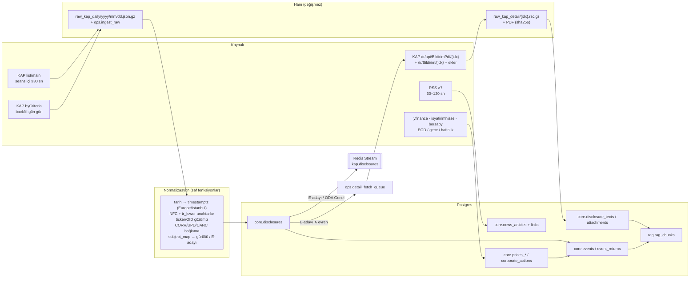

# KAPtan — Veri Hattı ve Veritabanı Şeması

> **Doküman 07** · SENG 429 · Güz 2026 · Sahip: Rol 1 (Veri & RAG)
> Doğruluk kaynağı: `_KANONIK-KARARLAR.md` (**REVİZYON 3 bölümü Revizyon 2'ye, Revizyon 2 orijinal kararlara üstündür**; bu doküman 30.09.2026'da Revizyon 2'ye, ardından aynı gün Revizyon 3'e hizalandı). Değişiklik önerileri ve durumları en sondaki **"Önerilen değişiklikler — durum (Revizyon 2)"** bölümündedir. Risk kapısı kural ID'leri `06-strateji-ve-kurallar.md` §10'a (R01–R16) aittir.
> Mimari bağlam: `04-mimari.md`. Ayrıntılı saha ölçümleri: `../arastirma/04-derin-arastirma/03-bist-kap-veri-hatti.md`.
> **[D]** = 29.09.2026'da canlı HTTP çağrısı / Context7 / resmi dokümanla doğrulandı. **[V]** = Revizyon 3 fizibilite araştırmasında (30.09.2026) canlı denendi / kaynağından doğrulandı. **[≈]** = ölçüme dayalı tahmin. **[!]** = W1'de tekrar kontrol et.

---

## İçindekiler

1. Kaynaklar
2. Veri akışı ve polling ritmi
3. Tekilleştirme, "ilk görülme" ve point-in-time kuralları
4. KAP backfill prosedürü (2018–2026)
5. Tam metin ve PDF ekleri
6. Fiyatlar ve kurumsal işlemler (düzeltilmiş vs ham)
7. RSS haberleri ve bildirime bağlama (ticker ±6 saat)
8. Türkçe metin işleme
9. Postgres + pgvector DDL (tam)
10. İndeksler
11. RAG: 3 taban ve chunk stratejisi
12. Hibrit arama (SQL, RRF)
13. Embedding modeli
14. Veri kalitesi kontrolleri
15. Saklama (retention) ve yedek
16. 1. hafta veri kontrol listesi
17. Önerilen değişiklikler — durum (Revizyon 2)

---

## 1. Kaynaklar

| Kaynak | Uç / kütüphane | Ne için | Ritim | Hedef tablo | Not / lisans |
|---|---|---|---|---|---|
| **KAP canlı** | `POST /tr/api/disclosure/list/main` (tarih `dd.MM.yyyy`) ve `POST /tr/api/disclosure/members/byCriteria` (tarih `yyyy-MM-dd`) **[D][V]** (anahtarsız, 0,2–0,5 sn) | Yeni bildirimler, `disclosureIndex` cursor | Seans içi **≥ 30 sn**; seans dışı 60 sn–5 dk (08:00–23:59) | `core.disclosures` | Anahtar yok; tarayıcı `User-Agent` + `Origin` + `Referer` şart **[V]**; MKK'nın kendi WAF'ı var, `robots.txt` bile **HTTP 666** döndürüyor **[V]** → 666 = geri çekilme sinyali; kibar polling; akademik/ticari olmayan kullanım beyan edilir, veri yeniden dağıtılmaz |
| **KAP geçmiş** | Aynı `byCriteria`, **gün gün**, yanıt başına **en fazla 2000 satır** **[D]**; geçmiş tarih sorgusu 2020 dahil çalışıyor → backfill mümkün **[V]** | 2018–2026 arşivi (arşiv 2009-06'dan başlar) | Tek seferlik + gece telafi | `core.disclosures` | ≥ 2 sn / istek |
| **KAP tam metin** | `GET /tr/api/BildirimPdf/{idx}` (formu tablo başlıklarıyla düzenli metin olarak verir; **birincil form/tablo kaynağı**) + `GET /tr/Bildirim/{idx}` (Next.js RSC yükü, ~280 KB) **[D][V]** | TR + EN metin, form tabloları, finansal tablo hücreleri | Yalnızca filtrelenmiş bildirimler | `core.disclosure_texts` | Hepsini çekme |
| **KAP ekleri** | `/tr/api/notification/attachment-detail/{idx}`, `/tr/api/file/download/{objId}` (uç adları `kap-client` **kaynak kodundan referans** alındı; paket bağımlılık değil) **[!]** | PDF ekleri | Filtrelenmiş | `core.attachments` | |
| **KAP yardımcı** | `GET /tr/api/disclosure/subjects/{ODA\|FR\|DG}/IGS` **[D]**, `/tr/api/company/generic/excel/IGS/A`, `POST /tr/api/expected-disclosure-inquiry/company` | Konu OID'leri, şirket listesi, beklenen bildirim takvimi | Haftalık | `core.companies`, `core.tickers` | `subjects/ODA/IGS` yalnızca **13 konu** döndürüyor (eksik) **[V]** → konu taksonomisi **gerçek bildirim satırlarından** kurulur (§2.2) |
| MKK API Portal | `apigwdev.mkk.com.tr/api/vyk/*` | **Yalnızca sandbox** (donmuş ~2023 verisi, 6 çağrı/dk) — şema fixture'ı | Bir kez | `tests/fixtures` | Canlı erişim BİST veri sözleşmesi ister |
| **KAP istemcisi** | **Kendi `kap_client.py`** (httpx; tarayıcı başlıkları, 429/5xx/boş gövde/**666** geri çekilme) — **tek yol** **[V]** | Tüm KAP çağrıları | — | — | `kap-client` 1.2.0 **bağımlılık olarak kullanılmaz**: şirket listesini IGS üye tipinden çekmediği için BIST hisselerinde `CompanyNotFoundError` veriyor **[V]**; yalnızca kaynak kodu referansı (ör. ek uçları) |
| Kütüphaneler | `borsapy` 0.11.0 | Fiyat / kurumsal işlemler | — | — | Sürümleri sabitle |
| **Fiyat (günlük)** | `yfinance` (`THYAO.IS`): 2018'den bugüne eksiksiz, `Close` **bölünme/bedelsize göre düzeltilmiş**, İş Yatırım düzeltilmiş kapanışıyla birebir aynı; **ham fiyat vermez** **[V]** · İş Yatırım (`HG_KAPANIS` **ham**, `HGDG_KAPANIS` düzeltilmiş, günlük `SERMAYE`, `PD`, `HAO_PD`) **[V]** | **Ham** seviye (dolum, bant, tavan/taban) yalnızca İş Yatırım'dan; getiri düzeltilmiş seriden; piyasa değeri, sermaye, XU100 | EOD 18:30 | `core.prices_daily` | 15 dk gecikme → strateji ertesi açılış. `Volume == 0` sahte tatil satırları (~31 gün, ör. Kurban Bayramı) atılır **[V]**; kod değişimleri `core.ticker_history` ile (ör. KOZAL → TRALT) **[V]**; **borsadan çıkanlar** yfinance/borsapy'de boş, İş Yatırım'da var → hayatta kalma yanlılığı için İş Yatırım **[V]**; `isyatirimhisse` sabit `timeout=10` yüzünden çoğunlukla zaman aşımına düşüyor → uç doğrudan **≥ 90 sn timeout**'lu ince sarmalayıcıyla çağrılır **[V]** |
| **Fiyat (gün içi)** | `borsapy` 1m (~2 hafta), `yfinance` 1h (730 gün) | Kendi gün içi arşivimiz | Her gece | `core.prices_intraday` | Ücretsiz geçmiş kaybolur → biriktir |
| **Kurumsal işlemler** | `borsapy` `.splits` (Capital, RightsIssue, BonusFromCapital, BonusFromDividend), `.dividends` | Bedelsiz / bedelli / temettü | Haftalık + KAP CA bildirimi geldiğinde | `core.corporate_actions` | |
| **Haber RSS** | AA Ekonomi, Dünya, Foreks, Habertürk Ekonomi, TRT Haber Ekonomi, CNBC-e, Borsagündem (`feedparser`) | Bildirime bağlı haber, bağlam | 60–120 sn, ETag/If-Modified-Since | `core.news_articles` | **Bloomberg HT RSS 14 Eylül'den beri ölü.** Yalnızca başlık + özet + URL saklanır |
| **Makro / kur** | TCMB EVDS3 (`evds` ≥ 0.4.0, **ücretsiz anahtar gerekir**, anahtar HTTP başlığı `key`; `.env`) | USD/EUR/GBP/CHF/JPY/CNY-TRY döviz alış (E3 döviz tutarlar **karar tarihindeki** TCMB kuruyla TL'ye çevrilir), TÜFE (E2 eşiği endekslemesi), politika faizi (bağlam) | Günlük | `core.macro_series` | |
| **Mevzuat** | SPK tebliğleri (II-15.1, II-22.1), piyasa bozucu eylemler, şirket risk politikası (kendi dokümanımız) | Kural ve mevzuat RAG tabanı | Elle, sürümlü | `rag.rag_chunks` | |
| **Tedbir** | KAP `DUY` sınıfı (SPK Tedbir Kararı), VBTS bildirimleri **[!]** kaynak ve format W1'de | Kaçınma filtresi, sert veto (`06` R04) | 30 dk | `core.restricted_securities` | |
| **Ekip engel listesi** | Admin tarafından elle (ekip üyelerinin bağlantılı olduğu şirketler) | İçeriden-öğrenen engeli (`06` R13) | Değiştikçe (audit'li) | `core.restricted_securities` (`kind='team_insider'`) | |

### 1.1 Yıllık hacim tahminleri ve temel veri notu (Revizyon 3)

Ölçüm: 24 rastgele iş günü, Eki 2025–Eyl 2026 **[V, yıllıklandırma ≈]**.

| Bildirim türü | Yıllık ≈ | Rota |
|---|---|---|
| Tüm bildirimler | ~68.600 | — |
| Gerçekleşen geri alım | ~1.100 | E1 adayı |
| Pay alım satım (yönetici/ana ortak, alış+satış) | ~2.000 | E2 adayı |
| Yeni İş İlişkisi | ~600 | E3 adayı |
| İhale | ~385 | E3 adayı |
| Finansal Rapor (mevsimsel) | ~2.700 | E4 adayı |
| Devre kesici | ~13.900 | gürültü |

- **Bildirim ≠ bağımsız olay:** geri alımlar 45 şirkette yoğunlaşıyor ve düşüş günlerinde patlıyor (29.09.2026: 47 geri alım) → olay çalışmasında şirket + pencere bazında kümeleme zorunlu (`06` §12.3).
- **Temel veri [~]:** İş Yatırım `SERMAYE` ve `PD` günlük ve point-in-time (E1 %0,25 eşiği ve E3 piyasa değeri yedeği için yeterli). Hasılat çeyreklik ve **yılbaşından kümülatif (YTD)**, **açıklanma tarihi yok**, sonradan düzeltilmiş olabilir → tek çeyrek değeri **ardışık YTD farkıyla** (`revenue_q = YTD(q) − YTD(q−1)`, TMS 29 ayarı `06` §3.4) hesaplanır; `fundamentals_pit.available_at` KAP "Finansal Rapor" bildiriminin `publishDate`'inden alınır, bulunamazsa **dönem sonu + yasal son başvuru süresi** (muhafazakâr) kullanılır (P3).

---

## 2. Veri akışı ve polling ritmi



### 2.1 KAP poller algoritması

```python
# backend/src/kaptan/ingest/kap_poller.py (özet)
POLL_BASE_S = {"session": 30, "offhours": 60}      # kanonik: seans içi ≥ 30 sn; seans dışı 60 sn
EMPTY_BACKOFF_S = [60, 120, 300, 600]               # boş gövde = "geri çekil", "haber yok" DEĞİL [D]

async def poll_once(client, repo, redis, clock) -> int:
    today = clock.now_tr().strftime("%d.%m.%Y")
    rows = await client.list_main(from_date=today, to_date=today)          # IGS
    if rows is None:                                                        # WAF / boş gövde / HTTP 666 [V]
        raise EmptyResponse                                                 # kap_client.py 666'yı da None'a çevirir → geri çekilme
    cursor = await repo.max_disclosure_index()
    new = [r for r in rows if r.disclosure_index > cursor]
    now = clock.now_utc()
    for r in sorted(new, key=lambda x: x.disclosure_index):
        d = normalize_row(r, first_seen_at=now, subject_map=SUBJECT_MAP_V1)
        inserted = await repo.upsert_disclosure(d)                         # ON CONFLICT (disclosure_index)
        await repo.save_raw("kap.list_main", str(r.disclosure_index), r.raw)
        if inserted and d.is_event_candidate and not d.is_noise:
            if d.primary_ticker in await repo.universe(today):
                await repo.enqueue_detail(d.disclosure_index, priority=0)  # canlı = en yüksek
            await redis.xadd("kap.disclosures", {"payload": d.envelope_json(), "attempt": "0"},
                             maxlen=100_000, approximate=True)
    return len(new)
```

- **Aralık (kanonik alt sınır: seans içi ≥ 30 sn):** iş günü 08:00–19:00 → 30 sn; 19:00–23:59 ve hafta sonu → 60 sn; 00:00–08:00 → 5 dk (gece bildirimleri nadir). Jitter yalnızca **yukarı** (+0–%20) uygulanır; aralık hiçbir zaman 30 sn'nin altına inmez.
- **Hata politikası:** 429/5xx → üstel geri çekilme (2, 4, 8 … 300 sn); boş gövde ve **HTTP 666 (MKK WAF) [V]** → `EMPTY_BACKOFF_S` (666 "haber yok" değil, geri çekilme sinyalidir; aralık hiçbir zaman kısaltılmaz); 3 ardışık hata → `kap_poll_failures` metriği + Telegram uyarısı.
- **Tarih sınırı:** 23:59:30–00:00:30 arasında hem dünü hem bugünü sorgula (gece yarısı kaçağı).
- **Cursor:** `max(disclosure_index)` Postgres'ten okunur (Redis'ten değil) → süreç yeniden başlasa da tutarlı. Aynı gün içinde geç gelen düşük indeksleri kaçırmamak için her 10 dk bir "tam gün uzlaştırma" (`byCriteria` bugün) yapılır; eksik indeksler aynı upsert'ten geçer.
- **Gürültü:** `Pay Bazında Devre Kesici Bildirimi` (~%20–28; Rev. 3) `is_noise=true` ile saklanır, **silinmez**, grafa gönderilmez. Dikkat: devre kesici ve **Pay Alım Satım Bildirimi** (E2 adayı) ikisi de `DKB` sınıfında gelir **[D]** → gürültü filtresi **sınıfa değil konuya** (`subject`) göre yapılır.
- **LLM'siz ön eleme:** Stream'e yazılan her aday, grafta hiçbir LLM çağrısından önce `pre_gate`'ten geçer (işlem görebilirlik `market_calendar`/işlem durdurma, evren `universe_daily`, SPK/VBTS tedbiri ve ekip engel listesi `restricted_securities`, yalnızca "Düzeltme" → yeni olay değil). Bu doküman bu tabloların PIT beslemesinden sorumludur.
- **Demo modu (kanonik):** `DEMO_MODE=true` iken `tests/fixtures/demo/` bildirim fixture'ları `ingest_source='demo'` ile aynı upsert yolundan enjekte edilir ve kaydedilmiş LLM yanıtları + fiyatlarla **replay** edilir; demo satırları değerlendirme ve backtest sorgularından `ingest_source <> 'demo'` ile dışlanır.

### 2.2 Konu haritası (`config/subject_map.v1.yaml`, özet)

| KAP `subject` | Sınıf/tür | Harita |
|---|---|---|
| Pay Bazında Devre Kesici Bildirimi | DKB | `noise` |
| Payların Geri Alınmasına İlişkin Bildirim | ODA / CA | `E1` adayı |
| Pay Alım Satım Bildirimi | DKB / ODA | `E2` adayı (yalnızca yönetici / YK üyesi / kontrol eden pay sahibi; **fon eşik bildirimleri E2 değildir** — Okuyucu `role`/`legal_basis` ile ayırır) |
| Yeni İş İlişkisi | ODA | `E3` adayı — **ayrı bir `subject`** **[V]** → E3 adaylarının çoğu LLM'siz tiplenir |
| İhale Süreci / Sonucu | ODA | `E3` adayı (ihale kazanımı; bağlayıcılık Okuyucu'da) **[V]** |
| Özel Durum Açıklaması (Genel) | ODA | `llm` (Sınıflandırıcı → E3 / diğer) |
| Finansal Rapor, Faaliyet Raporu (Konsolide), Sorumluluk Beyanı | FR | `E4` adayı (Finansal Rapor birincil) |
| Sermaye Artırımı - Azaltımı İşlemlerine İlişkin Bildirim | ODA / CA | `avoid:bedelsiz_hype` / `avoid:dilutive_rights` (Okuyucu ayırır) + `corporate_actions` girdisi |
| Sermaye Piyasası Kurulu Tedbir Kararı | DUY | `avoid:spk_tedbir` + `restricted_securities` |
| Kar Payı Dağıtım İşlemlerine İlişkin Bildirim | ODA / CA | `corporate_actions` girdisi |
| Haber ve Söylentilere İlişkin Açıklama | ODA | `llm` |
| Şirket Genel Bilgi Formu, Kurumsal Yönetim, Sürdürülebilirlik, KFİF | DG | `archive_only` (RAG bağlamı) |
| diğerleri | — | `archive_only` |

Harita backfill'den **ampirik** olarak tamamlanır: `subjects/ODA/IGS` uç noktası yalnızca **13 konu** döndürüyor **[D][V]**, bu yüzden taksonomi **gerçek bildirim satırlarının `subject` frekans tablosundan** kurulur; `v1.0-fwd` ile dondurulur.

---

## 3. Tekilleştirme, "ilk görülme" ve point-in-time kuralları

### 3.1 Doğal anahtarlar ve tekilleştirme

| Varlık | Doğal anahtar | Yöntem |
|---|---|---|
| Bildirim | `disclosure_index` (KAP monoton kimliği) | `INSERT … ON CONFLICT (disclosure_index) DO UPDATE` (yalnızca değişebilir alanlar) |
| Ham yanıt | `(source, natural_key, payload_sha256)` | Aynı yük ikinci kez yazılmaz; yük değişirse yeni satır → değişiklik geçmişi |
| Düzeltme | `reason = CORR` ("Düzeltme mi? Evet") + `related_index` | **Yalnızca düzeltme** yeni olay sayılmaz; `events.is_correction_of` ile asıl olaya bağlanır. `UPD` ("Güncelleme: Evet") yeni olay **olabilir** (ör. gerçekleşen geri alım işlemi); E1'de tekilleştirme işlem satırı (tarih, nominal) düzeyinde. `CANC` asıl olayı iptal eder |
| Haber | `url_canonical` (utm_*, AMP, sondaki `/` temizlenmiş) + `sha256(title_key)` | Kesin tekil |
| Yakın-kopya haber | MinHash LSH, karakter 5-shingle, Jaccard ≥ 0,8 (`datasketch`) ±24 saat | `cluster_id` |
| Fiyat | `(ticker, d, source)` / `(ticker, ts, interval, source)` | Upsert |
| RAG chunk | `(doc_ref, chunk_no, lang, embed_model)` + `content_sha256` | Aynı içerik tekrar embed edilmez |
| Ajan çalıştırması | `thread_id = disc-{idx}-{strategy_version}` | Aynı bildirim aynı sürümle iki kez işlenmez |

```sql
-- first_seen_at yalnızca ilk kez yazılır; backfill (NULL) canlı değeri ezmez
INSERT INTO core.disclosures AS d (disclosure_index, ..., first_seen_at, available_at, ingest_source, raw)
VALUES ($1, ..., $n_first_seen, $n_available, $n_source, $n_raw)
ON CONFLICT (disclosure_index) DO UPDATE SET
  attachment_count = EXCLUDED.attachment_count,
  summary          = COALESCE(EXCLUDED.summary, d.summary),
  first_seen_at    = COALESCE(d.first_seen_at, EXCLUDED.first_seen_at),
  updated_at       = now()
  -- published_at ve available_at ASLA güncellenmez
RETURNING (xmax = 0) AS inserted;
```

### 3.2 Zaman damgaları

Her kaynak satırı üç zaman taşır:

| Alan | Anlam | Kaynak |
|---|---|---|
| `published_at` | Kaynağın beyan ettiği yayın anı | KAP `publishDate` (`dd.MM.yyyy HH:mm:ss`, **İstanbul yerel, UTC+3**) → UTC `timestamptz` |
| `first_seen_at` | **Bizim** ilk gördüğümüz an (duvar saati, NTP'li) | Canlı poller; backfill'de `NULL` |
| `available_at` | Sistemin bu veriyi **kullanabileceği** en erken an | Canlı: `GREATEST(first_seen_at, published_at)` (saat kayması korumalı); backfill: `published_at + interval '60 seconds'`. İlk INSERT'te uygulama yazar, **asla güncellenmez** (generated değil: `timestamptz + interval` IMMUTABLE değil) |

`first_seen_at − published_at` dağılımı (p50/p95) **ders raporunun ölçüm sonucudur** (işlem gününde henüz ölçülmedi **[!]**).

### 3.3 Point-in-time kuralları (değişmez)

1. **P1 — Her okuma `available_at <= as_of`.** RAG, SQL araçları (Önemlilik), olay çalışması, backtest. `as_of` = kararı tetikleyen bildirimin `available_at`'i.
2. **P2 — Getiriler olgunlaşınca erişilebilir.** `event_returns.available_at` = ufkun son seansının kapanışı (18:10) + EOD işi (≈ 18:30). 20 günlük getiri, olaydan 20 seans sonra görülebilir. Getiriler **yalnızca `core.event_returns`'ten** `available_at <= as_of` filtresiyle okunur (chunk metadata'sından değil); Kanıt ajanı getirileri hiç görmez, istatistikleri Birleştirme düğümü kodla hesaplar.
3. **P3 — Finansallar rapor yayın anında erişilebilir.** `fundamentals_pit.available_at` = kaynak KAP "Finansal Rapor" bildiriminin `publishDate`'ine dayanan `available_at`'i; dönem sonu tarihi değil. İş Yatırım hasılat verisinin açıklanma tarihi yoktur **[V]**; eşleşen FR bildirimi bulunamazsa **dönem sonu + yasal son başvuru süresi** (muhafazakâr) kullanılır ve `available_at_basis` sütununa yazılır (Revizyon 3).
4. **P4 — Mevzuat sürümlüdür.** `rag_chunks.valid_to`; karar anında yürürlükte olmayan madde getirilmez.
5. **P5 — Giriş seansı.** `available_at` ≥ 09:55 ise (açılış seansı eşleşmesinden sonra) giriş = **sonraki** işlem gününün açılışı; 18:10 sonrası bildirimler ertesi gün 09:40–09:55 emir toplama → 10:00 öncesi eşleşme. `events.t0_session` bu kurala göre hesaplanır.
6. **P6 — Evren günlüktür.** `core.universe_daily(d)` o gün bilinen ADV20 ve halka açıklık oranıyla hesaplanır (hayatta kalma yanlılığı yok: delist olmuş şirketler tabloda kalır).
7. **P7 — Holdout koruması.** 2025-01-01 sonrası olayların getirileri geliştirme notebook'larında görünmez: `core.event_returns_dev` görünümü (`event_time < '2025-01-01'`); notebook'lar yalnızca bu görünüme yetkili `dev_ro` rolüyle bağlanır (`core.event_returns` tablosuna yetkisi yok, §9 yetkiler). Holdout (2025-01-01 → 2026-10-31) yalnızca bir kez, kurallar dondurulduktan sonra koşulur.
8. **P8 — Fiyat seviyesi ham, getiri düzeltilmiş.** Limit fiyat, lot, tavan/taban, ±%2 bant (R09) ve SimBIST dolumları → **ham** fiyat (İş Yatırım `HG_KAPANIS`; yfinance ham vermez **[V]**); getiri ve anormal getiri → **düzeltilmiş** seri (§6).

---

## 4. KAP backfill prosedürü (2018–2026)

**Kapsam:** 2018-01-01 → bugün (kanonik aralık). Arşiv 2009-06'dan beri var (ilk indeks 84196) **[D]**; olay çalışmasını genişletmek istersek aynı iş 2009'a kadar geri çalıştırılabilir.

```python
# backend/src/kaptan/ingest/kap_backfill.py (özet)
CLASSES = ["ODA", "FR", "DG", "DKB", "DUY"]
CAP = 2000                                              # [D] yanıt başına sert sınır
SLEEP_S = 2.0

async def backfill(start: date, end: date, client, repo) -> None:
    for day in daterange(start, end):                   # hafta sonları DAHİL (bildirim gelebilir)
        if await repo.run_status("kap_backfill", day.isoformat()) == "done":
            continue                                    # sürdürülebilir
        rows = await fetch_day(client, day)
        await repo.write_raw_gz(f"raw_kap_daily/{day:%Y/%m/%d}.json.gz", rows)
        await repo.upsert_disclosures(normalize(r, first_seen_at=None) for r in rows)
        await repo.mark_run("kap_backfill", day.isoformat(), "done", rows=len(rows))
        await asyncio.sleep(SLEEP_S + random.uniform(0, 0.5))

async def fetch_day(client, day) -> list[dict]:
    rows = await client.by_criteria(day, day)
    if len(rows) < CAP:
        return rows
    out: list[dict] = []                                # 2000'e ulaştıysa sınıflara böl
    for cls in CLASSES:
        part = await client.by_criteria(day, day, disclosure_class=cls)
        if len(part) >= CAP:                            # hâlâ taşıyor → konu OID gruplarına böl
            part = await fetch_by_subject_groups(client, day, cls)
        out.extend(part)
        await asyncio.sleep(SLEEP_S)
    return dedup_by_index(out)
```

Adımlar:
1. `ops.ingestion_runs` satırı gün başına (`job='kap_backfill'`, `key='2021-03-15'`); iş kesilirse kaldığı günden devam eder.
2. Ham yanıt **önce** diske (`raw_kap_daily/yyyy/mm/dd.json.gz`) yazılır → KAP'a bir daha gitmeye gerek kalmaz; normalizasyon ham dosyadan yeniden koşulabilir.
3. Kontrol: gün satır sayısı `== 2000` ise bölme zorunlu (sessiz kesilme riski) — DQ kontrolü **Q-K2**.
4. Hacim: ~3.200 gün × 1 istek / 2 sn ≈ **2 saat**; ~250–350 satır/iş günü → **~0,6–0,9 M satır**.
5. Backfill satırlarında `first_seen_at = NULL`, `ingest_source = 'backfill'`, `available_at = published_at + 60 sn`.
6. Bitince: `subject` frekans tablosu → `subject_map.v1.yaml` tamamlanır; şirket/ticker çözümleme oranı raporlanır.
7. Tam metin kuyruğu (§5) önceliklerle doldurulur: `0` canlı · `1` holdout 2025–2026 · `2` geliştirme 2018–2024.
8. Delist olmuş şirketler korunur (`memberType: "IGS"` + `inactiveMkkMemberOidList`; satırlar `kapTitle`'ı taşır).

---

## 5. Tam metin ve PDF ekleri

**Kaynak sırası:** `GET /tr/api/BildirimPdf/{idx}` form alanlarını ve tablo başlıklarını düzenli metin olarak verir → Okuyucu için birincil form/tablo kaynağı (`disclosure_texts.source='bildirim_pdf'`); `/tr/Bildirim/{idx}` RSC yükü TR/EN ayrımı ve finansal tablo hücreleri için (§5.1). İkisi de aynı etik polling sınırlarına tabidir.

**Hangi bildirimler?** `is_event_candidate ∨ subject = 'Özel Durum Açıklaması (Genel)' ∨ class = 'FR'` **ve** ticker `universe_daily`'de (canlı) veya BIST-100 ∪ likidite evreni (backfill). Tahmin: backfill için 60–120 bin sayfa → 1 istek / 2 sn ile 33–66 saat, arka planda, sürdürülebilir kuyruk (`ops.detail_fetch_queue`).

### 5.1 RSC yükünden metin

```python
# backend/src/kaptan/ingest/kap_detail.py (özet) — [D] idx 1669809 ile test edildi
RSC_RE = re.compile(r'self\.__next_f\.push\(\[1,"(.*?)"\]\)', re.S)
ODA_MARK = "oda_ExplanationTextBlock|"   # [V] Rev. 3: HER bildirim tipinde YOK (ör. geri alım bildiriminde
                                         # tablo metinden okunur) → yalnızca genel ÖDA gövdesi için; form/tablo
                                         # tipleri PARSERS[subject] altındaki tip bazlı ayrıştırıcılara gider

def extract_payload(html_text: str) -> str:
    return "".join(json.loads(f'"{c}"') for c in RSC_RE.findall(html_text))

def extract_texts(payload: str) -> dict[str, str]:
    plain = html.unescape(re.sub(r"\s+", " ", re.sub(r"<[^>]+>", " ", payload)))
    i = plain.find(ODA_MARK)
    body = plain[i + len(ODA_MARK):] if i >= 0 else plain
    tr, en = split_tr_en(body)          # EN bölümü TR'den sonra gelir; ayırıcı sezgisel + dil tespiti
    return {"tr": normalize_text(tr), "en": normalize_text(en)} if en else {"tr": normalize_text(body)}
```

- **Tip bazlı ayrıştırıcı (Revizyon 3) [V]:** `oda_ExplanationTextBlock` anahtarı her bildirim tipinde bulunmaz; yukarıdaki `extract_texts` yalnızca serbest metinli ÖDA (Genel, Yeni İş İlişkisi vb.) için geçerlidir. Geri alım (E1), pay alım satım (E2), finansal rapor (E4) gibi form/tablo tipleri `subject`'e göre seçilen ayrı ayrıştırıcılarla okunur (birincil kaynak `BildirimPdf` düzenli metni); her ayrıştırıcının gerçek bildirimlerden alınmış **fixture testleri** vardır (`tests/fixtures/kap_detail/{subject}/`). İşaret bulunamazsa sessizce tüm metne düşmek yalnızca genel ÖDA'da kabul edilir; form tiplerinde ayrıştırma hatası DQ'ya yazılır.
- Ham RSC yükü `raw_kap_detail/{idx}.rsc.gz` olarak saklanır (tam HTML değil → ~%80 daha küçük).
- `extractor_version` saklanır; ayrıştırıcı değişirse yalnızca ham yükten yeniden çıkarılır.
- `split_tr_en`: `hasMultiLanguageSupport=true` ise EN metni ayrı satır (`lang='en'`). **Hukuken bağlayıcı olan TR metindir;** sınıflandırma TR üzerinde, EN çapraz kontrol. `/en/Bildirim/{idx}` yolu alternatif **[!]**.
- Finansal tablolar (`taxonomy-*` HTML hücreleri) ayrıca ayrıştırılıp `core.fundamentals_pit`'e yazılır (hasılat, net kâr, ödenmiş sermaye, özkaynak; TMS 29 enflasyon düzeltmeli bayrağı).

### 5.2 PDF ekleri

1. `attachment-detail/{idx}` → dosya listesi (`objId`, ad) **[!]**; `file/download/{objId}` → bayt.
2. Boyut sınırı 20 MB; `sha256` ile içerik adresli depolama (`/data/raw/att/{sha256[:2]}/{sha256}.pdf`); aynı PDF iki bildirimde ise bir kez saklanır.
3. Metin: `pypdf` (varsayılan) → boşsa `pdfplumber` (tablolar) → hâlâ boşsa `text_status='empty_needs_ocr'` (OCR opsiyonel: `ocrmypdf -l tur`). PyMuPDF AGPL olduğu için kullanılmaz.
4. Sayfa başı/sonu tekrarları (antet, sayfa no) sayfalar arası frekansla atılır.
5. PDF metni Okuyucu'ya **veri** olarak (fenced) verilir; prompt-injection skoru PDF metni için de hesaplanır.

---

## 6. Fiyatlar ve kurumsal işlemler

**İlke: ham OHLCV + `corporate_actions` saklanır; düzeltilmiş seri görünümde hesaplanır.** Yalnızca düzeltilmiş fiyat saklamak point-in-time'ı bozar (yeni işlem geçmiş seriyi değiştirir).

**Kaynak ayrımı (Revizyon 3) [V]:**
- **Ham seviye yalnızca İş Yatırım'dan** (`HG_KAPANIS` ve diğer `HG_*`): SimBIST dolumları, R09 fiyat bandı ve tavan/taban kontrolleri bununla yapılır. `HGDG_KAPANIS` (düzeltilmiş), günlük `SERMAYE` ve `PD` aynı satıra yazılır.
- **yfinance `Close` düzeltilmiştir** (bölünme/bedelsiz; İş Yatırım düzeltilmiş kapanışıyla birebir aynı) ve ham fiyat vermez → `price_basis='adjusted'` ile saklanır, yalnızca getiri çapraz kontrolü için kullanılır; ham seviye yerine asla geçmez.
- **Sahte tatil satırları:** yfinance'te hacmi 0 ve fiyatı değişmeyen ~31 gün var (ör. Kurban Bayramı) → yüklemede `Volume == 0` satırları atılır, seri `market_calendar`/XU100 takvimine hizalanır.
- **Kod değişimleri:** eski kod çalışmaz (ör. KOZAL → TRALT) → sorgular `core.ticker_history` üzerinden güncel/eski koda çevrilir.
- **Borsadan çıkanlar:** yfinance/borsapy boş döner, İş Yatırım veri verir → hayatta kalma yanlılığını önlemek için bu paylar İş Yatırım'dan yüklenir.
- **`isyatirimhisse` zaman aşımı:** kütüphanedeki sabit `timeout=10` çağrıların çoğunu düşürüyor → aynı uç **≥ 90 sn timeout**'lu ince bir httpx sarmalayıcısıyla doğrudan çağrılır (`ingest/isyatirim_client.py`).

| İşlem | Geri düzeltme faktörü (ex-date **öncesi** fiyatlarla çarpılır) | Kaynak |
|---|---|---|
| **Bedelsiz** (iç kaynak + temettüden) | `1 / (1 + (bonus_capital_pct + bonus_dividend_pct)/100)` — THYAO 2009-06-25: %313,77 + %86,23 = %400 → 1/5 (yfinance `Stock Splits 5.0` ile uyumlu **[D]**) | borsapy `.splits` |
| **Bedelli** | `TERP / P_cum`, `TERP = (P_cum + r·S) / (1 + r)`; `r` = rüçhan oranı, `S` = satış fiyatı (çoğunlukla 1 TL nominal) | borsapy `RightsIssue` + KAP Sermaye Artırımı |
| **Temettü** | `(P_prev_close − D_gross) / P_prev_close` | borsapy `.dividends` |

```sql
-- Düzeltilmiş görünüm: d gününün faktörü = d'den SONRAKİ tüm ex-date faktörlerinin çarpımı
CREATE VIEW core.prices_daily_adj AS
SELECT p.ticker, p.d, p.source,
       p.close * f.adj AS adj_close,
       p.open  * f.adj AS adj_open,
       p.volume / NULLIF(f.adj, 0) AS adj_volume,
       p.close AS raw_close, f.adj AS adj_factor
FROM core.prices_daily p
CROSS JOIN LATERAL (
  SELECT COALESCE(exp(sum(ln(ca.factor))), 1.0) AS adj
  FROM core.corporate_actions ca
  WHERE ca.ticker = p.ticker AND ca.ex_date > p.d AND ca.factor > 0
) f;
```

- **Getiri PIT-güvenlidir:** iki tarih arası getiri yalnızca aradaki ex-date'lerden etkilenir; gelecekteki bir işlem iki fiyatı da aynı oranda çarpar. **Fiyat seviyesi** (limit fiyat, lot, bant, tavan/taban) ise daima **ham**dır (P8).
- **Çapraz kontrol (birim testi):** kendi `adj_close` serimiz ile İş Yatırım `HGDG_KAPANIS` (ve yfinance `Close`, ikisi birebir aynı **[V]**) farkı < %0,5 (işlem günlerinin ≥ %99'unda); THYAO 2009-06-25 faktörü 0,2.
- **Anormal getiri:** piyasa düzeltmeli `AR_t = r_i,t − r_XU100,t` (birincil) ve piyasa modeli (β, [-250, -30] seans penceresi) (ikincil). Ufuklar 1/5/20/60 seans, `t0` = giriş seansı açılışı (P5), ilk getiri `open(t0) → close(t0)`.
- **Tavan/taban:** BIST pay piyasası günlük fiyat limiti ±%10 (baz fiyata göre) **[!]** seans kurallarından teyit; `limit_up_locked` = kapanış = tavan ve kapanış seansında karşı taraf yok (yaklaşık: `high = low = close = tavan`).
- **Gün içi:** `prices_intraday` 1m (borsapy, kapanış müzayedesi 18:09 barı dahil) ve 1h (yfinance, 18:00–18:10 **yok**). Kaynak sütunu tutulur; karıştırılmaz.
- **Takvim:** `core.market_calendar(d, is_trading_day, half_day)` — BIST tatilleri (29 Ekim, bayram arifeleri yarım gün vb.) elle seed edilir; SimBIST ve `t0` hesabı buna bakar.

---

## 7. RSS haberleri ve bildirime bağlama

```python
# backend/src/kaptan/ingest/linker.py (özet)
LINK_WINDOW = timedelta(hours=6)

def detect_tickers(title: str, summary: str, tickers: set[str], aliases: dict[str, str]) -> set[str]:
    found = {t for t in re.findall(r"\b[A-ZÇĞİÖŞÜ]{4,6}\b", title + " " + summary) if t in tickers}
    key = tr_lower(nfc(title + " " + summary))
    found |= {tk for alias, tk in aliases.items() if alias in key}       # "türk hava yolları" → THYAO
    return found

async def link_article(article, repo) -> list[Link]:
    links = []
    for tk in article.tickers:
        cands = await repo.disclosures_near(tk, article.published_at, LINK_WINDOW)   # ±6 saat
        for d in cands:
            delta = (article.published_at - d.published_at).total_seconds()
            score = 1.0 - abs(delta) / LINK_WINDOW.total_seconds()
            if delta >= 0: score += 0.2                     # haber bildirimden SONRA gelir (beklenen)
            if "kap" in tr_lower(article.summary or ""): score += 0.2   # "KAP'a yaptığı açıklamaya göre"
            links.append(Link(article.id, d.disclosure_index, int(delta), "ticker_window", score))
    return sorted(links, key=lambda l: -l.score)[:3]
```

- **Olay zamanı KAP'ınkidir.** Haber her zaman sonradır; bağlanan haber olayın zamanını değiştirmez, yalnızca bağlam ve "piyasa fark etti mi?" sinyalidir.
- Bağlanmamış haberler de saklanır (ileride haber-öncesi sızıntı analizi).
- `investing.com` gibi TZ'siz `pubDate` → UTC varsayılır ve işaretlenir; Borsagündem eski içerik → `pubDate < now − 7 gün` atlanır.
- Tam metin **saklanmaz** (telif); gerekirse `trafilatura` ile geçici çekilir, LLM'e verilir, atılır.

---

## 8. Türkçe metin işleme

```python
# backend/src/kaptan/text/turkish.py
import re, unicodedata
from datetime import datetime
from decimal import Decimal, InvalidOperation
from zoneinfo import ZoneInfo

IST = ZoneInfo("Europe/Istanbul")
_INVISIBLE = re.compile(r"[​-‏‪-‮⁠-⁤]")   # zero-width + bidi

def nfc(s: str) -> str:
    return unicodedata.normalize("NFC", s)

def tr_lower(s: str) -> str:
    """Türkçe küçük harf: 'İ'→'i', 'I'→'ı'. str.lower()/casefold() KULLANMA ('İ'→'i̇' olur)."""
    return nfc(s).replace("I", "ı").replace("İ", "i").lower()

def tr_upper(s: str) -> str:
    return nfc(s).replace("i", "İ").replace("ı", "I").upper()

def clean_text(s: str) -> str:
    """Ingest temizliği: NFC, görünmez/bidi karakterler, boşluk sıkıştırma."""
    return re.sub(r"\s+", " ", _INVISIBLE.sub("", nfc(s))).strip()

def norm_key(s: str) -> str:
    """Eşleştirme/dedup/trigram anahtarı: tr_lower + noktalama → boşluk."""
    return re.sub(r"\s+", " ", re.sub(r"[^\w\s%]", " ", tr_lower(clean_text(s)))).strip()

_MULT = {"bin": Decimal(10**3), "milyon": Decimal(10**6), "milyar": Decimal(10**9)}

def parse_tr_decimal(s: str) -> Decimal | None:
    """'1.234.567,89' → 1234567.89 · '12,5 milyon' → 12500000 · '%0,25' → 0.25 (yüzde puan)."""
    t = tr_lower(s).replace("%", "").replace("tl", "").replace("try", "").strip()
    mult = Decimal(1)
    for word, m in _MULT.items():
        if t.endswith(word):
            t, mult = t[: -len(word)].strip(), m
    t = t.replace(".", "").replace(" ", "").replace(",", ".")
    try:
        return Decimal(t) * mult
    except InvalidOperation:
        return None

_KAP_FORMATS = ("%d.%m.%Y %H:%M:%S", "%Y.%m.%d %H:%M:%S", "%d.%m.%Y %H:%M", "%d.%m.%Y")

def parse_kap_datetime(s: str) -> datetime:
    """KAP: byCriteria/list-main 'dd.MM.yyyy HH:mm:ss', detay yükü 'yyyy.MM.dd HH:mm:ss' — İstanbul yerel."""
    for fmt in _KAP_FORMATS:
        try:
            return datetime.strptime(s.strip(), fmt).replace(tzinfo=IST)
        except ValueError:
            continue
    raise ValueError(f"tanınmayan KAP tarihi: {s!r}")

def decode_bytes(b: bytes) -> str:
    """UTF-8 dene; olmazsa cp1254 (eski ekler, Excel/CSV). Hangisinin kullanıldığı loglanır."""
    try:
        return b.decode("utf-8")
    except UnicodeDecodeError:
        return b.decode("cp1254")
```

Birim testleri (zorunlu):

```python
def test_tr_lower():
    assert tr_lower("İSTANBUL IĞDIR ŞİRKET") == "istanbul ığdır şirket"
    assert len(tr_lower("İSTANBUL")) == len("İSTANBUL")        # 'i̇' birleşik nokta yok
def test_decimal():
    assert parse_tr_decimal("1.234.567,89") == Decimal("1234567.89")
    assert parse_tr_decimal("12,5 milyon TL") == Decimal("12500000")
def test_cp1254():
    assert decode_bytes("Özel Durum Açıklaması".encode("cp1254")) == "Özel Durum Açıklaması"
def test_kap_dt():
    assert parse_kap_datetime("28.09.2026 21:49:46").utcoffset().total_seconds() == 3 * 3600
```

Kurallar:
- **Birleştirme (join) her zaman ticker veya KAP üye OID üzerinden,** şirket unvanıyla asla ("ECZACIBAŞI YATIRIM HOLDİNG").
- Tickers ASCII büyük harf; `tr_lower` uygulanmaz.
- **Windows:** `PYTHONIOENCODING=utf-8` ve `PYTHONUTF8=1` (compose'da tanımlı); dosyalar `encoding="utf-8"` ile açılır; `.gitattributes` LF.
- **Postgres:** ICU collation `core.tr_ci` (büyük/küçük harf duyarsız karşılaştırma), sıralama `COLLATE "tr-TR-x-icu"`. FTS'e **`content_norm` (tr_lower edilmiş)** metin verilir; böylece `turkish` sözlüğünün küçük harf dönüşümü veritabanı `LC_CTYPE`'ına bağlı kalmaz. Sorgu tarafı da aynı `norm_key` ile normalize edilir.
- **Token bütçesi:** Türkçe metin İngilizce'nin ~1,5–2 katı token; chunk boyutları bge-m3 tokenizer'ıyla (`BAAI/bge-m3`, XLM-R) ölçülür, karakterle değil.

### 8.1 Kişi adı maskeleme ve injection ön kontrolü (LLM öncesi)

- **Kişi adları LLM'e ve LangSmith'e gitmeden maskelenir** (KVKK; kanonik R2). `text/mask_persons.py`: KAP form alanları ("Adı Soyadı", "İşlemi Yapan"), unvan kalıpları ("Sn.", "Yönetim Kurulu Başkanı …") ve `CompanyProfile.board_and_executives` sözlüğü ile gerçek kişi adları `KİŞİ_1, KİŞİ_2…` ile değiştirilir; eşleme yalnızca ilgili koşunun belleğinde tutulur, LLM çağrısına, LangSmith izine ve RAG chunk'ına maskeli metin gider. Şirket unvanları maskelenmez. Ham metin yalnızca `core.disclosure_texts` ve ham arşivde kalır.
- **Türkçe kural tabanlı injection kontrolü:** `ingest/injection_patterns.py` regex'leri (`tr_lower` + NFC sonrası) Prompt Guard'dan **önce** çalışır; sonuç `attachments.injection_score` yanında `injection_regex_hits` olarak saklanır (`05` §8 L1–L2, `09` §3).
- Her ikisi de grafın `guard` düğümünde, **LLM'siz ön elemeden (`pre_gate`) sonra** ve herhangi bir LLM çağrısından önce uygulanır.

---

## 9. Postgres + pgvector DDL (tam)

Kurallar: tüm zamanlar `timestamptz` (UTC saklanır), para `numeric`, şemalar `auth`, `core`, `rag`, `trading`, `audit`, `ops`. Rolleri `db/init/00_roles.sql` oluşturur (`kaptan_owner`, `app_rw`, `app_ro`, `auditor_ro`, `dev_ro`). LangGraph checkpoint tabloları `AsyncPostgresSaver.setup()` ile `public` şemasında.

```sql
-- db/migrations/0001_init.sql
CREATE EXTENSION IF NOT EXISTS vector;       -- pgvector >= 0.8 (iterative index scan)
CREATE EXTENSION IF NOT EXISTS pg_trgm;
CREATE EXTENSION IF NOT EXISTS pgcrypto;
CREATE EXTENSION IF NOT EXISTS citext;

CREATE SCHEMA IF NOT EXISTS auth;
CREATE SCHEMA IF NOT EXISTS core;
CREATE SCHEMA IF NOT EXISTS rag;
CREATE SCHEMA IF NOT EXISTS trading;
CREATE SCHEMA IF NOT EXISTS audit;
CREATE SCHEMA IF NOT EXISTS ops;

CREATE COLLATION IF NOT EXISTS core.tr_ci
  (provider = icu, locale = 'tr-TR-u-ks-level2', deterministic = false);

-- ═════════════════════════ auth ═════════════════════════
CREATE TABLE auth.roles (
  code        text PRIMARY KEY CHECK (code IN ('analyst', 'risk_officer', 'admin', 'auditor')),
  description text NOT NULL
);
INSERT INTO auth.roles VALUES
  ('analyst',      'Görür, not ekler'),
  ('risk_officer', 'Onay/ret, kill switch, limitler'),
  ('admin',        'Kullanıcı, evren, config'),
  ('auditor',      'Salt okunur audit (SPK denetçisi personası)');

CREATE TABLE auth.users (
  id            uuid PRIMARY KEY DEFAULT gen_random_uuid(),
  email         citext UNIQUE NOT NULL,
  password_hash text NOT NULL,                        -- argon2id
  display_name  text NOT NULL,
  is_active     boolean NOT NULL DEFAULT true,
  mfa_secret    text,                                 -- TOTP (risk_officer/admin, canlı mod)
  created_at    timestamptz NOT NULL DEFAULT now(),
  last_login_at timestamptz
);

CREATE TABLE auth.user_roles (
  user_id    uuid NOT NULL REFERENCES auth.users(id) ON DELETE CASCADE,
  role       text NOT NULL REFERENCES auth.roles(code),
  granted_by uuid REFERENCES auth.users(id),
  granted_at timestamptz NOT NULL DEFAULT now(),
  PRIMARY KEY (user_id, role),
  CHECK (granted_by IS NULL OR granted_by <> user_id)          -- kimse kendine rol veremez
);

-- ═════════════════════════ core: referans ═════════════════════════
CREATE TABLE core.companies (
  company_id     bigint GENERATED ALWAYS AS IDENTITY PRIMARY KEY,
  kap_member_oid text UNIQUE,                         -- KAP web 32-hex OID
  kap_member_id  int UNIQUE,                          -- VYK members.id
  title          text NOT NULL,
  title_norm     text NOT NULL,                       -- norm_key(title)
  member_type    text,                                -- IGS, ...
  sector         text,
  is_active      boolean NOT NULL DEFAULT true,
  listed_from    date,
  delisted_on    date,
  aliases        text[] NOT NULL DEFAULT '{}'         -- norm_key'li kısa adlar ("türk hava yolları")
);

CREATE TABLE core.tickers (                           -- bir şirketin zaman içinde birden çok kodu olabilir
  ticker     text NOT NULL CHECK (ticker ~ '^[A-Z0-9]{3,8}$'),
  company_id bigint NOT NULL REFERENCES core.companies(company_id),
  isin       text,
  valid_from date NOT NULL,
  valid_to   date,
  PRIMARY KEY (ticker, valid_from),
  CHECK (valid_to IS NULL OR valid_to > valid_from)
);

CREATE TABLE core.ticker_history (                    -- Rev. 3 [V]: kod değişimleri (ör. KOZAL → TRALT); eski kod fiyat kaynaklarında çalışmaz
  old_ticker        text NOT NULL CHECK (old_ticker ~ '^[A-Z0-9]{3,8}$'),
  new_ticker        text NOT NULL CHECK (new_ticker ~ '^[A-Z0-9]{3,8}$'),
  company_id        bigint REFERENCES core.companies(company_id),
  changed_on        date NOT NULL,                    -- yeni kodun ilk işlem günü
  source            text NOT NULL CHECK (source IN ('kap', 'isyatirim', 'manual')),
  source_disclosure bigint,                           -- KAP bildirimi (FK yok: disclosures aşağıda tanımlı)
  PRIMARY KEY (old_ticker, changed_on),
  CHECK (old_ticker <> new_ticker)
);

CREATE TABLE core.market_calendar (
  d              date PRIMARY KEY,
  is_trading_day boolean NOT NULL,
  is_half_day    boolean NOT NULL DEFAULT false,
  note           text
);

CREATE TABLE core.universe_daily (                    -- P6: günlük, PIT evren
  d               date NOT NULL,
  ticker          text NOT NULL,
  adv20_try       numeric(20,2),
  free_float_pct  numeric(7,4),
  mcap_try        numeric(24,2),
  is_eligible     boolean NOT NULL,
  rule_version    text NOT NULL,
  PRIMARY KEY (d, ticker)
);

-- ═════════════════════════ core: KAP ═════════════════════════
CREATE TABLE core.disclosures (
  disclosure_index    bigint PRIMARY KEY,             -- KAP monoton kimlik
  disclosure_oid      text UNIQUE,                    -- list/main disclosureId (32-hex)
  company_id          bigint REFERENCES core.companies(company_id),
  stock_codes         text[] NOT NULL DEFAULT '{}',   -- stockCodes ',' ile bölünmüş
  related_stocks      text[] NOT NULL DEFAULT '{}',
  primary_ticker      text,                           -- stock_codes[1] veya çözümlenen
  disclosure_class    text NOT NULL,                  -- ODA|FR|DG|DKB|DUY
  disclosure_type     text,                           -- ODA|CA|DG|DUY|FR|FON
  disclosure_category text,                           -- ODA|STT|NULL
  subject             text NOT NULL,
  summary             text,
  reason              text CHECK (reason IN ('NEW', 'UPD', 'CORR', 'CANC')),
  related_index       bigint,                         -- FK yok: hedef evren dışında olabilir
  is_late             boolean,
  fin_year            int,
  fin_period          text,
  attachment_count    int NOT NULL DEFAULT 0,
  has_multilang       boolean NOT NULL DEFAULT false,
  is_noise            boolean NOT NULL DEFAULT false,  -- devre kesici vb.
  subject_route       text NOT NULL,                  -- subject_map çıktısı: noise|E1|E2|E3|E4|llm|avoid:*|archive_only
  subject_map_version text NOT NULL,
  published_at        timestamptz NOT NULL,
  first_seen_at       timestamptz,                    -- canlı poller; backfill'de NULL
  available_at        timestamptz NOT NULL,           -- COALESCE(first_seen_at, published_at + 60 sn)
  ingest_source       text NOT NULL CHECK (ingest_source IN ('live', 'backfill', 'reconcile', 'demo')),
  raw                 jsonb NOT NULL,
  created_at          timestamptz NOT NULL DEFAULT now(),
  updated_at          timestamptz NOT NULL DEFAULT now(),
  tsv                 tsvector GENERATED ALWAYS AS (
                        to_tsvector('turkish', coalesce(subject, '') || ' ' || coalesce(summary, ''))) STORED,
  CHECK (available_at >= published_at)
  -- available_at ilk INSERT'te yazılır ve bir daha değişmez: backfill ile gelen satırı canlı poller
  -- sonradan görürse first_seen_at dolar ama available_at (published_at + 60 sn) korunur.
);

CREATE TABLE core.disclosure_texts (
  disclosure_index  bigint NOT NULL REFERENCES core.disclosures(disclosure_index),
  lang              text NOT NULL CHECK (lang IN ('tr', 'en')),
  body              text NOT NULL,                    -- clean_text uygulanmış
  body_norm         text NOT NULL,                    -- norm_key(body)
  source            text NOT NULL CHECK (source IN ('bildirim_pdf', 'rsc_payload', 'vyk_html', 'vyk_data', 'manual')),
  has_full_report   boolean NOT NULL DEFAULT false,   -- E4: tam rapor okundu mu
  extractor_version text NOT NULL,
  payload_sha256    bytea NOT NULL,
  extracted_at      timestamptz NOT NULL DEFAULT now(),
  tsv               tsvector GENERATED ALWAYS AS (to_tsvector('turkish', body_norm)) STORED,
  PRIMARY KEY (disclosure_index, lang)
);

CREATE TABLE core.attachments (
  attachment_id    bigint GENERATED ALWAYS AS IDENTITY PRIMARY KEY,
  disclosure_index bigint NOT NULL REFERENCES core.disclosures(disclosure_index),
  kap_obj_id       text NOT NULL,
  file_name        text NOT NULL,
  mime_type        text NOT NULL DEFAULT 'application/pdf',
  size_bytes       bigint,
  sha256           bytea,
  storage_path     text,
  page_count       int,
  text_status      text NOT NULL DEFAULT 'pending'
                   CHECK (text_status IN ('pending', 'ok', 'empty_needs_ocr', 'ocr_ok', 'failed', 'skipped_size')),
  text_body        text,
  injection_score  real,                              -- Prompt Guard
  injection_regex_hits text[] NOT NULL DEFAULT '{}',   -- Türkçe kural tabanlı kontrol
  fetched_at       timestamptz,
  UNIQUE (disclosure_index, kap_obj_id)
);

CREATE TABLE core.restricted_securities (             -- SPK tedbiri, VBTS (06 R04) + ekip engel listesi (06 R13)
  id               bigint GENERATED ALWAYS AS IDENTITY PRIMARY KEY,
  ticker           text NOT NULL,
  kind             text NOT NULL CHECK (kind IN ('spk_tedbir', 'vbts_brut_takas', 'vbts_aciga_satis',
                                                     'vbts_kredili_islem', 'vbts_tek_fiyat', 'trading_halt',
                                                     'team_insider', 'other')),
  start_date       date NOT NULL,
  end_date         date,
  source_disclosure bigint REFERENCES core.disclosures(disclosure_index),
  available_at     timestamptz NOT NULL,
  detail           jsonb NOT NULL DEFAULT '{}'
);

CREATE TABLE core.fundamentals_pit (                  -- P3: Önemlilik ajanının SQL araçları buradan okur
  ticker            text NOT NULL,
  period_end        date NOT NULL,
  item              text NOT NULL CHECK (item IN ('revenue_ttm', 'revenue_annual', 'net_income_ttm',
                                                  'paid_in_capital', 'equity', 'shares_outstanding',
                                                  -- E4 satırları (05 §3.2 FinancialSnapshot)
                                                  'revenue_q', 'operating_profit_q', 'net_monetary_position_gain_q',
                                                  'net_profit_parent_q', 'cfo_ttm')),
  value             numeric(24,2) NOT NULL,           -- *_q: ardışık YTD kümülatif değerlerin farkı (Rev. 3)
  currency          text NOT NULL DEFAULT 'TRY',
  is_inflation_adj  boolean NOT NULL,                 -- TMS 29
  source            text NOT NULL DEFAULT 'kap_fr' CHECK (source IN ('kap_fr', 'isyatirim')),
  source_disclosure bigint REFERENCES core.disclosures(disclosure_index),  -- eşleşen KAP Finansal Rapor bildirimi
  available_at      timestamptz NOT NULL,
  available_at_basis text NOT NULL CHECK (available_at_basis IN (
                      'kap_fr_publish',                 -- KAP "Finansal Rapor" publishDate'i (birincil)
                      'period_end_plus_legal_deadline'  -- FR bulunamazsa: dönem sonu + yasal süre (muhafazakâr)
                    )),
  PRIMARY KEY (ticker, period_end, item, available_at),
  CHECK (available_at_basis <> 'kap_fr_publish' OR source_disclosure IS NOT NULL)
);

-- ═════════════════════════ core: haber ═════════════════════════
CREATE TABLE core.news_articles (
  article_id    bigint GENERATED ALWAYS AS IDENTITY PRIMARY KEY,
  source        text NOT NULL,                        -- 'aa','dunya','foreks','haberturk','trt','cnbce','borsagundem'
  url_canonical text NOT NULL UNIQUE,
  title         text NOT NULL,
  summary       text,
  title_key     text NOT NULL,                        -- norm_key(title)
  title_sha256  bytea NOT NULL,
  published_at  timestamptz,                          -- feed pubDate (TZ düzeltilmiş)
  pubdate_tz_assumed boolean NOT NULL DEFAULT false,
  first_seen_at timestamptz NOT NULL,
  available_at  timestamptz NOT NULL,                 -- = first_seen_at
  tickers       text[] NOT NULL DEFAULT '{}',
  cluster_id    bigint,
  minhash       bytea,
  raw           jsonb
);

CREATE TABLE core.news_disclosure_links (
  article_id       bigint NOT NULL REFERENCES core.news_articles(article_id),
  disclosure_index bigint NOT NULL REFERENCES core.disclosures(disclosure_index),
  delta_seconds    int NOT NULL,                      -- haber − bildirim (+ beklenen)
  method           text NOT NULL CHECK (method IN ('ticker_window', 'manual')),
  score            real NOT NULL,
  PRIMARY KEY (article_id, disclosure_index),
  CHECK (abs(delta_seconds) <= 6 * 3600)
);

-- ═════════════════════════ core: fiyat ═════════════════════════
CREATE TABLE core.prices_daily (                      -- HAM (düzeltilmemiş)
  ticker              text NOT NULL,                  -- 'XU100' dahil
  d                   date NOT NULL,
  open                numeric(18,6),
  high                numeric(18,6),
  low                 numeric(18,6),
  close               numeric(18,6) NOT NULL,
  volume              numeric(24,4),
  turnover_try        numeric(24,2),
  mcap_try            numeric(24,2),                  -- isyatirim PD
  free_float_mcap_try numeric(24,2),                  -- isyatirim HAO_PD
  capital_try         numeric(24,2),                  -- isyatirim SERMAYE (günlük, PIT) — Rev. 3
  ref_adj_close       numeric(18,6),                  -- isyatirim HGDG_KAPANIS (yalnızca çapraz kontrol)
  price_basis         text NOT NULL DEFAULT 'raw' CHECK (price_basis IN ('raw', 'adjusted')),
                                                      -- Rev. 3 [V]: yfinance Close düzeltilmiş → 'adjusted';
                                                      -- ham seviye (dolum, R09) yalnızca source='isyatirim' AND 'raw'
  source              text NOT NULL CHECK (source IN ('isyatirim', 'yfinance', 'borsapy')),
                                                      -- volume = 0 sahte tatil satırları yüklemede atılır (Rev. 3)
  fetched_at          timestamptz NOT NULL DEFAULT now(),
  PRIMARY KEY (ticker, d, source),
  CHECK (close > 0),
  CHECK (high IS NULL OR low IS NULL OR high >= low)
);

CREATE TABLE core.prices_intraday (
  ticker   text NOT NULL,
  ts       timestamptz NOT NULL,                      -- bar başlangıcı
  interval text NOT NULL CHECK (interval IN ('1m', '5m', '15m', '1h')),
  open     numeric(18,6),
  high     numeric(18,6),
  low      numeric(18,6),
  close    numeric(18,6) NOT NULL,
  volume   numeric(24,4),
  source   text NOT NULL CHECK (source IN ('borsapy', 'yfinance')),
  PRIMARY KEY (ticker, ts, interval, source)
);

CREATE TABLE core.corporate_actions (
  ticker             text NOT NULL,
  ex_date            date NOT NULL,
  kind               text NOT NULL CHECK (kind IN ('bedelsiz', 'bedelli', 'temettu', 'split', 'other')),
  bonus_capital_pct  numeric(12,6),
  bonus_dividend_pct numeric(12,6),
  rights_pct         numeric(12,6),
  subscription_price numeric(18,6),
  cash_gross         numeric(18,6),
  cash_net           numeric(18,6),
  factor             numeric(18,12) NOT NULL CHECK (factor > 0 AND factor <= 1.5),  -- ex-date öncesine çarpan
  announced_at       timestamptz,                     -- KAP CA bildirimi available_at
  source_disclosure  bigint REFERENCES core.disclosures(disclosure_index),
  source             text NOT NULL,
  PRIMARY KEY (ticker, ex_date, kind)
);

CREATE TABLE core.macro_series (
  series_code text NOT NULL,
  d           date NOT NULL,
  value       numeric NOT NULL,
  available_at timestamptz NOT NULL,
  PRIMARY KEY (series_code, d)
);

-- ═════════════════════════ core: olaylar ═════════════════════════
CREATE TABLE core.events (
  event_id          bigint GENERATED ALWAYS AS IDENTITY PRIMARY KEY,
  source_kind       text NOT NULL CHECK (source_kind IN ('kap', 'news', 'macro')),
  disclosure_index  bigint REFERENCES core.disclosures(disclosure_index),
  article_id        bigint REFERENCES core.news_articles(article_id),
  ticker            text,
  event_code        text NOT NULL CHECK (event_code IN ('E1', 'E2', 'E3', 'E4', 'AVOID', 'OTHER')),
  subtype           text,                             -- contract, tender, insider_buy, buyback_exec, ...
  direction         smallint CHECK (direction IN (-1, 0, 1)),
  materiality       numeric,                          -- oran (tutar / payda)
  confidence        numeric CHECK (confidence BETWEEN 0 AND 1),
  extracted         jsonb NOT NULL DEFAULT '{}',      -- StructuredEvent dump
  classifier        text NOT NULL,                    -- 'rule:subject_map.v1' | 'llm:gemini-flash@prompt_v3'
  is_correction_of  bigint REFERENCES core.events(event_id),
  event_time        timestamptz NOT NULL,             -- = KAP published_at
  available_at      timestamptz NOT NULL,
  t0_session        date,                             -- P5: giriş seansı
  UNIQUE (disclosure_index, classifier)
);

CREATE TABLE core.event_returns (
  event_id     bigint NOT NULL REFERENCES core.events(event_id),
  horizon      int NOT NULL CHECK (horizon IN (1, 5, 20, 60)),
  model        text NOT NULL CHECK (model IN ('market_adj', 'market_model')),
  t0           date NOT NULL,
  t_end        date NOT NULL,
  raw_ret      numeric(12,8) NOT NULL,                -- düzeltilmiş seriden
  bench_ret    numeric(12,8) NOT NULL,                -- XU100
  car          numeric(12,8) NOT NULL,
  beta         numeric(8,4),
  available_at timestamptz NOT NULL,                  -- P2: t_end kapanışı + EOD işi
  computed_at  timestamptz NOT NULL DEFAULT now(),
  PRIMARY KEY (event_id, horizon, model)
);

CREATE VIEW core.event_returns_dev AS                 -- P7: holdout koruması
SELECT r.* FROM core.event_returns r
JOIN core.events e USING (event_id)
WHERE e.event_time < timestamptz '2025-01-01 00:00:00+03';

-- ═════════════════════════ rag ═════════════════════════
CREATE TABLE rag.rag_chunks (
  id             uuid PRIMARY KEY DEFAULT gen_random_uuid(),
  base_type      text NOT NULL CHECK (base_type IN ('disclosure_archive', 'event_memory', 'regulation')),
  doc_kind       text NOT NULL CHECK (doc_kind IN ('disclosure', 'attachment', 'fin_report',
                                                   'event', 'regulation', 'policy')),
  doc_ref        text NOT NULL,                       -- 'kap:1669809' | 'att:123' | 'event:456' | 'reg:II-15.1:md5'
  chunk_no       int NOT NULL,
  lang           text NOT NULL CHECK (lang IN ('tr', 'en')),
  ticker         text,
  event_code     text,
  disclosure_index bigint,
  event_id       bigint,
  published_at   timestamptz NOT NULL,
  available_at   timestamptz NOT NULL,              -- P1 filtresi
  valid_to       timestamptz,                         -- P4: yürürlükten kalkan mevzuat
  content        text NOT NULL,                       -- başlık önekli chunk metni
  content_norm   text NOT NULL,                       -- norm_key(content); trigger doldurur
  content_sha256 bytea NOT NULL,
  token_count    int NOT NULL,
  embedding      vector(1024) NOT NULL,               -- bge-m3 dense
  embed_model    text NOT NULL DEFAULT 'bge-m3',
  metadata       jsonb NOT NULL DEFAULT '{}',
  created_at     timestamptz NOT NULL DEFAULT now(),
  tsv            tsvector GENERATED ALWAYS AS (to_tsvector('turkish', content_norm)) STORED,
  UNIQUE (doc_ref, chunk_no, lang, embed_model),
  CHECK (available_at >= published_at)
);

-- PGVectorStore gibi content_norm'u bilmeyen yazarlar için güvenlik ağı.
-- Uygulama norm_key() ile doldurur; boş gelirse ICU Türkçe lower yedeklenir.
-- (Stored generated sütunlar BEFORE trigger'lardan SONRA hesaplanır → tsv doğru olur.)
CREATE FUNCTION rag.fill_norm() RETURNS trigger LANGUAGE plpgsql AS $$
BEGIN
  IF NEW.content_norm IS NULL OR NEW.content_norm = '' THEN
    NEW.content_norm := lower(NEW.content COLLATE "tr-TR-x-icu");
  END IF;
  IF NEW.content_sha256 IS NULL THEN
    NEW.content_sha256 := digest(NEW.content, 'sha256');
  END IF;
  RETURN NEW;
END $$;
CREATE TRIGGER trg_rag_fill_norm BEFORE INSERT OR UPDATE OF content ON rag.rag_chunks
  FOR EACH ROW EXECUTE FUNCTION rag.fill_norm();

-- ═════════════════════════ trading ═════════════════════════
CREATE TABLE trading.accounts (
  id           uuid PRIMARY KEY DEFAULT gen_random_uuid(),
  broker       text NOT NULL CHECK (broker IN ('simbist', 'alpaca_paper', 'order_ticket', 'btcturk', 'matriks_dek')),  -- alpaca_paper = stretch
  mode         text NOT NULL CHECK (mode IN ('paper', 'manual', 'live')),
  label        text NOT NULL,
  base_ccy     text NOT NULL DEFAULT 'TRY',
  start_equity numeric(20,2) NOT NULL,
  is_active    boolean NOT NULL DEFAULT true,
  UNIQUE (broker, mode, label)
);

CREATE TABLE trading.limit_versions (                 -- sürümlü limitler, 4-göz
  version        int PRIMARY KEY,
  status         text NOT NULL CHECK (status IN ('proposed', 'active', 'superseded', 'rejected')),
  reason         text NOT NULL,
  created_by     uuid NOT NULL REFERENCES auth.users(id),
  created_at     timestamptz NOT NULL DEFAULT now(),
  approved_by    uuid REFERENCES auth.users(id),
  approved_at    timestamptz,
  effective_from timestamptz,
  CHECK (approved_by IS NULL OR approved_by <> created_by),
  CHECK (status NOT IN ('active', 'superseded') OR approved_by IS NOT NULL)
);
CREATE UNIQUE INDEX limit_versions_one_active ON trading.limit_versions ((true)) WHERE status = 'active';

CREATE TABLE trading.limits (
  version int NOT NULL REFERENCES trading.limit_versions(version),
  key     text NOT NULL,                              -- aşağıdaki seed'e bak
  value   numeric NOT NULL,
  PRIMARY KEY (version, key)
);
-- v1 seed (kanonik tek set): risk_per_trade_pct=0.005, max_position_pct=0.10, max_concurrent_positions=10,
-- target_concurrent_positions=8, max_adv_share=0.01, price_band_pct=0.02, daily_loss_halt_pct=-0.01,
-- kill_drawdown_pct=-0.05, min_edge_cost_ratio=2, crisis_exposure_mult=0.5, leak_ret5d_threshold=0.08

CREATE TABLE trading.system_flags (                   -- kill switch, günlük durdurma, canlı mod
  key        text PRIMARY KEY CHECK (key IN ('kill_switch', 'halted_today', 'live_armed', 'regime', 'kill_reset_request')),
  value      jsonb NOT NULL,
  updated_by text NOT NULL,                           -- 'user:<uuid>' | 'system:<job>'
  updated_at timestamptz NOT NULL DEFAULT now()
);

CREATE TABLE trading.agent_runs (
  id               uuid PRIMARY KEY DEFAULT gen_random_uuid(),
  thread_id        text UNIQUE NOT NULL CHECK (length(thread_id) < 255),
  disclosure_index bigint NOT NULL REFERENCES core.disclosures(disclosure_index),
  strategy_version text NOT NULL,                     -- 'v1.0-fwd'
  graph_version    text NOT NULL,                     -- git sha
  mode             text NOT NULL CHECK (mode IN ('paper', 'personal', 'live', 'backtest', 'replay', 'demo')),
  status           text NOT NULL CHECK (status IN ('running', 'interrupted', 'completed', 'failed',
                                                     'hold_quota', 'skipped')),
  outcome          text,
  as_of            timestamptz NOT NULL,
  started_at       timestamptz NOT NULL DEFAULT now(),
  finished_at      timestamptz,
  llm_calls        int NOT NULL DEFAULT 0,
  tokens_in        int NOT NULL DEFAULT 0,
  tokens_out       int NOT NULL DEFAULT 0,
  cost_usd_est     numeric(12,6) NOT NULL DEFAULT 0,
  latency_ms       int,
  error            text,
  UNIQUE (disclosure_index, strategy_version, mode)
);

CREATE TABLE trading.agent_outputs (                  -- her düğüm çıktısı ("Neden bu işlem?")
  id            bigint GENERATED ALWAYS AS IDENTITY PRIMARY KEY,
  run_id        uuid NOT NULL REFERENCES trading.agent_runs(id),
  node          text NOT NULL,                        -- pre_gate|guard|classifier|reader|materiality|evidence|merge|skeptic|compliance|risk_gate (05 adları)
  model_id      text,                                 -- tam sürüm ID (alias değil)
  prompt_version text,
  prompt_sha256 text,                                 -- v1.0-fwd / v1.1-fwd manifestiyle eşleşmeli
  output        jsonb NOT NULL,                       -- doğrulanmış Pydantic dump
  chunk_ids     uuid[] NOT NULL DEFAULT '{}',         -- getirilen rag_chunks
  tokens_in     int, tokens_out int, cached boolean,
  created_at    timestamptz NOT NULL DEFAULT now()
);

CREATE TABLE trading.decisions (                      -- kural motoru çıktısı (NoTrade dahil)
  id              uuid PRIMARY KEY DEFAULT gen_random_uuid(),
  run_id          uuid UNIQUE NOT NULL REFERENCES trading.agent_runs(id),
  event_code      text NOT NULL,
  rule_version    text NOT NULL,                      -- 'rules.v1'
  outcome         text NOT NULL CHECK (outcome IN ('trade', 'no_trade')),
  reason          text,                               -- event_rule|skeptic_veto|no_evidence|edge_lt_2x_cost|leak_skip|prescreen_*
  size_multiplier numeric(6,4) CHECK (size_multiplier BETWEEN 0 AND 1),
  rule_trace      jsonb NOT NULL,
  created_at      timestamptz NOT NULL DEFAULT now()
);

CREATE TABLE trading.trade_proposals (
  id                 uuid PRIMARY KEY DEFAULT gen_random_uuid(),
  decision_id        uuid UNIQUE NOT NULL REFERENCES trading.decisions(id),
  account_id         uuid NOT NULL REFERENCES trading.accounts(id),
  ticker             text NOT NULL,
  side               text NOT NULL CHECK (side IN ('buy', 'sell')),
  purpose            text NOT NULL CHECK (purpose IN ('entry', 'exit')),
  event_code         text NOT NULL,
  entry              text NOT NULL CHECK (entry IN ('next_open', 'intraday_limit')),
  requested_notional numeric(20,2) NOT NULL CHECK (requested_notional > 0),
  final_notional     numeric(20,2),                   -- risk kapısı sonrası
  approved_notional  numeric(20,2),                   -- onay sonrası
  ref_price          numeric(18,6) NOT NULL CHECK (ref_price > 0),   -- HAM fiyat
  ref_price_at       timestamptz NOT NULL,
  stop_pct           numeric(8,6) NOT NULL,
  holding_days       int NOT NULL CHECK (holding_days BETWEEN 1 AND 60),
  planned_exit_date  date,
  expected_edge_bps  int NOT NULL,
  est_cost_bps       int NOT NULL,
  limits_version     int NOT NULL REFERENCES trading.limit_versions(version),
  status             text NOT NULL CHECK (status IN ('pending_compliance', 'compliance_veto', 'pending_risk',
                          'risk_rejected', 'awaiting_approval', 'approved', 'rejected', 'expired',
                          'cancelled', 'sent')),
  created_at         timestamptz NOT NULL DEFAULT now(),
  CHECK (final_notional IS NULL OR final_notional <= requested_notional),
  CHECK (approved_notional IS NULL OR (final_notional IS NOT NULL AND approved_notional <= final_notional))
);

CREATE TABLE trading.risk_checks (
  id          bigint GENERATED ALWAYS AS IDENTITY PRIMARY KEY,
  proposal_id uuid NOT NULL REFERENCES trading.trade_proposals(id),
  phase       text NOT NULL CHECK (phase IN ('pre_trade', 'at_send')),
  rule_code   text NOT NULL,                          -- 06 §10: R01 ... R16 (ör. 'R14_AMOUNT_MISMATCH')
  outcome     text NOT NULL CHECK (outcome IN ('pass', 'resize', 'reject', 'hold', 'approval_required')),
  detail      jsonb NOT NULL,
  checked_at  timestamptz NOT NULL DEFAULT now()
);

CREATE TABLE trading.approvals (
  proposal_id       uuid PRIMARY KEY REFERENCES trading.trade_proposals(id),
  thread_id         text NOT NULL,
  requested_at      timestamptz NOT NULL DEFAULT now(),
  expires_at        timestamptz NOT NULL,             -- bir sonraki seansın 09:50'si (kanonik; 06 R15)
  status            text NOT NULL DEFAULT 'pending'
                    CHECK (status IN ('pending', 'claimed', 'approved', 'rejected', 'expired', 'cancelled')),
  decided_by        uuid REFERENCES auth.users(id),
  decided_at        timestamptz,
  approved_notional numeric(20,2),
  comment           text,
  CHECK (status IN ('pending', 'expired', 'cancelled') OR decided_by IS NOT NULL)
);

CREATE TABLE trading.orders (
  id              uuid PRIMARY KEY DEFAULT gen_random_uuid(),
  proposal_id     uuid NOT NULL REFERENCES trading.trade_proposals(id),
  account_id      uuid NOT NULL REFERENCES trading.accounts(id),
  client_order_id text UNIQUE NOT NULL,               -- sha256(run_id|proposal_id)[:32] → idempotent
  broker_order_id text,
  ticker          text NOT NULL,
  side            text NOT NULL CHECK (side IN ('buy', 'sell')),
  order_type      text NOT NULL CHECK (order_type IN ('market', 'limit')),
  time_in_force   text NOT NULL CHECK (time_in_force IN ('day', 'opg')),
  qty             numeric(20,4) NOT NULL CHECK (qty > 0),
  limit_price     numeric(18,6),
  status          text NOT NULL CHECK (status IN ('pending_open', 'accepted', 'awaiting_manual_entry',
                        'partially_filled', 'filled', 'canceled', 'rejected')),
  submitted_at    timestamptz NOT NULL DEFAULT now(),
  updated_at      timestamptz NOT NULL DEFAULT now(),
  raw             jsonb NOT NULL DEFAULT '{}'
);

CREATE TABLE trading.fills (
  id             uuid PRIMARY KEY DEFAULT gen_random_uuid(),
  order_id       uuid NOT NULL REFERENCES trading.orders(id),
  broker_fill_id text NOT NULL,
  qty            numeric(20,4) NOT NULL CHECK (qty > 0),
  price          numeric(18,6) NOT NULL CHECK (price > 0),
  commission     numeric(18,6) NOT NULL DEFAULT 0,
  bsmv           numeric(18,6) NOT NULL DEFAULT 0,
  slippage_bps   numeric(8,2),
  source         text NOT NULL CHECK (source IN ('simbist', 'alpaca', 'manual')),
  entered_by     uuid REFERENCES auth.users(id),      -- manuel dolumda
  filled_at      timestamptz NOT NULL,
  UNIQUE (order_id, broker_fill_id)
);

CREATE TABLE trading.positions (                      -- projeksiyon; fills ile aynı transaction
  account_id    uuid NOT NULL REFERENCES trading.accounts(id),
  ticker        text NOT NULL,
  qty           numeric(20,4) NOT NULL CHECK (qty >= 0),       -- açığa satış yok
  avg_cost      numeric(18,6) NOT NULL,
  opened_at     timestamptz NOT NULL,
  planned_exit_date date,
  source_proposal uuid REFERENCES trading.trade_proposals(id),
  realized_pnl  numeric(20,2) NOT NULL DEFAULT 0,
  updated_at    timestamptz NOT NULL DEFAULT now(),
  PRIMARY KEY (account_id, ticker)
);

CREATE TABLE trading.pnl_daily (
  d            date NOT NULL,
  account_id   uuid NOT NULL REFERENCES trading.accounts(id),
  strategy     text NOT NULL,                         -- 'kaptan:v1.0-fwd' | 'baseline:xu100_bh' | 'baseline:ew_universe' | 'ablation:*'
  equity       numeric(20,2) NOT NULL,
  realized     numeric(20,2) NOT NULL,
  unrealized   numeric(20,2) NOT NULL,
  fees         numeric(20,2) NOT NULL,
  daily_return numeric(12,8) NOT NULL,
  peak_equity  numeric(20,2) NOT NULL,
  drawdown     numeric(12,8) NOT NULL CHECK (drawdown <= 0),
  n_positions  int NOT NULL,
  n_trades     int NOT NULL,
  PRIMARY KEY (d, account_id, strategy)
);

CREATE TABLE trading.llm_usage (
  id         bigint GENERATED ALWAYS AS IDENTITY PRIMARY KEY,
  run_id     uuid REFERENCES trading.agent_runs(id),
  provider   text NOT NULL,
  model_id   text NOT NULL,
  node       text NOT NULL,
  tokens_in  int NOT NULL,
  tokens_out int NOT NULL,
  cached     boolean NOT NULL,
  latency_ms int NOT NULL,
  at         timestamptz NOT NULL DEFAULT now()
);

-- ═════════════════════════ audit (yalnızca eklenebilir, hash zinciri) ═════════════════════════
-- Kanonik (R2): hash = sha256(prev_hash || canonical); canonical = run_id DAHİL tüm anlamlı alanların
-- kanonik JSON dizisi (jsonb_build_array(...)::text). Tasarımın ayrıntısı ve doğrulama: 09 §7.1–7.2.
CREATE TABLE audit.audit_log (
  seq              bigint GENERATED ALWAYS AS IDENTITY PRIMARY KEY,
  chain_pos        bigint UNIQUE NOT NULL,            -- trigger kilit altında atar
  occurred_at      timestamptz NOT NULL DEFAULT clock_timestamp(),
  actor            text NOT NULL,                     -- 'user:<uuid>' | 'agent:<node>' | 'system:<job>'
  action           text NOT NULL,                     -- 'disclosure.ingested','classification.done','proposal.created',
                                                      -- 'risk.rejected','approval.decided','order.sent','order.filled',
                                                      -- 'kill_switch.on','kill_switch.reset','limits.approved', ...
  entity_type      text NOT NULL,
  entity_id        text,
  run_id           uuid,
  strategy_version text,                              -- 'v1.0-fwd' | 'v1.1-fwd'
  payload          jsonb NOT NULL,
  canonical        text  NOT NULL,                    -- trigger üretir; doğrulama betiği yeniden hesaplar
  prev_hash        bytea NOT NULL,
  hash             bytea NOT NULL
);

CREATE FUNCTION audit.canonical_of(r audit.audit_log) RETURNS text LANGUAGE sql IMMUTABLE AS $$
  SELECT jsonb_build_array(
           r.chain_pos,
           to_char(r.occurred_at AT TIME ZONE 'UTC', 'YYYY-MM-DD"T"HH24:MI:SS.US"Z"'),
           r.actor, r.action, r.entity_type, r.entity_id, r.run_id, r.strategy_version, r.payload
         )::text
$$;

CREATE FUNCTION audit.chain() RETURNS trigger LANGUAGE plpgsql AS $$
DECLARE last_hash bytea; last_pos bigint;
BEGIN
  PERFORM pg_advisory_xact_lock(hashtext('audit.audit_log'));        -- yazıcıları sıraya sok
  SELECT hash, chain_pos INTO last_hash, last_pos
    FROM audit.audit_log ORDER BY chain_pos DESC LIMIT 1;
  NEW.chain_pos := COALESCE(last_pos, 0) + 1;
  NEW.prev_hash := COALESCE(last_hash, '\x00'::bytea);
  NEW.canonical := audit.canonical_of(NEW);
  NEW.hash      := digest(NEW.prev_hash || convert_to(NEW.canonical, 'UTF8'), 'sha256');
  RETURN NEW;
END $$;
CREATE TRIGGER trg_audit_chain BEFORE INSERT ON audit.audit_log
  FOR EACH ROW EXECUTE FUNCTION audit.chain();

CREATE FUNCTION audit.forbid_mutation() RETURNS trigger LANGUAGE plpgsql AS $$
BEGIN RAISE EXCEPTION 'audit_log yalnızca eklenebilir'; END $$;
CREATE TRIGGER trg_audit_immutable BEFORE UPDATE OR DELETE ON audit.audit_log
  FOR EACH ROW EXECUTE FUNCTION audit.forbid_mutation();
CREATE TRIGGER trg_audit_no_truncate BEFORE TRUNCATE ON audit.audit_log
  FOR EACH STATEMENT EXECUTE FUNCTION audit.forbid_mutation();

CREATE TABLE audit.anchors (                          -- gece dış çıpa kaydı
  anchored_at timestamptz PRIMARY KEY DEFAULT now(),
  chain_pos   bigint NOT NULL,
  hash        bytea NOT NULL,
  target      text NOT NULL                           -- 'git:<repo>@<commit>'
);

-- ═════════════════════════ ops ═════════════════════════
CREATE TABLE ops.ingest_raw (                         -- ham yanıt değişiklik geçmişi (küçük JSON'lar)
  id             bigint GENERATED ALWAYS AS IDENTITY PRIMARY KEY,
  source         text NOT NULL,                       -- 'kap.list_main' | 'kap.by_criteria' | 'rss:foreks' ...
  natural_key    text NOT NULL,
  payload        jsonb NOT NULL,
  payload_sha256 bytea NOT NULL,
  fetched_at     timestamptz NOT NULL DEFAULT now(),
  UNIQUE (source, natural_key, payload_sha256)
);

CREATE TABLE ops.ingestion_runs (
  job         text NOT NULL,                          -- 'kap_backfill' | 'eod_prices' | 'detail_fetch' ...
  key         text NOT NULL,                          -- '2021-03-15'
  status      text NOT NULL CHECK (status IN ('running', 'done', 'failed', 'partial')),
  rows        int,
  attempt     int NOT NULL DEFAULT 1,
  started_at  timestamptz NOT NULL DEFAULT now(),
  finished_at timestamptz,
  error       text,
  PRIMARY KEY (job, key)
);

CREATE TABLE ops.detail_fetch_queue (
  disclosure_index bigint PRIMARY KEY REFERENCES core.disclosures(disclosure_index),
  priority         smallint NOT NULL,                 -- 0 canlı · 1 holdout · 2 geliştirme
  status           text NOT NULL DEFAULT 'queued' CHECK (status IN ('queued', 'running', 'done', 'failed')),
  attempts         int NOT NULL DEFAULT 0,
  next_attempt_at  timestamptz NOT NULL DEFAULT now(),
  last_error       text
);

CREATE TABLE ops.dq_results (
  check_code text NOT NULL,
  run_at     timestamptz NOT NULL DEFAULT now(),
  severity   text NOT NULL CHECK (severity IN ('info', 'warn', 'error')),
  passed     boolean NOT NULL,
  observed   jsonb NOT NULL,
  PRIMARY KEY (check_code, run_at)
);

-- ═════════════════════════ yetkiler ═════════════════════════
GRANT USAGE ON SCHEMA auth, core, rag, trading, audit, ops TO app_rw;
GRANT SELECT, INSERT, UPDATE ON ALL TABLES IN SCHEMA core, rag, trading, ops TO app_rw;
GRANT SELECT, INSERT, UPDATE ON auth.users, auth.user_roles TO app_rw;
GRANT SELECT ON auth.roles TO app_rw;
REVOKE ALL ON audit.audit_log FROM PUBLIC;
GRANT SELECT, INSERT ON audit.audit_log, audit.anchors TO app_rw;       -- UPDATE/DELETE/TRUNCATE yok
GRANT USAGE ON SCHEMA audit TO auditor_ro;
GRANT SELECT ON audit.audit_log, audit.anchors TO auditor_ro;
GRANT USAGE ON SCHEMA core, trading TO app_ro;
GRANT SELECT ON ALL TABLES IN SCHEMA core, trading TO app_ro;
-- P7 holdout koruması: geliştirme notebook'ları yalnızca dev_ro ile bağlanır
GRANT USAGE ON SCHEMA core, rag TO dev_ro;
GRANT SELECT ON ALL TABLES IN SCHEMA core, rag TO dev_ro;
REVOKE SELECT ON core.event_returns FROM dev_ro;                        -- ham getiriler (holdout dahil) görünmez
GRANT SELECT ON core.event_returns_dev TO dev_ro;                       -- yalnızca event_time < 2025-01-01
```

Notlar:
- `canonical` = `jsonb_build_array(...)::text`: JSON dizisi ayırıcı belirsizliğini ortadan kaldırır (`concat_ws('|', …)` kullanılmaz), `run_id` ve `strategy_version` hash'e dahildir; `jsonb::text` Postgres'te kanoniktir ve zaman UTC formatlanır → hash oturum saat dilimine bağlı değildir. Audit satırları `READ COMMITTED` altında yazılır (kilit sonrası `SELECT` bekleme sırasında commit edilenleri görür).
- `scripts/verify_audit_chain.py` (`auditor_ro` ile) zinciri `chain_pos` sırasıyla yeniden hesaplar: alanlar ↔ `canonical_of(row)` ve `sha256(prev_hash ‖ canonical)` ↔ `hash` ayrı ayrı kontrol edilir (`09` §7.2); zincir W7'de devreye girer; gece başı hash dışarıya çıpalanır. Tehdit modeli: DB sahibi trigger'ı kapatabilir → dış çıpa ile tespit.
- `trading.positions.qty >= 0` → açığa satış şema düzeyinde de imkânsız.

---

## 10. İndeksler

```sql
-- db/migrations/0002_indexes.sql
-- KAP
CREATE INDEX disclosures_published_idx   ON core.disclosures (published_at DESC);
CREATE INDEX disclosures_available_idx   ON core.disclosures (available_at);
CREATE INDEX disclosures_ticker_time_idx ON core.disclosures (primary_ticker, published_at DESC);
CREATE INDEX disclosures_codes_gin       ON core.disclosures USING gin (stock_codes);
CREATE INDEX disclosures_route_idx       ON core.disclosures (subject_route, published_at DESC) WHERE NOT is_noise;
CREATE INDEX disclosures_related_idx     ON core.disclosures (related_index) WHERE related_index IS NOT NULL;
CREATE INDEX disclosures_tsv_gin         ON core.disclosures USING gin (tsv);
CREATE INDEX disclosure_texts_tsv_gin    ON core.disclosure_texts USING gin (tsv);
CREATE INDEX companies_title_trgm        ON core.companies USING gin (title_norm gin_trgm_ops);
CREATE INDEX restricted_ticker_idx       ON core.restricted_securities (ticker, start_date, end_date);
CREATE INDEX fundamentals_lookup_idx     ON core.fundamentals_pit (ticker, item, available_at DESC);

-- Haber
CREATE INDEX news_published_idx   ON core.news_articles (published_at DESC);
CREATE INDEX news_tickers_gin     ON core.news_articles USING gin (tickers);
CREATE INDEX news_title_trgm      ON core.news_articles USING gin (title_key gin_trgm_ops);
CREATE INDEX news_links_disc_idx  ON core.news_disclosure_links (disclosure_index);

-- Fiyat / olay (PK'lar zaten (ticker, d ...) önekli)
CREATE INDEX ca_ticker_ex_idx     ON core.corporate_actions (ticker, ex_date);
CREATE INDEX events_ticker_time   ON core.events (ticker, event_time);
CREATE INDEX events_code_time     ON core.events (event_code, event_time);
CREATE INDEX event_returns_avail  ON core.event_returns (available_at);

-- RAG
CREATE INDEX rag_chunks_hnsw ON rag.rag_chunks
  USING hnsw (embedding vector_cosine_ops) WITH (m = 16, ef_construction = 64);
CREATE INDEX rag_chunks_filter_idx ON rag.rag_chunks (base_type, ticker, available_at);
CREATE INDEX rag_chunks_tsv_gin    ON rag.rag_chunks USING gin (tsv);
CREATE INDEX rag_chunks_trgm_gin   ON rag.rag_chunks USING gin (content_norm gin_trgm_ops);
CREATE INDEX rag_chunks_meta_gin   ON rag.rag_chunks USING gin (metadata jsonb_path_ops);

-- İşlem / audit
CREATE INDEX proposals_status_idx ON trading.trade_proposals (status, created_at DESC);
CREATE INDEX approvals_pending    ON trading.approvals (expires_at) WHERE status = 'pending';
CREATE INDEX orders_status_idx    ON trading.orders (status, submitted_at DESC);
CREATE INDEX risk_checks_prop_idx ON trading.risk_checks (proposal_id);
CREATE INDEX agent_outputs_run    ON trading.agent_outputs (run_id);
CREATE INDEX audit_entity_idx     ON audit.audit_log (entity_type, entity_id);
CREATE INDEX audit_run_idx        ON audit.audit_log (run_id) WHERE run_id IS NOT NULL;
CREATE INDEX audit_time_idx       ON audit.audit_log (occurred_at);
```

HNSW notları:
- 1024 boyut `vector` için HNSW sınırının (2000) altında. Bellek sıkışırsa `halfvec(1024)` + `halfvec_cosine_ops` ile yarıya indirilir.
- Filtreli sorgularda (ticker + `available_at`) HNSW önce en yakın `ef_search` adayı alıp sonra filtreler → sonuç eksik kalabilir. pgvector ≥ 0.8 **iterative scan** kullanılır: `SET hnsw.iterative_scan = relaxed_order; SET hnsw.ef_search = 100;` (`hnsw.max_scan_tuples` varsayılanı yeterli) **[!]** kurulu pgvector sürümünü `SELECT extversion FROM pg_extension WHERE extname='vector'` ile kontrol et.
- Olay hafızası tabanı küçükse (~10–30 bin olay) ticker filtreli sorgular HNSW yerine B-tree + tam tarama ile zaten hızlıdır; planlayıcı seçer.
- Büyük backfill yüklemesinde HNSW indeksi **yüklemeden sonra** kurulur (`maintenance_work_mem` ≥ 2 GB geçici).

---

## 11. RAG: 3 taban ve chunk stratejisi

Tüm tabanlar tek tabloda (`rag.rag_chunks`), `base_type` ile ayrılır. Her chunk içeriği **bağlamsal başlık** ile başlar (hem dense hem FTS için): `[THYAO | 2025-03-14 | Yeni İş İlişkisi | ODA | kap:1234567]`.

Token sayıları bge-m3 (XLM-R) tokenizer'ı ile; Türkçe ≈ 1,5–2× İngilizce token.

### 11.1 Bildirim arşivi (`disclosure_archive`) — Okuyucu, Önemlilik

| Belge | Birim | Hedef / maks. token | Örtüşme | Not |
|---|---|---|---|---|
| ODA metni (TR, EN ayrı) | Tüm metin ≤ 500 token ise **tek chunk**; değilse paragraf sınırlarından | 400 / 700 | 1 paragraf (≤ 80 token, ~%15) | Madde işaretleri ve tablolar bölünmez |
| FR (finansal rapor) | Bölüm: bilanço / gelir tablosu / nakit akış / dipnot başına; tablo satırları `kalem: değer (dönem)` olarak doğrusallaştırılır | 500 / 800 | yok (bölüm başlığı tekrarlanır) | Sayılar `parse_tr_decimal` ile normalize edilmiş ek sütun `metadata.figures` |
| Faaliyet raporu / PDF ek | Sayfa → paragraf | 450 / 700 | 1 paragraf | Antet/sayfa no temizlenir; `metadata.page` |
| Gürültü (devre kesici) | **Embed edilmez** | — | — | |

`metadata`: `{"subject", "disclosure_class", "disclosure_type", "reason", "page", "section", "has_multilang"}`. `available_at` = bildirimin `available_at`'i (ek ve metin de aynı).

### 11.2 Olay hafızası (`event_memory`) — Kanıt, Şüpheci

- **Olay başına 1 chunk, bölünmez** (≤ 300 token). İçerik şablonla üretilir (LLM'siz, tekrarlanabilir):
  `"[ASELS | 2023-06-12 | E3 sözleşme] Savunma Sanayii Başkanlığı ile 1,2 milyar USD tutarlı, bağlayıcı sözleşme; yıllık hasılata oranı %38; ilişkili taraf değil. Sektör: savunma. Önceki 5 seans getirisi +%2,1. XU100 rejimi: normal."`
- `metadata`: `{"event_id", "event_code", "subtype", "sector", "materiality", "mcap_bucket", "ret_5d_pre"}` — **olay sonrası getiri (CAR) chunk'a ve metadata'ya yazılmaz** (kanonik R2): Kanıt ajanı getirileri görmeden seçer; getiriler yalnızca `core.event_returns`'te tutulur.
- **Point-in-time (P2):** Chunk olay anında (`available_at` = olayın `available_at`'i) aranabilir; kanıt **istatistikleri** (`mean_car`, `median_car`, `hit_rate`, n) Birleştirme düğümünde kodla, doğrudan `core.event_returns` üzerinden `er.available_at <= as_of` filtresiyle hesaplanır. Böylece holdout replay'inde henüz olgunlaşmamış getiri sızmaz.
- Kanıt kartı: hibrit arama (aynı `event_code`, sektör önceliği; getiriler maskeli) → Kanıt LLM'i benzer olayları **getirilerini görmeden** seçer (≤ 25) → kod `event_returns` join → ortalama/medyan CAR, isabet oranı, n (`05` §4.4).

### 11.3 Kural ve mevzuat (`regulation`) — Uyum

| Belge | Birim | Hedef / maks. token | Metadata |
|---|---|---|---|
| SPK II-15.1 (Özel Durumlar), II-22.1 (Geri Alınan Paylar), piyasa bozucu eylemler düzenlemeleri | **Madde** (`MADDE n`); madde > 800 token ise **fıkra** bazında, madde başlığı her parçada tekrar | 350 / 800 | `{"regulation_code": "II-15.1", "article_no": 5, "paragraph": 2, "title", "effective_from"}` |
| Şirket risk politikası (kendi dokümanımız) | Bölüm başlığı (`##`) | 300 / 600 | `{"policy_version", "section"}` |

`published_at` = yürürlük tarihi, `valid_to` = yürürlükten kalkış (P4). Tebliğ değişikliğinde eski maddeler silinmez, `valid_to` alır.

### 11.4 Hacim tahmini

| Taban | Belge | Chunk | Depolama (vektör + metin) |
|---|---|---|---|
| Bildirim arşivi | ~100 bin metinli bildirim (TR+EN) + ekler | ~0,4–1,0 M | ~2–5 GB |
| Olay hafızası | ~10–30 bin olay | aynı | < 200 MB |
| Mevzuat | ~20 belge | ~1–2 bin | < 20 MB |

---

## 12. Hibrit arama (SQL, RRF)

Üç bacak: **dense** (bge-m3, cosine) + **FTS** (`turkish`, `websearch_to_tsquery`) + **trigram** (`word_similarity`, özellikle şirket/karşı taraf adları, ticker, tutar gibi özel adlar). Birleştirme: **Reciprocal Rank Fusion**, `k = 60`. Tüm bacaklarda aynı point-in-time filtresi.

```sql
-- rag/hybrid.sql
-- $1 = sorgu embedding'i (vector(1024))      $2 = norm_key(sorgu) (text)
-- $3 = as_of (timestamptz)                    $4 = base_type (text, tek taban)
-- $5 = ticker (text | NULL)                   $6 = k (int)
-- Oturum: SET LOCAL hnsw.iterative_scan = relaxed_order; SET LOCAL hnsw.ef_search = 100;
--         SET LOCAL pg_trgm.word_similarity_threshold = 0.4;
WITH
dense_raw AS (
  SELECT id, embedding <=> $1 AS dist
  FROM rag.rag_chunks
  WHERE base_type = $4
    AND available_at <= $3
    AND (valid_to IS NULL OR valid_to > $3)
    AND ($5::text IS NULL OR ticker = $5)
  ORDER BY embedding <=> $1
  LIMIT 50
),
dense AS (
  SELECT id, row_number() OVER (ORDER BY dist) AS rnk FROM dense_raw
),
fts AS (
  SELECT c.id, row_number() OVER (ORDER BY ts_rank_cd(c.tsv, q) DESC) AS rnk
  FROM rag.rag_chunks c, websearch_to_tsquery('turkish', $2) AS q
  WHERE c.tsv @@ q
    AND c.base_type = $4
    AND c.available_at <= $3
    AND (c.valid_to IS NULL OR c.valid_to > $3)
    AND ($5::text IS NULL OR c.ticker = $5)
  ORDER BY ts_rank_cd(c.tsv, q) DESC
  LIMIT 50
),
trgm AS (
  SELECT id, row_number() OVER (ORDER BY word_similarity($2, content_norm) DESC) AS rnk
  FROM rag.rag_chunks
  WHERE $2 <% content_norm                               -- GIN (gin_trgm_ops) destekli
    AND base_type = $4
    AND available_at <= $3
    AND (valid_to IS NULL OR valid_to > $3)
    AND ($5::text IS NULL OR ticker = $5)
  ORDER BY word_similarity($2, content_norm) DESC
  LIMIT 50
),
fused AS (
  SELECT id,
         sum(1.0 / (60 + rnk))                   AS rrf,
         array_agg(src ORDER BY src)             AS legs
  FROM (
    SELECT id, rnk, 'dense' AS src FROM dense
    UNION ALL SELECT id, rnk, 'fts'  FROM fts
    UNION ALL SELECT id, rnk, 'trgm' FROM trgm
  ) u
  GROUP BY id
)
SELECT c.id, c.base_type, c.doc_ref, c.ticker, c.event_id, c.disclosure_index,
       c.published_at, c.available_at, c.content, c.metadata, f.rrf, f.legs
FROM fused f
JOIN rag.rag_chunks c USING (id)
ORDER BY f.rrf DESC
LIMIT $6;
```

Uygulama notları:
- Sorgu parametreli çalıştırılır (psycopg `%s` yer tutucuları); hiçbir parça string birleştirmeyle kurulmaz. `base_type` üç değerli sabit enum'dan gelir.
- Trigram bacağı uzun, doğal dil sorgularında gürültülüdür; sorgu > 12 kelime ise uygulama bu bacağı atlar (2 bacaklı RRF).
- Dönen `id`'ler state'teki `retrieved_ids`'e eklenir → risk kapısı **`06` R05** (kanıt yalnızca gerçekten getirilen olay/chunk'lara atıf yapabilir).
- **LangChain entegrasyonu:** `PGVectorStore.create(engine, table_name="rag_chunks", schema_name="rag", embedding_service=..., id_column="id", content_column="content", embedding_column="embedding", metadata_columns=["base_type", "ticker", "event_code", "published_at", "available_at", "doc_ref"], metadata_json_column="metadata")` **[D]** — basit dense aramalar ve LangChain retriever arayüzü için; filtre `{"$and": [{"base_type": {"$eq": "event_memory"}}, {"available_at": {"$lte": as_of}}]}`. `PGVectorStore` ayrıca `HybridSearchConfig(tsv_column="tsv", tsv_lang="pg_catalog.turkish", fusion_function=reciprocal_rank_fusion, fusion_function_parameters={"rrf_k": 60, "fetch_top_k": 50})` ile 2 bacaklı (dense + FTS) hibrit destekler **[D]**; trigram bacağı gerektiği için birincil yol yukarıdaki SQL'dir. `PGEngine.from_connection_string(url="postgresql+psycopg://...")` (SQLAlchemy URL biçimi).
- Toplu yazım `worker-embed` tarafından doğrudan psycopg ile yapılır (önceden hesaplanmış embedding, `executemany`/`COPY`); `content_sha256` aynıysa atlanır.

---

## 13. Embedding modeli

| Karar | Değer |
|---|---|
| Model | **`BAAI/bge-m3`** (kanonik) — çok dilli, 8192 token bağlam, TR+EN aynı uzayda |
| Boyut | **1024** → `vector(1024)` |
| Mesafe | Cosine (`vector_cosine_ops`); vektörler uygulamada L2-normalize edilir |
| Servis | Ollama `bge-m3` (compose profili `local-llm`) veya `sentence-transformers` (CPU); **tek model, karıştırılmaz** |
| Önek | bge-m3 sorgu/pasaj öneki gerektirmez |
| Sparse | bge-m3 sparse ağırlıkları kullanılmaz; lexical bacak Postgres FTS + trigram |
| Rakip (değerlendirme) | `intfloat/multilingual-e5-large-instruct` (1024-d, **512 token sınırı**, `query:`/`passage:` önekleri) — kendi 100 sorgu→bildirim çiftimizde recall@10 karşılaştırması |
| Neden hibrit | Türkçe arama çalışmalarında **BM25, dense ve hibrit arasında anlamlı fark bulunmadı (dense'in açık üstünlüğü yok)** (Revizyon 3 düzeltmesi) → yalnızca dense'e güvenmek için gerekçe yok; hibrit arama **dayanıklılık** için korunur (özel adlar, tutarlar, ticker'lar lexical bacakta) |
| Model değişirse | Yeni `embed_model` değeriyle **yeni satırlar** (UNIQUE anahtarında `embed_model` var) + yeni indeks; eski satırlar değerlendirme bitince silinir |

Maliyet (Revizyon 3 **[≈]**): bge-m3 CPU'da yavaştır, tahmini **~5–15 chunk/sn** (önceki 20–60 chunk/sn varsayımı iyimserdi) → **yalnızca filtrelenmiş bildirimler** (E-adayları + evren) ve mevzuat gömülür; hız W1'de **1.000 chunk** ile ölçülür; toplu (backfill) gömme **Colab GPU**'da yapılır, CPU yalnızca canlı akışı gömer. Öncelik: olay hafızası → holdout dönemi → geliştirme dönemi.

---

## 14. Veri kalitesi kontrolleri

`scheduler` her gece 21:00'de (ve backfill sonunda) SQL kontrollerini koşar → `ops.dq_results`; `error` seviyesi Telegram uyarısı + Değerlendirme panosunda kırmızı.

| Kod | Kontrol | Eşik | Seviye |
|---|---|---|---|
| Q-K1 | Günlük KAP satır sayısı son 20 iş günü medyanının %50–%200'ü arasında | dışı | warn |
| Q-K2 | Hiçbir gün tam **2000** satırla bitmemiş (bölme yapılmadıysa kesilme) | > 0 gün | error |
| Q-K3 | Backfill'de eksik gün yok (`ingestion_runs` ↔ takvim) | > 0 | error |
| Q-K4 | IGS satırlarında ticker çözümleme oranı | < %99 | warn |
| Q-K5 | `available_at >= published_at` ve canlı satırlarda `first_seen_at − published_at` p95 | p95 > 120 sn | warn |
| Q-K6 | Düzeltme (`CORR/UPD`) satırlarının `related_index`'i dolu | < %95 | warn |
| Q-K7 | E-adayı + evren bildirimlerinde tam metin oranı (48 saat sonra) | < %98 | warn |
| Q-P1 | Fiyat: `close > 0`, `high ≥ max(open, close)`, `low ≤ min(open, close)` | ihlal | error |
| Q-P2 | Evren × takvim: eksik günlük bar | > 0 | warn |
| Q-P3 | Günlük getiri \|r\| > %10,5 ve o gün kurumsal işlem yok | > 0 | warn (tavan/taban dışı sıçrama → bölünme kaçağı) |
| Q-P4 | Kendi `adj_close` ↔ isyatirim `HGDG_KAPANIS` farkı > %0,5 olan gün oranı | > %1 | warn |
| Q-P5 | yfinance `Close` (düzeltilmiş) ↔ isyatirim `HGDG_KAPANIS` farkı > %1 (Rev. 3: yfinance ham vermez, ham ile karşılaştırılmaz) | > %1 gün | warn |
| Q-P6 | `volume = 0` satırı yüklenmiş (sahte tatil satırı, Rev. 3) veya `market_calendar`'da işlem günü olmayan bar | > 0 | error |
| Q-N1 | Her RSS kaynağında son 24 saatte ≥ 1 yeni öğe (Bloomberg HT benzeri ölü akış) | 0 | warn |
| Q-R1 | `rag_chunks` sayısı ↔ beklenen (metinli bildirim × ortalama chunk) | ±%10 | info |
| Q-R2 | Embedding normu 0,99–1,01; NaN yok | ihlal | error |
| Q-R3 | **PIT değişmezi:** `rag_chunks.available_at < kaynak.available_at` olan satır yok | > 0 | error |
| Q-E1 | `event_returns.available_at` ≥ `t_end` kapanışı | ihlal | error |
| Q-E2 | Olay hafızasında `is_correction_of` olan olay yok (düzeltmeler olay sayılmaz) | > 0 | error |
| Q-A1 | Audit zinciri doğrulaması | bozuk | error |

Bunlar ek olarak `tests/integration/db/test_dq.py` içinde fixture veriyle birim test olarak da koşar.

---

## 15. Saklama (retention) ve yedek

| Veri | Saklama | Gerekçe |
|---|---|---|
| `raw_kap_daily/*.json.gz` | **Süresiz** (toplam < 1 GB) | Ham değişmez; yeniden normalizasyon |
| `raw_kap_detail/*.rsc.gz`, PDF'ler | Süresiz (tahmini 5–15 GB); tam HTML saklanmaz | Yeniden ayrıştırma |
| `core.*` (bildirim, fiyat, olay) | Süresiz | Araştırma arşivi |
| `ops.ingest_raw` | 180 gün, sonra yalnızca en son yük | Değişiklik geçmişi |
| Haber | Başlık + özet + URL süresiz; tam metin **hiç saklanmaz** | Telif |
| `prices_intraday` 1m | Süresiz (kendi biriktirdiğimiz tek kaynak) | Ücretsiz geçmiş 1–2 haftada kaybolur |
| Redis `kap.disclosures` | `MAXLEN ~100000` | Yalnızca iş kuyruğu |
| Redis LLM cache | 7 gün TTL (demo fixture'ları kalıcı) | Kota + replay |
| LangGraph checkpoint tabloları | Tamamlanan thread'ler 90 gün, sonra budanır; `interrupted` thread'ler süresi dolunca kapatılıp budanır | Tablo büyümesi; karar kaydı zaten `trading.*` + audit'te |
| `trading.*`, `audit.*` | **Süresiz**; audit silinemez | Denetim |
| Kullanıcı verisi | Yalnızca e-posta, ad, parola hash'i; hesap silmede audit'teki `user:<uuid>` kalır (takma ad) | KVKK asgari veri |
| Bildirimlerdeki kişi adları | Ham metinde kalır; LLM girdileri, LangSmith izleri, RAG chunk'ları ve LLM önbelleği **maskeli** (`KİŞİ_n`, §8.1) | KVKK (yurt dışına aktarım + veri minimizasyonu) |

**Yedek:** her gece `pg_dump -Fc` (şifreli, SOPS/age anahtarıyla) + ham arşiv klasörünün rsync'i ikinci diske; **aylık geri yükleme tatbikatı** (W11'de zorunlu); audit başı hash'i gece dış Git repo'ya çıpalanır.

---

## 16. 1. hafta veri kontrol listesi (W1 · 5 Ekim)

**Gün 1 — Ortam**
- [ ] `docker compose up postgres redis` (pgvector/pgvector:pg17); `SELECT extversion FROM pg_extension WHERE extname='vector'` ≥ 0.8.
- [ ] ICU kontrolü: `SELECT collname FROM pg_collation WHERE collname LIKE 'tr%';` ve `SELECT lower('İSTANBUL IĞDIR' COLLATE "tr-TR-x-icu");` → `istanbul ığdır`.
- [ ] FTS kontrolü: `SELECT to_tsvector('turkish', 'şirketimiz yeni sözleşmeler imzaladı');` (kökleme çalışıyor mu).
- [ ] `0001_init.sql` + `0002_indexes.sql` Alembic ile uygulanır; `AsyncPostgresSaver.setup()` `migrate` işinde.
- [ ] Windows'ta `PYTHONIOENCODING=utf-8`, `PYTHONUTF8=1`; `.gitattributes` LF.
- [ ] `text/turkish.py` + birim testleri yeşil.

**Gün 2 — KAP canlı**
- [ ] `kap_client.py` (kendi httpx istemcimiz — `kap-client` paketi bağımlılık değil; tarayıcı `User-Agent` + `Origin`/`Referer`, 429/5xx/boş gövde/**HTTP 666** geri çekilme); `list/main` ve `byCriteria` fixture'ları (`tests/fixtures/kap_json/`: normal gün, 2000 sınır günü, CORR satırı, devre kesici).
- [ ] Poller canlıda (seans içi 30 sn) **bir işlem gününde 09:00–19:00** koşar; `first_seen_at − published_at` p50/p95 kaydedilir (raporun ilk ölçümü).
- [ ] Redis `kap.disclosures` + consumer group oluşur; sahte graf tüketicisi ACK'ler.

**Gün 3 — Backfill**
- [ ] `kap_backfill.py` 2018-01-01 → bugün arka planda (1 istek/2 sn, ~2 saat), sürdürülebilirlik testi (işi öldür → devam).
- [ ] `subject` frekans tablosu (gerçek satırlardan; `subjects` uç noktası yalnızca 13 konu veriyor) → `subject_map.v1.yaml` taslağı; gürültü oranı (~%28) doğrulanır.
- [ ] Tip bazlı ayrıştırıcılar (E1 geri alım, E2 pay alım satım, genel ÖDA) için gerçek bildirimlerden fixture'lar.
- [ ] Şirket listesi + ticker tablosu (delist dahil); çözümleme oranı ≥ %99.

**Gün 4 — Fiyat ve kurumsal işlem**
- [ ] BIST-100 + XU100 günlük fiyat 2017'den bu yana (β penceresi için 1 yıl önce): **ham + düzeltilmiş + `SERMAYE` + `PD` İş Yatırım'dan** (≥ 90 sn timeout'lu sarmalayıcı), yfinance yalnızca düzeltilmiş çapraz kontrol; `Volume == 0` filtresi; borsadan çıkanlar İş Yatırım'dan.
- [ ] `ticker_history` seed (bilinen kod değişimleri, ör. KOZAL → TRALT).
- [ ] borsapy `.splits/.dividends` → `corporate_actions`; **THYAO 2009-06-25 faktör 0,2 birim testi**; `prices_daily_adj` ↔ `HGDG_KAPANIS` testi.
- [ ] Gece 1m/1h arşiv işi başlatılır (biriktirmeye bugünden başla).
- [ ] `market_calendar` 2018–2027 seed.

**Gün 5 — Metin, haber, RAG iskeleti**
- [ ] `kap_detail.py` + `ops.detail_fetch_queue`; 50 örnek bildirimde TR/EN ayrımı elle kontrol.
- [ ] RSS poller (7 akış) + kanonik URL + MinHash + ticker ±6 saat bağlama; 1 gün sonra bağlanma oranı raporu.
- [ ] bge-m3 servis (Ollama veya sentence-transformers); 1.000 chunk ile CPU hızı ölçülür (tahmin ~5–15 chunk/sn); 1.000 bildirimle `rag_chunks` doldur; hibrit SQL'i 20 elle yazılmış sorguyla dene (dense-only vs RRF recall@10).
- [ ] EVDS3 ücretsiz anahtarı alınır, `.env`'e; USD/TRY, TÜFE, politika faizi.

**Hesaplar / yazışmalar (ilk hafta içinde)**
- [ ] MKK API Portal kaydı → sandbox'tan `lastDisclosureIndex` + bir `disclosureDetail?fileType=data` → şema fixture'ı.
- [ ] kapdestek@mkk.com.tr'ye akademik canlı erişim sorusu.
- [ ] KAP kullanım şartları ve AA/Foreks RSS şartları okunur; rapora "akademik, ticari olmayan kullanım" notu.
- [ ] SPK tedbir / VBTS listesinin kaynağı ve formatı belirlenir (`restricted_securities` besleyicisi).

---

## 17. Önerilen değişiklikler — durum (Revizyon 2)

1. **`auditor` rolü (salt okunur).** ✅ Kabul edildi ve uygulandı (kanonik: "Ek rol: Auditor"); `auth.roles` + `auditor_ro` DB rolü.
2. **Ek tablolar** (`core.fundamentals_pit`, `core.restricted_securities`, `core.universe_daily`, `core.market_calendar`, `trading.agent_outputs`, `ops.*`). ✅ Kabul edildi ve uygulandı (kanonik ek tablolar DDL'de; `restricted_securities` ekip engel listesini de taşır, `kind='team_insider'`).
3. **Olay hafızası getirileri metadata'dan değil `event_returns`'ten, `available_at` filtresiyle.** ✅ Kabul edildi ve uygulandı; ek olarak getiriler chunk metadata'sından tamamen çıkarıldı (Kanıt ajanı getirileri görmeden seçer, §11.2).
4. **FTS `content_norm` (Türkçe küçük harfe çevrilmiş kolon) üzerinde.** ✅ Kabul edildi ve uygulandı (§8, §9).
5. **Holdout koruması görünümü** (`core.event_returns_dev`). ✅ Kabul edildi ve uygulandı; `dev_ro` rolüyle yetki düzeyinde zorlanır (§3.3 P7, §9 yetkiler).
6. **Backfill kapsamının 2012–2017'ye genişletilmesi.** ⏳ Açık — kanonda **stretch** olarak işaretlendi; gerekirse E1/E2 örneklemi yetersiz kalınca açılır (holdout değişmez).
7. **(Yeni) Polling aralığı.** ✅ Uygulandı: kanonik "seans içi ≥ 30 sn" (eski 15 sn kaldırıldı, §2.1).
8. **(Yeni) Tam metin kaynağı `BildirimPdf`.** ✅ Uygulandı (§1, §5; `disclosure_texts.source='bildirim_pdf'`).
9. **(Yeni) Audit hash biçimi.** ✅ Uygulandı: `concat_ws('|')` yerine `09` §7.1 ile aynı kanonik JSON dizisi + `canonical` kolonu (§9).
